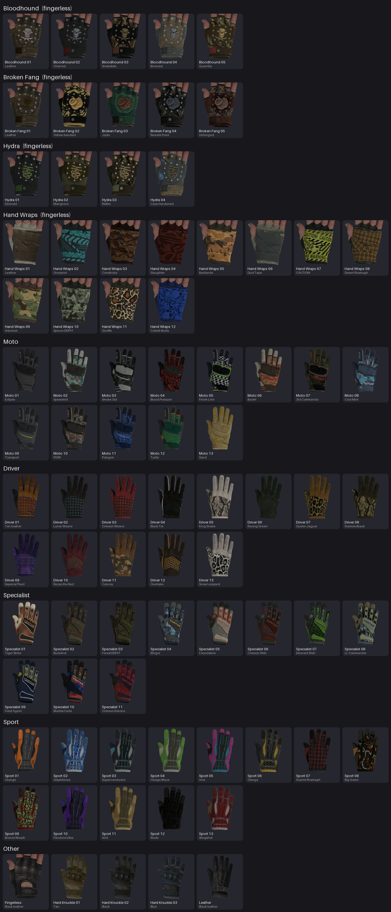
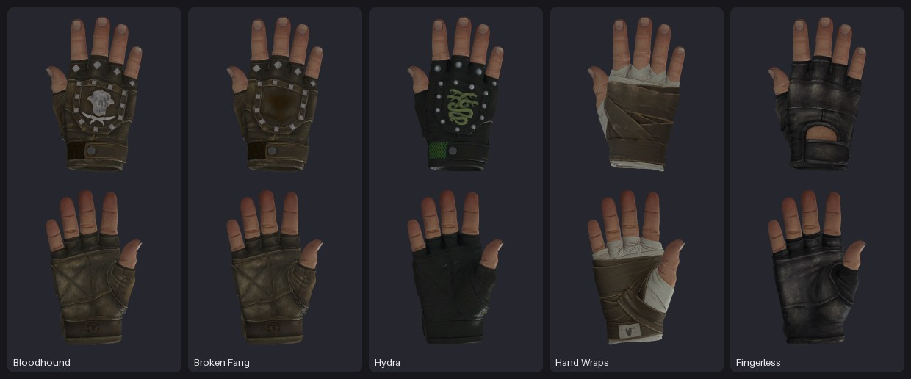

# Z-City CS:GO Gloves

Аддон для Garry's Mod, который добавляет **81 перчатку из CS:GO** в слот **Gloves** редактора
внешности режима **Z-City**. Перчатки можно выбрать для любой внешности (любая мужская или
женская модель из редактора), их видят все игроки, они остаются на рэгдолле и на трупе.

С версии 2.0.0 это ещё и общий аддон для внешности: в сборку попадает Lua из остальных архивов
репозитория — **Z-City Appearance Mod** и «привязки» одежды, — а файлы самой одежды кладутся в
папки `materials` и `models` аддона. С версии 2.2.0 раскладывать их по папкам самому не нужно:
в аддоне лежит **`sort_content.bat`**, который находит каждому файлу его место прямо в
установленном аддоне. С версии 2.4.0 сборка ещё и **запускает** Lua одежды и проверяет по дороге,
чтобы ни одно имя и ни одна вещь не потерялись, — см.
[«Одежда и Appearance Mod»](#одежда-и-appearance-mod) и
[«Чтобы ничего не терялось»](#чтобы-ничего-не-терялось). С версии 2.5.0 в выпуске **два архива**:
с Appearance Mod и с его прежней версией LEGACY — см.
[«Две версии Appearance Mod»](#две-версии-appearance-mod). С версии 2.6.0 контент можно бросать в
аддон **целыми папками под номерами** — `materials1`, `materials2`, `models1` … — в `materials`, в
`models` или рядом с ними: `sort_content.bat` проходит по всем папкам и подпапкам и сам кладёт
модели в `models`, а материалы и текстуры в `materials` — см.
[«Папки целиком, под номерами»](#папки-целиком-под-номерами). В 2.6.1 это исправлено по отчёту
о первом настоящем запуске: файл из такой папки ложится по тому пути, который у него внутри неё,
— и никуда больше. В 2.6.2 он **показывает, что проверил**: сколько папок и подпапок прошёл и до
какой глубины, что лежит в `materials` и `models` после раскладки, где лежал и где лежит теперь
каждый файл, — а недостающие файлы ищет ещё и **в самой игре** (в её архивах, в аддонах
мастерской, в CS:S) и говорит, чего нет на самом деле, — см.
[«Что он проверяет и показывает»](#что-он-проверяет-и-показывает). С версии 2.18.0 аддон ведёт
внешность **сам**: у него свой каталог всего контента внешности, свои таблицы, своё меню с
предпросмотром, своя отрисовка аксессуаров и свои файлы — **Appearance Mod для этого не нужен**.
Если мод на сервере есть, его таблицы, меню и файлы не трогаются: аддон добавляет в них только то,
чего в них нет, — см.
[«Своя внешность (без Appearance Mod)»](#своя-внешность-без-appearance-mod). В 2.18.1 то же
сделано и для самого Z-City: что его Lua уже положил в таблицы внешности, то и остаётся, выбранное
в меню пишется ещё и в его файл `data/zcity/appearances/<имя>.json`, а `ply.CurAppearance`
заполняется так, как этого ждут его режимы. С версии 2.19.0 аддон **сам даёт пакам одежды то API
внешности, которое они зовут по именам** (`AppAddModel`, `AppAddClothes`, `AddFacemap`,
`AppAddBodygroup`, `hg.AppearanceFix`), — пак, скачанный отдельно, работает без своего файла-фикса,
а всё, что он зарегистрировал, попадает и в каталог аддона, и в его меню, — см.
[«API для паков одежды»](#api-для-паков-одежды). И **контент без Lua** аддон теперь ищет у себя в
папке сам (не только по списку батника), а аксессуарам, которым их пак не написал место на теле,
дописывает его — чтобы кнопки в меню появлялись сразу после скачивания аддона из Мастерской, без
второго аддона рядом, см. [«Контент без Lua»](#контент-без-lua). С 2.20.0 лицо, которое пак добавил
одним из двух способов Z-City, видно в **обоих** редакторах (см.
[«Лица в обоих редакторах»](#лица-в-обоих-редакторах)), аксессуар держится на ближайшей кости того
же семейства, если названной в модели нет, аддон пишет, **чьей папкой держится контент** и есть ли
модель игрока на его диске, а `sort_content.bat` по умолчанию не трогает файлы самой игры.
С 2.20.1 сохранённая внешность **остаётся на игроке**, когда режим Z-City просит случайную
(Event, Superfighters, Deathmatch зовут её на каждом возрождении), — так же, как это делает сам
Appearance Mod, см.
[«Сохранённая внешность остаётся на игроке»](#сохранённая-внешность-остаётся-на-игроке).
С 2.21.0 контент аддона лежит **только в его `materials` и `models`** — так, как устроен аддон
Мастерской: папку, которая лежит в аддоне рядом с этими двумя (набор, скачанный целиком),
`sort_content.bat` разбирает сам, а в конце говорит, что вне их контента не осталось; `zcg_content`
пишет, сколько файлов аддон несёт в них сам, см.
[«Что он проверяет и показывает»](#что-он-проверяет-и-показывает).
С 2.22.0 аддон находит у себя в папке **и модели без Lua**: он проходит по своим `materials` и
`models`, модель, которую не назвал ничей Lua, появляется в его меню (слоты, в которые уходит
одежда, он читает из её же файла), любой материал можно надеть руками, а текстуру без материала и
модель без частей он называет тем, что они есть, — см.
[«Модели и всё остальное без Lua»](#модели-и-всё-остальное-без-lua).
С 2.23.0 исправлено первое, что показал запуск в игре: окно выбора лица больше не пишет в панель,
которая уже закрыта (ошибка `Tried to use a NULL Panel`), **Apply** в редакторе внешности отправляет
внешность на сервер, даже если файл внешности записать не удалось, и печатает в консоль, что именно
отправил; лица встают и на те модели, в файлах которых нет материала, названного Lua как слот (лица
слота зеркалятся в материал, который у модели есть); строка пресетов редактора (Save / Load / Delete)
появилась и в обычном редакторе Z-City. См. [«Лица в обоих редакторах»](#лица-в-обоих-редакторах);
если лицо всё же не встаёт на игрока — `zcg_face_debug` показывает, что именно не совпало.
С 2.24.0 аддон **сам никогда не надевает случайный набор**: сохранение игрока — это файл его
клиента (свой `data/zco/` и, с этой версии, файл самого Appearance Mod — `data/zcity/appearances/`),
поэтому внешность, выбранная один раз и нажатая Apply, остаётся с первого спавна; надетое лицо
возвращается на игрока после каждого спавна напрямую, по его материалам. См.
[«Сохранённая внешность остаётся на игроке»](#сохранённая-внешность-остаётся-на-игроке).
С 2.24.1 **список лиц не бывает пустым**: модели, которой Lua одежды не написал ни одного лица
(только `Default` с пустым материалом — так в Z-City устроены Cohrt, Leet и John Wick), предлагается
выбор лиц её пола, и он попадает в обе таблицы, которые читают меню игры. См.
[«Лица в обоих редакторах»](#лица-в-обоих-редакторах).
С 2.24.2 **лицо можно выбрать в любом меню**: кнопка «Facemap» редактора Z-City и окна Appearance Mod
перед открытием снова докладывают лица в таблицы игры, каждая модель меню получает свой слот по тому
самому пути, по которому её спрашивает меню, а если для этой модели в таблицах всё равно ничего нет —
вместо пустого списка открывается список лиц самого аддона (он записан в его каталог при сборке и
пустым не бывает). См.
[«Лица в обоих редакторах»](#лица-в-обоих-редакторах).
С 2.24.3 **лицо без его текстуры больше не предлагается и не надевается**: на сервере, где стоят
только Z-City и этот аддон, из 243 текстур лиц, которые называют таблицы внешности, нет ни одного
файла — любое выбранное лицо показывало не ту картинку (собственное лицо модели или клетки). Такое
лицо теперь уходит из меню само (и из своего меню аддона, и из окна редактора), не надевается на
игрока при появлении, модель остаётся со своим лицом, а `zcg_content` называет каждый недостающий
файл и Lua, который его называет. См. [«Лица без файлов»](#лица-без-файлов).
С 2.24.4 **нажатая кнопка Apply сохраняет внешность так же, как её сохраняет сама игра**: файл
`data/zcity/appearances/<hg_appearance_selected>.json` и `OnlyGet_Appearance` → `CachedAppearance`
на сервере — и копия аддона `data/zco/<steamid64>.txt` пишется из той же таблицы в тот же момент, а
не при следующем возрождении. Копия аддона больше не идёт впереди того, что игрок применил: именно
она надевалась вместо выбранного на каждом спавне, при релоге и на любом вызове режима. См.
[«Сохранённая внешность остаётся на игроке»](#сохранённая-внешность-остаётся-на-игроке).
С 2.24.5 **выбранная одежда не слетает после смерти**: надевание игры оставляет то, чему в его
собственных таблицах нет имени (одежда и лица паков, Lua которых на сервере не запускался), и аддон
докладывает это своим путём — тем же самым набором, который игрок применил. И **окна выбора лица
больше не показывают лица без текстуры**: пока окно или список редактора строится, такие имена
вынимаются из таблиц и возвращаются сразу после — прежде каждое из них рисовалось собственным лицом
модели, и все лица в окне были на одно лицо. С 2.24.6 `sort_content.bat` сам подставляет лицо-тёзку:
если все файлы этого имени в аддоне — один и тот же файл, он кладётся на тот путь, по которому его
называют таблицы, и лицо возвращается в меню без ручной перекладки.



> **Важно.** Аддон написан по исходникам Z-City из `z_city.zip` и проверяется на имитации игры
> (2932 автоматические проверки Lua-кода, проверка всех моделей, материалов и текстур): там, где
> он создаётся, Garry's Mod нет. В игре версия 1.0.0 рисовала перчатки в стороне от рук; в 1.0.1
> посадка на руки сделана по-другому, в 1.1.0 у перчаток с открытыми пальцами появились свои
> пальцы, в 1.2.0 добавлены перчатки Driver и Specialist, в 1.2.1 у пальцев другая кожа, в 1.3.0
> добавлены перчатки Sport, в 2.0.0 — Appearance Mod и привязки одежды, в 2.1.0 сборка научилась
> раскладывать файлы одежды по именам, в 2.2.0 то же делает `sort_content.bat` в установленном
> аддоне, а одежда «не на тех частях тела» и вторая пара рук под перчаткой исправлены по
> скриншотам из игры, в 2.3.0 перчатка стала единственной парой рук у любой модели, в 2.4.0
> привязана одежда Drill Clothes, а имена файлов одежды сборка узнаёт, запуская её Lua, в 2.5.0
> привязан Appearance Mod LEGACY — отдельной сборкой, в 2.6.0 `sort_content.bat` разбирает целые
> папки под номерами, в 2.6.1 он исправлен по отчёту о таком запуске, в 2.6.2 показывает, что
> проверил, и ищет недостающее в самой игре, в 2.18.0 внешность ведёт сам аддон — свой каталог
> контента, своё меню, своя отрисовка, Appearance Mod ему не нужен, — в 2.18.1 он уживается с
> таблицами, файлами и командами самого Z-City, — в 2.19.0 сам даёт пакам одежды API внешности
> (их настоящий Lua запускается в проверках без изменения), сам находит у себя в папке контент без
> Lua и дописывает аксессуарам место, на котором их носят, — в 2.20.0 приводит друг к другу обе
> таблицы лиц Z-City (лицо одного пака видно в обоих меню), вешает аксессуар на ближайшую кость того
> же семейства, пишет, чьей папкой держится контент, и говорит игроку, если его модели на этом
> компьютере нет, — в 2.20.1 сохранённая внешность остаётся на игроке, когда режим просит
> случайную (как в Appearance Mod), — в 2.21.0 контент аддона лежит только в его `materials` и
> `models`: папку рядом с ними батник разбирает сам и говорит, что вне их ничего не осталось, —
> в 2.22.0 аддон находит в этих двух папках и то, чего не назвал ничей Lua: модель можно надеть,
> слоты её одежды читаются из её же файла, материал надевается в любой слот, — в 2.23.0 по первому
> отчёту из игры исправлены ошибка при закрытии окна лица, Apply редактора, лица на моделях без
> своего слота и пресеты в обычном редакторе, — в 2.24.0 аддон сам никогда не надевает случайный
> набор: его сохранение — файл клиента, свой и файл самого Appearance Mod, а надетое лицо
> возвращается на игрока после каждого спавна, — в 2.24.1 по второму отчёту из игры список лиц
> больше не бывает пустым: модели без своих лиц предлагаются лица её пола, в обеих таблицах, —
> в 2.24.2 по третьему отчёту из игры лицо можно выбрать в любом меню: кнопка «Facemap» и окна
> Appearance Mod перед открытием докладывают лица в таблицы игры, каждая модель меню получает свой
> слот по тому пути, по которому её спрашивают, а где для модели ничего нет — открывается список лиц
> самого аддона, — в 2.24.3 по четвёртому отчёту из игры («фейсмапы есть, а текстура не та, которая
> должна быть, где-то контент теряется») лицо, текстуры которого на этом компьютере нет, из меню
> убирается само: на сервере только с Z-City и этим аддоном таких текстур 242 из 243, и именно
> поэтому любое выбранное лицо показывало не то, — в 2.24.4 по пятому отчёту из игры (`zcg_face_debug`
> находит лицо и его текстуру, а после Apply надевается прежнее) сохранение применённой внешности
> повторено за оригиналом: файл игры, `OnlyGet_Appearance` → `CachedAppearance` и копия аддона из той
> же таблицы в тот же момент, — в 2.24.5 по шестому отчёту из игры (окно «Select Face», где все лица
> одинаковые, и сброс одежды после смерти) лица без текстуры перестали перечисляться в окнах и
> списках игры, а выбранная одежда докладывается на спавне, — в 2.24.6 `sort_content.bat` сам
> подставляет лицо-тёзку на путь, который называют таблицы, когда все файлы этого имени — один и тот
> же файл байт в байт,
> но **сам
> аддон там, где он пишется, в игре не запускается: каждое
> исправление — это предположение о причине, проверенное только на имитации**. Что посмотреть при
> запуске, написано в разделе [«Первая проверка в игре»](#первая-проверка-в-игре).

## Содержание

- [Установка](#установка)
- [Обновление](#обновление)
- [Одежда и Appearance Mod](#одежда-и-appearance-mod)
- [Своя внешность (без Appearance Mod)](#своя-внешность-без-appearance-mod)
- [Как пользоваться](#как-пользоваться)
- [Первая проверка в игре](#первая-проверка-в-игре)
- [Настройки](#настройки)
- [Хуки для своих правил](#хуки-для-своих-правил)
- [Особенности и ограничения](#особенности-и-ограничения)
- [Как это устроено](#как-это-устроено)
- [Разработка](#разработка)

## Установка

### 1. Получить аддон

**Готовый архив.** Скачайте `zcity_csgo_gloves.zip` (около 225 МБ) со страницы
[Releases](https://github.com/yaumaDDD/hand/releases) и распакуйте его — внутри папка
`zcity_csgo_gloves`. Переходите к шагу 2.

С 2.10.0 выбирать версию Appearance Mod не надо: в `zcity_csgo_gloves.zip` **обычная версия и
LEGACY работают вместе** — см. [«Обе версии Appearance Mod вместе»](#обе-версии-appearance-mod-вместе).
Берите этот архив. (`zcity_csgo_gloves_legacy.zip` в выпуске остался как запасной: в нём только
LEGACY, как раньше.)

Обновление то же: новая папка поверх старой с заменой файлов.

**С 2.4.1.** В 2.5.0 файлы перчаток прежние. В репозитории появился Lua ещё одного аддона — Z-City
Appearance Mod LEGACY, а это другая версия Appearance Mod, который уже в сборке: Lua-файлы у них
одни и те же. Вместе они не работают, поэтому:

- `zcity_csgo_gloves.zip` — всё как в 2.4.1, с тем же Appearance Mod. **Если у вас всё работало,
  берите его**: одежда в игре не меняется;
- `zcity_csgo_gloves_legacy.zip` — то же самое, но с Appearance Mod LEGACY. Он нужен, если ваш
  контент (модели и материалы мода) — от LEGACY;
- `sort_content.bat` в обоих архивах знает файлы **обеих** версий: файл другой версии кладёт на
  его собственное место и не принимает за тёзку из своей, а в конце пишет, от какой версии у вас
  контент и какой архив ему подходит. То же пишет `zcg_content` в игре.

Обновление то же: папка из выбранного архива поверх старой с заменой файлов, потом
`sort_content.bat`. Перейти с одного архива на другой можно так же, в любую сторону: одежда
остаётся на месте, а модели, которые лежат на местах другой версии, `sort_content.bat`
перекладывает сам, если модель знает свой путь. Подробно — в разделе
[«Две версии Appearance Mod»](#две-версии-appearance-mod).

**С 2.5.0.** В 2.6.0 файлы перчаток и Lua одежды прежние — изменился `sort_content.bat`. Контент
теперь можно бросать в аддон так, как он собран: папки `materials` и `models` разных аддонов под
номерами (`materials`, `materials1` … `materials8`, `models1` … `models4`) — в `materials`, в
`models`, в обе, одной папкой или рядом с ними:

- он проходит по всем папкам и подпапкам; папка с номером для него — копия `materials` или
  `models`, и то, что в ней лежит, ложится с теми же подпапками;
- файлы моделей (`.mdl`, `.vvd`, `.vtx`, `.phy`) оказываются в `models`, материалы и текстуры
  (`.vmt`, `.vtf`) — в `materials`, куда бы их ни бросили;
- опустевшие папки с номерами удаляются; файл, место которого занято, уезжает в `_not_used`, а
  не пропадает;
- имена по-прежнему важнее папок: файл, который называет Lua, ложится туда, где его называют.

Обновление то же: папка из архива поверх старой с заменой файлов. То, что разложено раньше,
остаётся на месте — файл, который уже лежит на своём месте, не заменяется ничем. Подробно — в
разделе [«Папки целиком, под номерами»](#папки-целиком-под-номерами).

**С 2.6.0.** В 2.6.1 исправлен `sort_content.bat`; файлы перчаток и Lua одежды прежние. Пришёл
отчёт о первом настоящем запуске 2.6.0 — 13 папок под номерами, 5113 файлов, — и по нему видно,
что она разложила не всё так, как оно лежало:

- модель из папки с номером она клала туда, **для какой папки модель собрана** (это записано в
  `.mdl`), а не туда, где модель лежала. А наборы моделей копируют из аддона в аддон, не собирая
  заново: 669 файлов из `models3/tnb/halflife/` уехали в `models/tnb/halflife2/`, ещё 67 — в
  другие папки, 18 остались без места и попали в `_not_used` (среди них
  `tnb/newcitizen/halflife2/male_torso_wintercoat.mdl`, которую называет сама Z-City), а
  несколько материалов ушли из своих папок в чужие — туда, где материал с таким именем искала
  другая модель. Теперь папка с номером, в которой лежит дерево папок, читается как есть:
  `models3/tnb/halflife/x.mdl` — это `models/tnb/halflife/x.mdl`, что бы ни было записано в
  самом файле, а файл в папке, где хоть что-нибудь кто-нибудь называет, по одному имени из неё
  не забирается;
- файл, лежащий прямо в такой папке (`materials7/x.vtf`), ложится на верх дерева
  (`materials/x.vtf`), а не остаётся в ней;
- вторая папка `materials`, без номера, считается раньше `materials1` (была позже всех);
- от какой версии Appearance Mod ваш контент, он говорит и тогда, когда в нём есть немного файлов
  другой версии (в том отчёте — 13 из 15 файлов LEGACY и 9 из 85 обычной версии; 2.6.0 их только
  посчитала), и повторяет это последней строкой — вместо «Готово».

**Папку, которую уже разложила 2.6.0, повторный запуск не исправит**: её файлы теперь лежат «на
своих местах», и откуда они пришли, по ним не узнать. Если вы бросали в аддон папки под номерами
и запускали 2.6.0:

1. распакуйте архив 2.6.1 в **новую** папку (старую не удаляйте, пока не убедитесь, что всё на
   месте);
2. бросьте в неё **те же папки ещё раз** и запустите `sort_content.bat`.

Если тех папок больше нет (в аддон они были перенесены, а не скопированы), сохраните
`sort_content_report.txt` из старой папки до следующего запуска — он перезаписывается. Не на
своих местах в ней то, что в его разделе «Переложено» стоит в строках, где папка назначения не
повторяет исходную (`…/models3/tnb/halflife/  ->  models/tnb/halflife2/`), и то, что лежит в
`_not_used`; остальное 2.6.0 клала так же, как кладёт 2.6.1. Точно вернуть можно не всё: в
папке, куда попали файлы из двух папок, их уже не различить — такой набор надёжнее взять заново.

**С 2.6.1.** В 2.6.2 файлы ложатся туда же, куда их клала 2.6.1; изменилось то, что
`sort_content.bat` **показывает и проверяет**. Пришёл отчёт о запуске 2.6.1 — те же 13 папок,
5116 файлов: разложены все 5116, в папках с номерами не осталось ничего, в `_not_used` не ушло
ничего, замечаний нет. Но заканчивался он тремя длинными списками «не хватает» (50 имён из Lua,
1006 материалов моделей, 36 текстур), и выглядело это так, будто в подпапки никто не заглядывал.
Заглядывал — но показать этого не мог, а что из «недостающего» лежит в самой игре, не знал.
Теперь он:

- пишет, сколько папок и подпапок прошёл, какая из них самая глубокая и сколько в них файлов
  каких видов; папку, которую не смог прочитать, называет, а не пропускает молча;
- после раскладки проходит `materials` и `models` ещё раз и пишет, что в них лежит: не осталось
  ли файлов моделей в `materials`, материалов в `models`, чего-нибудь в папках с номерами;
- каждое недостающее имя ищет ещё раз — по одному имени файла, во всех папках и подпапках, — и
  пишет, что нашёл: нигде нет, лежит тёзка в другой папке, есть в самой игре;
- ищет недостающее в самой игре — в её архивах, в `addons`, в аддонах мастерской, в CS:S — и
  подводит итог: сколько из недостающего в игре есть, а сколько нет нигде;
- в конце отчёта перечисляет каждый файл: где лежал и где лежит теперь.

Обновление то же: папка из архива поверх старой с заменой файлов — и `sort_content.bat` ещё раз.
Разложенное остаётся на месте: второй запуск ничего не перекладывает («Было перемещено внутри
аддона: 0») и печатает проверку. Подробно — в разделе
[«Что он проверяет и показывает»](#что-он-проверяет-и-показывает).

## Одежда и Appearance Mod

С версии 2.0.0 сборка кладёт в аддон не только перчатки, но и Lua-код других аддонов, который
лежит в репозитории архивами. Сейчас это:

| Архив | Аддон | Что добавляет | Где ждёт свои файлы |
| --- | --- | --- | --- |
| `apperance.zip` | Z-City Appearance Mod | окна с предпросмотром вместо выпадающих меню редактора, 28 моделей игроков (15 стандартных заменяет своими, 13 добавляет), одежда, лица, класс Rebel | `models/slav/`, `materials/models/humans/slav/`, `materials/models/humans/modern/` и ещё десяток папок в `materials/models/` |
| `луашки для привязок 3.zip` | Z-City Appearance Mod LEGACY (с 2.5.0) | **другая версия того же мода: в обычную сборку не входит**, только в `zcity_csgo_gloves_legacy.zip` — см. [«Две версии Appearance Mod»](#две-версии-appearance-mod). Те же окна с предпросмотром, 13 добавленных моделей игроков (стандартные 15 не заменяет), одежда, лица, класс Rebel | `models/zcity/`, `materials/models/humans/slav/`, `materials/models/humans/modern/` и другие папки в `materials/models/` |
| `луашки для привязок всей одежды.zip` | ZCITY Clothing+ | свой редактор, одежда и свои модели игроков (вместе с Appearance Mod остаются модели мода) | `models/zcityadodser/`, `materials/models/humans/male/group01/`, `materials/models/humans/female/group01/` |
| | Z-City \| bib's custom shirts | 70 футболок и 3 класса игроков | `materials/models/humans/male/group01/`, `models/player/dewobedil/vocaloid/` |
| | Z-CITY \| Maga's small clothes pack | 9 вещей | `materials/models/gate/` |
| | Z-CITY\|usec basic clothes | 1 вещь | `materials/models/humans/male/group01/` |
| | Z-City Armbands | 10 повязок | `models/zcband/`, `materials/zcbands41/` |
| `еще лушашки для привязок + аддон json 2.zip` | [ZCITY] Drill Clothes (с 2.4.0) | 22 вещи, каждая и для мужских, и для женских моделей | `materials/zcity_drill/` |
| `еще лушашки для привязок + аддон json.zip` | Z-City Clothes RP Update | **ничего**: в архиве только `addon.json`, Lua в нём нет — привязывать нечего. Сборка так и пишет: `NOTHING for the addon` | — |

Это только «привязки» — Lua, который называет материалы и модели по именам. **Самих материалов и
моделей одежды в репозитории нет**: их нужно положить в папки `materials` и `models` аддона.
Все имена, которые называет этот Lua (637), перечислены в
[`docs/content_names.txt`](docs/content_names.txt) — и те, что написаны в его тексте, и те, что
видны только в таблицах редактора после его запуска (таких 35, см.
[«Чтобы ничего не терялось»](#чтобы-ничего-не-терялось)). Это имена обычной сборки; 15 файлов,
которые называет только Appearance Mod LEGACY, стоят в конце списка отдельно.

> **Этот список — не перечень файлов, которые нужно собрать.** В нём только то, что называет Lua.
> Игре нужно больше: материал (`.vmt`) тянет свои текстуры (`.vtf` — их бывает несколько, и
> называются они не обязательно так же), модель (`.mdl`) — свои материалы и файлы `.vvd`, `.vtx`,
> `.phy`. Выбирать файлы по списку не надо: кладите папки `materials` и `models` исходных
> аддонов целиком, как есть.

### Файлы из аддонов мастерской

**С 2.11.0 `sort_content.bat` сам достаёт недостающие файлы из аддонов мастерской.** Если лицо,
одежду или модель называет Lua, файла в аддоне нет, но он лежит на этом компьютере в архиве
аддона мастерской (`.gma` в `steamapps/workshop/content/4000/…`, в `garrysmod/addons` или в кэше
игры), батник копирует его в аддон — на точный путь, вместе с текстурами материала и файлами
модели (`.vvd`, `.vtx`, `.phy`). Раньше про такой файл писалось только «В ИГРЕ ЕСТЬ», а игра его
не показывала: аддон мастерской виден игре, только пока он включён, а на сервере его нет вовсе.
Так было с лицами `Face 10 (New)` … `Face 15 (New)` (`materials/models/humans/modern/male/…`,
лежат в «KalCity Legacy Content 2»): в меню они были, а выглядели как обычное лицо.

Ничего не заменяется: файл, который в аддоне уже есть, не трогается. Из архивов самой игры
(`.vpk`) ничего не копируется — они есть у всех. Что скопировано — пишется на экране и в конце
`sort_content_report.txt`. Отключить: `sort_content.bat --no-take`. Аддон после этого станет
больше; на сервер и игрокам копируйте папку целиком.

### Обе версии Appearance Mod вместе

**С 2.10.0 выбирать между обычным Appearance Mod и LEGACY не нужно: в одном аддоне работают обе
версии сразу.** Ничего переключать и настраивать не надо — ставится `zcity_csgo_gloves.zip`,
запускается `sort_content.bat`.

Как это устроено. Lua-файлы у двух версий лежат по одним и тем же путям, поэтому загрузить игрой
оба нельзя: один затирает другой. Загружается обычная версия (в ней есть почти всё, что есть в
LEGACY), а файл таблиц LEGACY лежит в аддоне отдельно — `lua/zcity_csgo_gloves/merged/` — и аддон
сам выполняет его «в коробке»: смотрит, что он добавил бы в меню внешности, и добавляет то, чего
у обычной версии нет:

- **модели игроков LEGACY** (`models/zcity/m/…`, `models/zcity/f/…` — 13 штук) стоят в меню рядом
  с моделями обычной версии (`models/slav/…`). Имена у них совпадали, поэтому модели LEGACY
  называются с пометкой: `Male 10 (LEGACY)`, `Male Cohrt (LEGACY)`, `Female Mossman (LEGACY)` и
  так далее. Модели обычной версии называются как раньше;
- **лица** этих моделей (68 записей) и лица, которые у версий различаются (`Face 1 (LEGACY)` у
  Mossman, лицо Cohrt);
- одежда, которой нет в обычной версии, — если такая есть.

Ничего из того, что сделала обычная версия, не меняется и не заменяется. `sort_content.bat` знает
имена файлов обеих версий и раскладывает и те и другие; сам аддон на LEGACY он больше не
переключает.

| Команда | Что делает |
|---|---|
| `zcg_merge_list` (в консоли сервера; у игрока — `zcg_merge_list_cl`) | список всего, что добавлено из LEGACY |
| `zcg_merge_versions 0` | убрать добавленное из меню (по умолчанию `1`) |
| `zcg_content` | среди прочего пишет строку «both versions together: …» — сколько записей добавлено |

Если у вас стояла сборка с LEGACY (или `sort_content.bat` переключил аддон на LEGACY): просто
скопируйте новую папку поверх старой с заменой файлов и запустите `sort_content.bat`. Внешность,
сохранённая игроками с моделью LEGACY под именем без пометки (`Male 10`), теперь покажет модель
обычной версии с тем же именем; модель LEGACY выбирается заново — `Male 10 (LEGACY)`.

Проверено тестами на имитации игры, в том числе на настоящих Lua-файлах обеих версий (13 моделей,
3 лица и лица 14 моделей добавляются, повторный вызов ничего не дублирует). **В настоящей игре не
запускалось.** Чего в этой версии нет: группы тела (bodygroups) LEGACY отдельно не добавляются —
используются группы обычной версии.

Своя сборка: `build_addon.bat` делает общий аддон сам; `--no-combine` — как раньше, одна версия.
Дальше — старое описание двух версий (оно относится к сборке одной версии и к запасному архиву).

### Две версии Appearance Mod

В репозитории лежат **две версии одного мода**: `apperance.zip` — «Z-City Appearance Mod» и
`луашки для привязок 3.zip` — «Z-City Appearance Mod LEGACY» (с 2.5.0). Lua-файлы у них одни и те
же: те же пути, другое содержимое (из четырёх файлов LEGACY три отличаются). У Lua-файла в игре
один путь, поэтому **в одной сборке может быть только одна версия** — и целиком: меню одной
версии с таблицами другой дают ошибки в редакторе.

**С 2.7.0 выбирать архив не нужно.** В каждом архиве лежит Lua **обеих** версий: одна стоит на
месте, файлы обеих — в `sort_content/versions/` (6 файлов на версию, около 330 КБ; игра эту папку
не читает). `sort_content.bat`, разложив контент, смотрит, чей он, и если он от другой версии —
**сам ставит её Lua на место** и проверяет всё заново:

```
==============================================================================
Контент — от «Z-City Appearance Mod LEGACY», а в аддоне стоял Lua «Z-City Appearance Mod».
Аддон переключён на «Z-City Appearance Mod LEGACY»: заменено файлов: 6 (из sort_content/versions; файлы «Z-City Appearance Mod» лежат там же,
вернуть их: sort_content.bat --use-version "Z-City Appearance Mod"). Скачивать другой архив не нужно.
Теперь всё проверяется заново — уже с «Z-City Appearance Mod LEGACY». Итог — тот, что ниже.
==============================================================================
```

- Заменяются 6 файлов: четыре Lua-файла Appearance Mod, `lua/zcity_csgo_gloves/sh_bound.lua`
  (привязки перчаток к одежде этой версии) и `sort_content/lua_names.txt` (список имён). Ничего
  не удаляется; обратно — так же, в любую сторону.
- Переключение работает в обе стороны и по тому же правилу, что раньше давало «ВНИМАНИЕ» (ниже).
  Если контент — от версии, которая стоит, ничего не меняется.
- **Игра (и сервер) должны быть закрыты**: открытый Lua-файл Windows заменить не даст — батник
  тогда остановится и скажет об этом.
- Выбрать версию самому: `sort_content.bat --use-version legacy` (название или его часть;
  обратно — `--use-version "Z-City Appearance Mod"`). Не менять версию, что бы ни лежало:
  `sort_content.bat --no-switch`. Запуск без параметров снова выбирает по контенту.
- **После обновления** (новая папка поверх старой) на месте снова Lua из архива — запустите
  `sort_content.bat` ещё раз, как и раньше: он вернёт нужную версию.
- На **сервере** и у игроков версия должна быть одна: на сервер копируйте папку после того, как
  батник отработал (или запустите его и там).

Два архива в выпуске остались — они различаются только тем, какая версия стоит на месте сразу:

| Архив | Версия | Модели игроков | В таблицах редактора |
| --- | --- | --- | --- |
| `zcity_csgo_gloves.zip` | Z-City Appearance Mod — та же, что во всех выпусках с 2.0.0 | все 28 свои, в `models/slav/m/` и `models/slav/f/`: 15 стандартных заменены, 13 добавлены | 905 записей; сборка называет 637 файлов |
| `zcity_csgo_gloves_legacy.zip` | Z-City Appearance Mod LEGACY | 13 добавленных, в `models/zcity/m/` и `models/zcity/f/`; 15 стандартных не заменяет — в общей сборке это модели Clothing+ (`models/zcityadodser/`) | 665 записей; сборка называет 567 файлов |

Всё остальное в архивах одинаково: перчатки, Clothing+, Drill Clothes и остальные привязки,
`sort_content.bat`, папка внутри (`zcity_csgo_gloves`).

**Чем различается контент.** Почти ничем: из 567 файлов сборки с LEGACY 552 называет и обычная
сборка. Только LEGACY называет 15 файлов — 13 моделей в `models/zcity/` (`male_10`, `cohrt`,
`cheaple`, `eli`, `barney`, `bill`, `travis`, `johnwick`, `leet`, `mossman`, `zoey`,
`scientist_female`, `rochelle`) и 2 материала (`materials/models/humans/slav/mossman/mossman_face`
и `mossman_hair`). Только обычная версия называет 85: 28 моделей в `models/slav/` и 57
материалов, больше всего — в `materials/models/humans/slav/octo/`. Модели с одинаковыми именами
(`male_10.mdl` и другие) у версий лежат в разных папках. Одинаковые ли это файлы, здесь не
известно — контента нет, — поэтому `sort_content.bat` считает их разными и одну за другую не
выдаёт.

**Какой архив брать.** Любой (обычно первый) — и запустите `sort_content.bat`: он узнаёт файлы
обеих версий и сам ставит Lua той, чей контент. Дальше — как он это определяет и что писал до
2.7.0 (и пишет сейчас, если в аддоне нет папки `sort_content/versions` — например, в своей сборке
с `--no-versions` — или запущен с `--no-switch`). Когда файлы другой версии есть, а файлов версии из
сборки нет вовсе — или их мало (один-два; с 2.6.1 — или не больше четверти), а файлов другой
версии больше половины, — это выглядит так:

```
ВНИМАНИЕ: похоже, ваш контент — от «Z-City Appearance Mod LEGACY», а эта сборка — с «Z-City Appearance Mod».
  Файлов, которые называет только «Z-City Appearance Mod LEGACY»: 13 из 15.
  Файлов, которые называет только «Z-City Appearance Mod»: 9 из 85.
  С этой сборкой игра ищет файлы «Z-City Appearance Mod» — и не найдёт их. Нужна сборка с «Z-City Appearance Mod LEGACY»:
  в выпуске на GitHub это архив zcity_csgo_gloves_legacy.zip (свою делает build_addon.bat --pack "Z-City Appearance Mod LEGACY").
  Скопируйте её папку поверх этой с заменой файлов (одежда останется на месте) и запустите
  sort_content.bat ещё раз.
```

Это числа из отчёта о настоящем запуске: контент одной версии несёт с собой и часть файлов
другой — у них общие материалы, — и версией его делают модели. С 2.6.1 то же самое стоит и в
последней строке, вместо «Готово»:

```
Файлы разложены. Но контент — от «Z-City Appearance Mod LEGACY», а эта сборка — с «Z-City Appearance Mod» (см. «ВНИМАНИЕ» выше):
возьмите архив zcity_csgo_gloves_legacy.zip, скопируйте его папку поверх этой и запустите sort_content.bat ещё раз.
```

Если файлов обеих версий помногу, он только считает их: «Файлов версии «…», которой в сборке нет:
13 из 15 — лежат на своих местах, игре сейчас не нужны». В игре то же самое пишет `zcg_content`:
`this addon is built with "…"`, сколько файлов каждой версии установлено, и, если установлены
файлы только другой версии, — `IT LOOKS LIKE THE CONTENT HERE IS THAT OF "…"`.

**Перейти с одного архива на другой** (до 2.7.0 — единственный способ сменить версию) можно в любую сторону: скопируйте папку из другого архива
поверх установленной **с заменой файлов** (не удаляя её: в ней ваша одежда) и запустите
`sort_content.bat`. В архиве с LEGACY на месте файла
`lua/autorun/client/zzz_hg_appearance_patch.lua`, которого у LEGACY нет, лежит пустой файл с тем
же именем — он и заменяет файл обычной версии, оставшийся в папке.

**Что `sort_content.bat` делает с файлами другой версии.** Ничего не выбрасывает и ни с чем не
смешивает:

- файл, который называет только версия, которой в сборке нет, кладётся на **своё** место — туда,
  где его называет та версия (`models/zcity/m/male_10.mdl`), — и не берётся по имени на место
  тёзки из версии в сборке (`models/slav/m/male_10.mdl`). В «не хватает» такие файлы не
  попадают, а в отчёте стоят отдельным разделом «Файлы другой версии аддона»;
- чей файл, он узнаёт по тому, что известно точно: файл лежит по пути той версии; его папки
  называются как папки того пути (`…/zcity/m/`); модель **сама говорит**, для какого пути
  собрана (он записан в `.mdl`), материал — в какой папке его текстура. Файлы, лежащие в одной
  папке с такой моделью, едут вместе с ней;
- модель, которая о себе ничего не говорит и лежит в папке без названия (`models 7`), кладётся
  туда, где файл с таким именем называет Lua сборки, — как и раньше;
- если файл подошёл бы по имени на пустое место сборки, но оказался файлом другой версии, об этом
  строка «ВНИМАНИЕ» и замечание в отчёте: если это всё-таки нужный файл, переложите его сами;
- модели, которые лежат на местах версии из сборки, а собраны для путей другой (так их по имени
  разложил `sort_content.bat` до 2.5.0, не зная о версиях), остаются где лежат — он о них пишет
  и не считает их файлами этой версии. После перехода на другой архив он сам перекладывает их на
  их места — и пишет об этом в «Замечаниях».

**Если вторая версия установлена отдельно** (например, по подписке в Мастерской), а в сборке
другая, в игре окажутся два разных Lua-файла с одним путём, и какой из них возьмёт игра, не
известно. `zcg_content` это покажет: часть записей «NOT in the appearance tables» и строка о том,
что другая версия может стоять отдельным аддоном. Оставьте одну: либо отпишитесь, либо возьмите
архив с той же версией.

**Своя сборка:** `build_addon.bat --pack "Z-City Appearance Mod LEGACY"` (с `--zip` архив
называется `build/zcity_csgo_gloves_legacy.zip`). Сборка сама собирает и вторую версию (во
временную папку) и кладёт различающиеся файлы обеих в `sort_content/versions/`; без этого —
`--no-versions`. О версии, которая в сборку не вошла, сборка
пишет `NOT TAKEN` — с причиной и с тем, сколько файлов называет только она.

**Что не проверено.** Переключение проверено на настоящих сборках с придуманным контентом (файлы
с именами LEGACY) и тестами; на настоящем контенте и в настоящей игре — нет. Как и всё здесь, обе сборки проверены только на имитации игры: Lua обеих
версий запущен поверх Lua Z-City (без ошибок, таблицы прочитаны), перчатки проверены с меню
каждой версии. Меню LEGACY не сообщает о своём открытии, поэтому плитка «CS:GO gloves...»
появляется в нём по таймеру, до полусекунды после открытия. Самого контента ни одной из версий
здесь нет: для каких путей на самом деле собраны модели, не известно, и правило «модель сама
говорит» проверено только на придуманных файлах.

### Куда класть файлы

Игра ищет файл только по точному пути. Lua называет материал `models/gate/epl` — значит, нужен
ровно `materials/models/gate/epl.vmt`, а путь текстуры записан уже в нём. Файл, лежащий на
уровень выше или в «своей» папке, игра не найдёт; отсюда чёрно-розовые клетки, а у моделей
игроков — ещё и [одежда не на своих местах](#одежда-не-на-своих-местах-и-двойные-руки). Искать
файл по имени игра не умеет, поэтому это делается до игры. Способов три.

**1. `sort_content.bat` — в установленном аддоне (с 2.2.0).** Самый простой способ; папки могут
называться как угодно.

1. Положите аддон в `garrysmod/addons/` и **закройте игру** (пока она открыта, файлы заняты и
   переложить их нельзя).
2. Положите весь контент в `zcity_csgo_gloves/materials` и `zcity_csgo_gloves/models` — как он
   есть, в любых папках; проще всего — целыми папками `materials` и `models` тех аддонов, откуда
   он взят, под номерами (см. [ниже](#папки-целиком-под-номерами)). Или не кладите никуда, а
   перетащите папку с контентом (или архив `.zip`) мышью на `sort_content.bat`: файлы будут
   скопированы в аддон. Архивы `.7z` и `.rar` сначала распакуйте.
3. Запустите `sort_content.bat` двойным щелчком. Он читает имена из Lua аддона и из списка,
   который оставила сборка (`sort_content/lua_names.txt` — имена, найденные запуском этого Lua),
   находит каждый файл и перекладывает его туда, где его ищет игра, — по тем же правилам, что и
   сборка (они описаны ниже). В конце печатает, сколько файлов переложено и чего не хватает — с
   2.4.1 по наборам: скольких файлов какого набора нет и из каких они папок; с 2.6.2 — ещё и
   сколько папок он прошёл, что лежит в `materials` и `models` после раскладки и что из
   недостающего есть в самой игре (см.
   [«Что он проверяет и показывает»](#что-он-проверяет-и-показывает)); всё подробно — в
   `sort_content_report.txt` рядом с ним. Строка «ВНИМАНИЕ» в начале значит, что каких-то имён он
   может не знать, — см. [«Чтобы ничего не терялось»](#чтобы-ничего-не-терялось). С 2.21.0 папку,
   которая лежит в аддоне рядом с `materials` и `models` (набор, скачанный целиком, папка без
   номера), он разбирает сам: игра читает контент только из этих двух папок, поэтому всё из такой
   папки перекладывается в них, а сама она убирается. Перетаскивать её на батник не нужно. (Папки с
   номерами — `materials1`, `models 2` … — он разбирает с 2.6.0.)
4. Запустите игру, в консоли наберите `zcg_content` — см. [«Проверка»](#проверка).

#### Папки целиком, под номерами

С 2.6.0. Так контент обычно и собирается: папка `materials` одного аддона, другого, третьего — а
две папки с одним именем в одну не положить, поэтому у них номера:

```
materials  materials1  materials2 … materials8  models1  models2  models3  models4
```

Бросьте их в аддон как есть — как удобнее:

| Куда | Что получится |
| --- | --- |
| `materials*` — в `zcity_csgo_gloves/materials`, `models*` — в `zcity_csgo_gloves/models` | `materials/materials3/…`, `models/models1/…` |
| все подряд в `materials` (или все в `models`) | `materials/models1/…` — модели лежат в `materials`, это не страшно |
| одной папкой, в которой они лежат | `materials/моя папка/materials3/…` |
| рядом с `materials` и `models`, прямо в папку аддона | `zcity_csgo_gloves/materials3/…` |
| никуда: папку, в которой они лежат, перетащить на `sort_content.bat` | файлы копируются, ваша папка остаётся как была |

и запустите `sort_content.bat`. Он проходит по **всем** папкам и подпапкам, и вот что делает:

- **папку с номером читает как копию `materials` (или `models`)**:
  `materials/materials3/models/humans/x.vmt` — это `materials/models/humans/x.vmt`. Номером
  считается `materials3`, `materials 3`, `materials_3`, `materials-3`, `materials (3)`,
  `3 materials`, `material 3`; с `models` то же. Вложенная `materials` внутри `materials` (и
  `models` внутри `models`) читается так же: `materials/materials/x` — это `materials/x`. Файл,
  лежащий прямо в папке с номером, рядом с её подпапками (`materials7/x.vtf`), — это файл самой
  `materials` (`materials/x.vtf`; с 2.6.1);
- **кладёт каждый тип в свою папку**: файлы моделей (`.mdl`, `.vvd`, `.vtx`, `.phy`, `.ani`) — в
  `models`, материалы и текстуры (`.vmt`, `.vtf`) — в `materials`, в какую бы из двух их ни
  бросили. Модель, над которой нет никакой папки `models`, ложится в `models` с теми же
  подпапками, в которых лежала в `materials`;
- **верит такой папке** (с 2.6.1). Если в папке с номером лежит дерево папок — так, как оно
  лежало в `materials` или `models` аддона, откуда она взята, — то каждый её файл уже лежит по
  своему пути в игре. Он и читается как файл, лежащий в аддоне **по этому пути**, — раньше, чем
  что-либо ищется по именам, и называет его кто-нибудь или нет. То, что модель говорит о себе
  сама, с места её не сдвигает: в `.mdl` записано, для какой папки она собрана, но наборы
  моделей копируют из аддона в аддон, не собирая заново, и модель, лежащая в `tnb/halflife/`,
  может называть себя `tnb/halflife2/…`. 2.6.0 такой модели верила и уносила её в чужую папку.
  Дальше с таким файлом поступают как с любым, который лежит в аддоне (см. «Как файлу находится
  место» ниже): в папке, где хоть что-нибудь кто-нибудь называет, он дома и остаётся, даже если
  файл с таким именем ждут в другом месте; исправляется лишний или пропущенный уровень папок; и
  только из папки, в которой никто ничего не называет, файл может забрать имя — когда такого
  ждут в другом месте, а там пусто;
- **кучу под номером разбирает по именам**, как и раньше. Куча — это папка, в которой файлы лежат
  не по путям игры (`model 14/f/female_01.mdl`, а следующий набор — в `model 15/f/`). Отличает он
  её так: ни одного её файла никто не называет там, где он оказался бы по её папкам, а больше
  половины называют в другом месте, и там пусто. Папка с номером, в которой только файлы, без
  подпапок, — тоже куча: см. «Свои папки» ниже;
- **картинки и заметки** (`.png`, `.txt` …) переезжают вместе со своими подпапками;
- **опустевшие папки с номерами удаляет**. Заметка, которая лежала прямо в такой папке
  (`materials3/readme.txt`), уезжает в `_not_used`, чтобы папка не оставалась из-за неё;
- **два разных файла на одно место** (одинаковый путь в двух папках с номерами): берётся файл
  из папки, которая позже по имени, — числа читаются как числа, `materials10` позже
  `materials2`, а вложенная папка без номера (`materials` внутри `materials`) раньше
  `materials1`. Файл, который **уже лежит на своём месте**, не заменяется ничем. Второй файл
  уезжает в `_not_used`; пары названы в «Замечаниях» отчёта, а на экране — строка «Разных файлов
  на одно и то же место: пар — N». Точная копия уезжает туда же без замечания — её можно удалить;
- **модель переезжает целиком**: если её место занято другой моделью, она уезжает в `_not_used`
  вся, и её `.vvd` / `.vtx` / `.phy` к чужой модели не подкладываются. Если на месте лежит она же,
  байт в байт, — её файлы считаются копиями, а тот, которого у лежащей на месте модели нет
  (забытый `.phy`), к ней добавляется;
- **файл другой версии Appearance Mod** (той, которой в сборке нет), уже лежащий на своём месте,
  там и остаётся: его копия из папки с номером уезжает в `_not_used`, а не занимает его место.

В конце он пишет, сколько таких папок нашёл и что с ними стало:

```
Папки-копии materials и models (с номером в имени или вложенные: materials/materials, materials/materials1, materials/materials2 …) — 13:
  файлов в них 1508; переложено на места: 1508; в _not_used: 0; осталось: 0
```

По папкам — в отчёте. «В _not_used» — файлы, место которых занято; если бросить в аддон то, что
в нём уже разложено, туда уедут точные копии, и строкой выше будет написано, сколько их.
«Осталось» — это файлы папки с номером, в которой **нет подпапок** (только файлы), о которых
ничего не известно: см. «Свои папки» ниже.

Недостающие материалы моделей с 2.6.1 делятся по тому, чья модель, — чтобы было видно, что из
этого касается одежды аддона (с 2.6.2 — на три части, и у каждой написано, что нашлось):

```
    материалов, которые ищут модели: 1006 из 1478
        моделям, которые называет Lua аддона (их 28) — 368: нигде нет — 1, есть в самой игре — 367
        моделям, которые называет сам Z-City (их 4) — 6: нигде нет — 4, есть в самой игре — 2
        прочим моделям (их 202) — 632: нигде нет — 619, под этим именем лежит в другой папке — 7, есть в самой игре — 6
            это модели из models/tnb/ — 202
```

«Прочие» — модели, которые лежат в ваших папках, но ни в одной таблице аддона и самой Z-City не
названы (целый чужой набор, например; из каких они папок, написано строкой ниже). Их материалы —
дело того, кто этими моделями пользуется; в итог для одежды они не входят. Что значат пометки — в разделе
[«Что он проверяет и показывает»](#что-он-проверяет-и-показывает).

Чего он **не** делает:

- не считает номером `model1`, `materials_old`, `materials - копия` и вообще имена без числа —
  таких папок хватает в самих аддонах (`models/models_kit/…`). И папку, в которой называет файлы
  сам Lua, он оставляет тем, что она есть, как бы она ни называлась;
- не открывает архивы, которые лежат среди контента (`materials/materials3/pack.zip`): они
  остаются где лежат, а в начале он пишет «ВНИМАНИЕ: в папках materials и models аддона лежат
  архивы» и называет первые из них. Распакуйте их на место или перетащите на `sort_content.bat`;
- не трогает файл из папки с номером, в которой **нет подпапок**, если о нём ничего не
  известно: это куча, и куда он шёл, по ней не видно;
- не переносит модель из папки-дерева туда, для какой папки она собрана (с 2.6.1): она ложится
  туда, где лежала.

**Что не проверено.** Всё это проверено на придуманных файлах с настоящими именами — шесть
способов бросить папки, по одному прогону на каждый, в том числе через сам `sort_content.bat` на
Windows, и (с 2.6.1) 60 случайных наборов папок-деревьев, которые должны лечь ровно так, как
легли бы, если бы папки просто слили в одну; ещё на 60 наборах, где каждый двадцатый файл называет
чужую папку, проверяется, что ничего не теряется и не остаётся в папках с номерами, а расходится
со слиянием не больше 5 % файлов. Настоящих папок здесь по-прежнему нет. Есть один
отчёт о настоящем запуске 2.6.0 — по нему и сделана 2.6.1: случай из отчёта (набор моделей,
которые лежат в одной папке, а собраны для другой, — рядом с этой другой) придуман заново и стоит
в тестах; 2.6.0 раскладывает его с теми же ошибками, что в отчёте, 2.6.1 — по своим путям. Но что
лежит внутри настоящих файлов, отчёт не говорит. Если после запуска что-то осталось не там —
пришлите конец вывода `sort_content.bat` и `sort_content_report.txt`.

**Свои папки.** Папки могут быть какими угодно — в том числе свои, с номерами, с файлами прямо
внутри, без подпапок:

```
zcity_csgo_gloves/materials/materials0000/materials 1/naomi_facemap_new.vmt
zcity_csgo_gloves/materials/materials0000/materials 1/naomi_facemap_new.vtf
zcity_csgo_gloves/materials/materials0000/materials 2/...
```

Каждый файл находится по имени: материал — по имени, которое называет Lua или модель, текстура —
по пути, записанному в материале, в какой бы папке с номером она ни лежала. Чтобы так сработало:

- кладите материал (`.vmt`) **вместе со всеми его текстурами** (`.vtf`) — не только с
  одноимённой; чего не хватит, отчёт перечислит в разделе «Материал ищет текстуру, а её нет»;
- в одну свою папку — файлы **одной** исходной папки: тогда и те файлы, которых никто не
  называет, уедут вместе с соседями;
- **тёзки** — файлы с одним именем из разных папок игры (`cub_facemap.vmt` в `group02`, `group03`
  и `group03m`; `facemap_01.vmt` в `male_02`, `male_04` …). Их различает то, что они говорят сами:
  рядом с материалом лежит его текстура, названная в нём по пути его же папки. Если сказать им
  нечего, никто не гадает: файлы остаются на месте, а в «Замечаниях» отчёта написано, к каким
  папкам каждый подходит. Тогда назовите свою папку так же, как называется настоящая
  (`materials0000/group02/cub_facemap.vmt`) — этого достаточно. Совсем одинаковые файлы (копии
  одного и того же) раскладываются сами, если копий столько же, сколько имён;
- файл, про который **ничего не известно** (его не называет ни Lua, ни модель, ни материал, и
  соседи по папке ничего не подсказывают — например, текстура без своего материала), остаётся в
  своей папке. За «лежит на своём месте» он не считается: `sort_content.bat` пишет, сколько
  таких файлов, а отчёт в разделе «Оставлено в тех же папках» называет их папки. Игра по такому
  пути ничего не ищет — значит, либо файл не нужен, либо не хватает того, кто его называет.

Проще всего ничего не выбирать и не перекладывать: скопировать исходные папки целиком.

Запускать можно сколько угодно раз: добавили файлы — запустили ещё раз. Что важно:

- **С 2.15.0 в конце удаляется лишний контент** — то, что не относится к одежде и не
  используется: пропы, оружие, карты, модели, которые никто не носит, — всё, что приехало
  вместе с одеждой, когда в аддон клали чужие аддоны целиком. Остаётся:
  - то, что называет Lua аддона (обеих версий Appearance Mod и самого Z-City), и всё, что этим
    файлам нужно: модели — её `.vvd` / `.vtx` / `.phy` / `.ani`, материалы и модели, которые она
    подключает; материалу — его текстуры и материалы, которые он подключает;
  - одежда без Lua: лица (`…_facemap…`, `…_cylmap…`), материалы в папках, где Lua называет
    одежду, `…sheet…` в папках `…/male/…` и `…/female/…` (см. [«Контент без Lua»](#контент-без-lua));
  - файлы самих перчаток и всё, что не файл игры (заметки, картинки).

  Удаляются только `.vmt` `.vtf` `.mdl` `.vvd` `.vtx` `.phy` `.ani` в `materials` и `models` и вся
  папка `_not_used` (в неё по ходу раскладки уезжают файлы, которым места не нашлось: вторые
  экземпляры, тёзки). Сколько удалено и из каких папок — на экране и в конце
  `sort_content_report.txt`. **Удалённое не вернуть** — в корзину оно не попадает; исходные
  аддоны держите отдельно. Не удалять: `sort_content.bat --keep-unused`. Если рядом со скриптами
  нет списка имён `lua_names.txt` (аддон не из архива релиза), ничего не удаляется.
  Файлы самих перчаток не трогаются и не заменяются.
- **Нужен Python 3.7 или новее.** Если его нет, `sort_content.bat` один раз скачивает с
  python.org переносную копию (около 11 МБ) в `%LOCALAPPDATA%\zcg_python` — ничего не
  устанавливая в систему; для этого нужен интернет.
- **Запуск прервался** (закрыли окно, выключился компьютер) — следующий запуск доводит начатое до
  конца: файлы в пути лежат в папке `_sorting` вместе со списком, куда они шли.
- **Код возврата**: `0` — готово, `1` — не та папка или нет такого источника, `2` — часть файлов
  не удалось переложить (обычно открыта игра).
- Игре `sort_content.bat`, папки `sort_content`, `_not_used` и отчёт не мешают, а при загрузке в
  Мастерскую пропускаются (`addon.json`).
- Не Windows: `python3 sort_content/sort_content.py` из папки аддона; источники — аргументами,
  `--dry-run` — только показать, что будет сделано.

**Папка без номера (с 2.21.0).** Рядом с `materials` и `models` может лежать папка с любым другим
именем: набор, скачанный целиком (`мой пак/materials/…`, `z_city_appearance_mod/models/…`), или
папка, в которую контент высыпали как попало. Игра в неё не смотрит — контент аддона она читает
только из `materials` и `models`, — и до 2.21.0 такой папкой занимался хозяин: её надо было
перетащить на батник или переложить внутрь `materials`. Теперь `sort_content.bat` разбирает её сам,
как если бы её перетащили: файлы, которые называет Lua, кладутся туда, где их ищет игра, остальные —
по своим папкам внутри `materials` и `models`, а пустая папка убирается. Остались в ней заметка или
картинка, для которых места нет, — папка остаётся, и проверка после раскладки это называет. Свои
файлы аддона — перчатки — не трогаются: их пути зашиты в модели, и в раскладке они не участвуют.

#### Что он проверяет и показывает

С 2.6.2. По подпапкам `sort_content.bat` ходил и раньше — на любую глубину, — но из его вывода
этого не было видно. Теперь он показывает, что прошёл и что получилось.

**Все папки и подпапки.** Перед раскладкой:

```
Пройдены все папки и подпапки, до самой глубокой: папок — 133, файлов в них — 2913
  самая глубокая — на 7-м уровне: materials/materials7/models/ninja/eft/video/ustw3/
  моделей .mdl — 236, файлов к ним (.vvd .vtx .phy .ani) — 708, материалов .vmt — 988, текстур .vtf — 976, прочих — 5
  (своих файлов аддона — перчаток — 386: они не в счёт и не трогаются)
```

Папку, которую прочитать не удалось (нет прав, повреждён диск), он называет строкой «ВНИМАНИЕ: не
удалось прочитать папок: N» — молча не пропускается ничего. Пути длиннее 260 символов, которые
Windows обычно не открывает, он читает.

**Проверка после раскладки.** Когда файлы переложены, `materials` и `models` проходятся ещё раз —
заново, с диска, а не по своим же записям:

```
Проверка после раскладки — папки materials и models аддона пройдены ещё раз, каждая подпапка:
  materials: папок 179, файлов 2315 — материалов .vmt 1113, текстур .vtf 1117, прочих 85; файлов моделей: 0
  models: папок 25, файлов 984 — моделей .mdl 249, файлов к ним (.vvd .vtx .phy .ani) 734, прочих 1; материалов и текстур: 0
  папок с номерами (materials1, models2 …) не осталось: всё из них разложено
  в папке _not_used (не пригодилось, ничего не удалено): файлов 0
  весь контент аддона — в materials и models: файлов 3299, из них своих (перчаток) 386. Вне этих
  двух папок контента нет: игра читает его только оттуда, и Lua аддона берёт его там же.
  Подпапки внутри materials и models — так и должно быть: игра ищет файл по полному пути,
  а materials/models/… — это материалы моделей (по правилам игры они лежат в materials).
```

«Файлов моделей: 0» в `materials` и «материалов и текстур: 0» в `models` значит, что каждый вид
файлов лежит в своей папке. Если что-то осталось не там или в папке с номером, здесь стоит число
и первые такие папки, а в отчёте — каждый такой файл. **Подпапки при этом никуда не деваются и не
должны**: `materials/models/humans/male/…` — это и есть место файла. Разложить — значит убрать
лишние уровни (`materials3/`) и развести модели и материалы по своим папкам, а не ссыпать всё в
одну: игра ищет файл по полному пути.

**Весь контент — в `materials` и `models` (с 2.21.0).** Контент аддона Мастерской — это его
`materials` и `models`: игра читает его только оттуда, и Lua этого аддона ищет свои файлы там же
(`zcg_content` пишет, сколько файлов он несёт в этих двух папках и сколько из них нужно меню).
Последняя строка проверки и говорит, что больше нигде ничего не лежит. Если что-то осталось, вместо
неё стоит «ВНИМАНИЕ: вне materials и models в папке аддона осталось файлов контента: N (папка — n …)»
— такие папки надо перетащить на `sort_content.bat` или переложить в `materials` и запустить ещё
раз. Отдельно называется папка, которую аддон разобрал, но не убрал, потому что в ней осталось то,
что не материал и не модель (заметка, картинка без места): «папки аддона, в которые игра не смотрит,
остались — в них то, что не материал и не модель». Свои файлы аддона — перчатки — считаются
отдельно: они лежат по путям, зашитым в их модели, и не трогаются.

**Чего не хватает на самом деле.** «Не хватает» — это имена, которые называет Lua, модель или
материал и для которых в аддоне нет файла. Каждое такое имя с 2.6.2 ищется ещё раз — **по одному
имени файла во всех папках и подпапках**, а потом **в самой игре**, — и рядом написано, что
нашлось:

| Пометка | Что значит |
| --- | --- |
| `нет ни в одной папке` (когда игра названа — `нигде нет`) | файла с таким именем нет ни в одной папке аддона — и в игре тоже, если в неё смотрели: сюда его не приносили |
| `под этим именем лежит в другой папке` | файл с таким именем есть, но в папке, где его тоже кто-то называет: это тёзка на своём месте (в отчёте написано где). Нужен такой же файл по **этому** пути |
| `есть в самой игре` (только когда игра названа) | файл лежит в игре: в её архивах, в аддоне мастерской, в CS:S … На этом компьютере он есть; серверу и другим игрокам он нужен так же |

В конце — итог только по одежде аддона (модели, которых никто не называет, в него не входят;
строки про игру в нём есть только когда игра названа):

```
  ИТОГ для одежды аддона (прочие модели не в счёт):
    есть в самой игре — 387: в архивах самой игры — 93, в аддонах мастерской — 292, в других играх Steam — 2
    нет ни в аддоне, ни в игре — 45: из Lua — 32, материалов моделей — 5, текстур — 8
```

Вторая строка — то, чего действительно нет: это файлы других аддонов, и какой Lua их называет,
написано выше неё и в отчёте.

**Игра — с 2.20.0 только по просьбе.** Контент аддон берёт из своих папок и из того, что на
`sort_content.bat` перетащили: из файлов самой игры не берётся ничего, и игру он сам больше не
ищет — ни когда аддон лежит в `garrysmod/addons`, ни когда Garry's Mod есть в Steam. Так аддон
несёт своё сам, а в отчёте видно, чего **в его папках** нет, а не «что нашлось в игре».

Посмотреть, чего из недостающего в игре нет (и взять то, что держит `.gma` мастерской), можно —
для этого игру надо назвать: **перетащите папку игры** (`GarrysMod` — ту, в которой лежит
`garrysmod`) мышью на `sort_content.bat` или укажите её в командной строке:
`--game "D:\…\GarrysMod"` (то же — переменная `ZCG_GAME`). `--no-game` (или `ZCG_GAME=-`) — то
же, что по умолчанию, только в отчёте об игре не пишется ничего. Названная игра читается лишь
списками файлов — ничего не распаковывается и не меняется:

- архивы игры — `*_dir.vpk` в `garrysmod`, `sourceengine`, `platform`;
- файлы в `garrysmod/materials`, `garrysmod/models` и в `garrysmod/download` (скачанное с
  серверов);
- аддоны в `garrysmod/addons` — папками и `.gma` (другая копия этого же аддона не в счёт);
- аддоны мастерской — `steamapps/workshop/content/4000/…` (`.gma` и старые сжатые `.bin`);
- другие игры из той же библиотеки Steam, которые подключает Garry's Mod: CS:S, HL2 с
  эпизодами, Portal, TF2, DoD:S, L4D.

Что нашёл, он пишет строкой «Игра на этом компьютере: …» и тем, сколько чего просмотрел; в отчёте
у каждого найденного файла написано, где он лежит («В ИГРЕ ЕСТЬ: аддон мастерской «…» (номер
…)»). Если названная игра не найдена, он пишет «Игра на этом компьютере не найдена» и делает всё
остальное. Когда игру не называли, вместо этого в отчёте строка «В файлы самой игры не
заглядывали» — и как спросить, если понадобится.

На поиск в игре отведено две минуты (обычно хватает нескольких секунд; другое число секунд —
переменная `ZCG_GAME_SECONDS`). Если он не уложился или не смог прочитать какие-то архивы, об этом
написано и под строкой «Игра на этом компьютере», и под итогом: «нет ни в аддоне, ни в игре»
тогда значит «нет там, куда он успел заглянуть». Запустите ещё раз — второй раз диск отвечает
быстрее.

«Есть в самой игре» значит, что файл есть **на этом компьютере**. Серверу и другим игрокам он
нужен так же: аддон мастерской, в котором он лежит, должен стоять и у них — как сам Z-City и его
контент.

**Каждый файл.** В конце `sort_content_report.txt` — раздел «Все файлы, папка за папкой: где
лежал -> где лежит теперь»: каждая папка, в которой лежали файлы, с их именами и папкой, куда они
ушли. По нему находится любой файл из любой подпапки:

```
    materials/materials/models/bo2_seals/as_seal/  ->  materials/models/bo2_seals/as_seal/    файлов: 4
        body_205.vmt, body_205.vtf, trim_205.vmt, trim_205.vtf
```

В начале отчёта папки по-прежнему идут коротко, одной строкой на целое дерево — но теперь в такой
строке написано, сколько в нём папок с файлами, на любой глубине:

```
Папки-копии materials и models — по папкам (каждая пройдена целиком; «папок» — сколько в ней папок с файлами, на любой глубине):
    materials/materials7/    папок: 16, файлов: 718, на места: 718, в _not_used: 0, осталось: 0
    ...
Переложено (нашлись по имени или переехали вместе со своей папкой) — файлов: 2908
  Строка — папка целиком, вместе со всеми её подпапками: «папок» — сколько в ней папок с файлами. Каждая подпапка и каждый файл — в конце отчёта, «Все файлы, папка за папкой».
    zcity_csgo_gloves/materials/materials7/models/  ->  materials/models/    файлов: 718, папок: 16    [zcity_csgo_gloves]
```

`materials7/models/ -> materials/models/` значит не «заглянул в одну папку», а «всё дерево
`materials7/models/…` легло в `materials/models/…` с теми же подпапками».

Повторный запуск ничего не перекладывает («Было перемещено внутри аддона: 0») и печатает ту же
проверку — так её можно получить и для папки, разложенной раньше.

**Что не проверено.** Поиск в игре написан по описанию её файлов: список файлов `.gma` читается
так, как его читает `gmad` самой Facepunch (по её исходникам), а архивы `.vpk` и `.gma`,
записанные двумя посторонними библиотеками (`vpk`, `sourcepp`), в тестах читаются так же, как их
читают они. Но самой игры там, где это пишется, нет: на настоящих архивах игры и мастерской он не
запускался. Если он не нашёл игру, которая стоит, или не прочитал её архивы (сколько — он пишет),
пришлите начало его вывода.

**2. Отдать раскладку сборке.** Для тех, кто собирает аддон сам или хочет получить релиз уже с
одеждой внутри. Положите контент в репозиторий:

- архивами `.zip` или `.7z` в корень, имена любые (`material 1.zip`, `material 2.zip`, …);
- одним архивом, который 7-Zip разбил на тома: `content.7z.001`, `content.7z.002`, … — когда
  всё вместе больше 25 МБ, которые пропускает страница загрузки GitHub («Добавить к архиву» →
  «Разбить на тома размером» → `24M`);
- папками в корень: `material 1`, `material 2`, … (для сборки у себя);
- или прямо в `zcity_csgo_gloves/materials` и `zcity_csgo_gloves/models`.

Папки с номерами (`materials3`, `models1`) в корне и внутри архива сборка с 2.6.0 читает так же,
как `sort_content.bat`, — см. [«Папки целиком, под номерами»](#папки-целиком-под-номерами). В
`materials` и `models` аддона — тоже, но только материалы, текстуры и файлы моделей: картинки и
заметки из таких папок сборка копирует как лежат.

**Как файлу находится место** — и в `sort_content.bat`, и в сборке (это один и тот же код,
`tools/place_content.py`). Папкам, в которых лежат материалы, текстуры и модели, доверия нет
(кроме папки-дерева под номером, с 2.6.1: её файл читается как уже лежащий по своему пути — см.
[выше](#папки-целиком-под-номерами)): всё идёт по именам. Lua называет материалы и модели, модель — свои материалы, материал — свои
текстуры; каждое такое имя ищется среди всего, что положено, и файл кладётся туда, где его будет
искать игра:

| Что | Как находит своё место |
| --- | --- |
| материал или модель, которые называет Lua | по имени файла, где бы он ни лежал |
| материал модели | по списку папок и имён, записанному в самом `.mdl` |
| текстура | по пути, записанному в `.vmt`, который ею пользуется |
| файл из папки-дерева под номером (`materials3/models/…`, с 2.6.1) | читается как лежащий в аддоне по своему пути внутри неё; дальше — как любой файл, который там лежит |
| файл, который никто не называет | идёт туда же, куда ушла его папка; в куче под номером (с 2.6.0) — ложится с теми же подпапками, что были в ней; иначе остаётся, где лежал (вне папок `materials` и `models` — пропускается) |

Одного имени мало: в одежде полно тёзок — `sheet_01.vmt` есть и у мужчин, и у женщин,
`male_01.mdl` — у двух аддонов. Поэтому сборка смотрит, как папки файла соотносятся с нужным
путём:

- **файл лежит по нужному пути** — остаётся на месте;
- **путь тот же, но сдвинут на уровень** (`materials/gate/…` вместо `materials/models/gate/…`) —
  это тот самый файл, и папка переезжает целиком, вместе с тем, что никем не названо;
- **соседняя папка того же дерева** (`…/male/group01/` и `…/female/group01/`) — это другой файл:
  вместо недостающего он не берётся никогда;
- **папки ничего не говорят** (`material 1/…`) — остаётся только имя. Файл берётся, если он такой
  один и подходит к одному имени. Тёзок различает то, что файлы говорят сами: текстура лежит
  рядом с материалом, который её называет; рядом с материалом лежит его собственная текстура —
  значит, оба из той папки, куда ведёт её путь; модель собрана под определённый путь.
  Материал, который Lua называет в одной-единственной папке, кладётся именно туда, даже если
  его текстуры — из другой папки и лежат рядом с ним: материалы и текстуры нередко хранят
  порознь. Такой материал заодно говорит, чей это набор: если материалы из `materials 14`,
  текстуры которых названы в `models/drill_pack/`, ушли в `zcity_drill/`, то и лежащий с ними
  `sheet_16.vmt` с текстурой из `models/drill_pack/` — оттуда же, хотя Lua называет файл с таким
  именем ещё и в папке другого набора (с 2.4.0; раньше такой файл уходил вслед за текстурой,
  туда, где его никто не ищет).

Материал, который уже лежит на чьём-то месте, а текстуру берёт ровно с именем недостающего
материала (`zcity_drill/sheet_16` для `materials/zcity_drill/sheet_16.vmt`), — это он и есть: он
кладётся и туда, копией, а с прежнего места не убирается (с 2.4.0). Так находится файл, который
версия до 2.4.0 отдала тёзке из другого набора.

Чего решить нельзя, сборка не угадывает, а называет: файл, одинаково подходящий к нескольким
именам; несколько разных файлов на одно имя; имя, для которого нет файла (он может быть частью
игры или Z-City); файл, который не называет никто. С 2.4.0 — ещё и файл, имя которого Lua
называет, а на это место он не взят, потому что ничто не говорит, что это он: в «Замечаниях»
написано, где он теперь лежит и в каких папках Lua ждёт файл с таким именем. Если он оттуда,
переложите его в ту папку сами; пока имя пустует, а файл лежит там, где его никто не называет,
замечание повторяется при каждом запуске. Отсюда два совета:

- надёжнее всего оставлять папки такими, как в аддоне, откуда взят контент, — лишний или
  пропущенный уровень сборка исправит сама;
- если раскладываете по своим папкам, то одна своя папка на одну папку игры, а материалы — вместе
  со своими текстурами. Файлы из разных папок игры, ссыпанные в одну кучу, сборка разберёт
  только там, где им есть чем отличаться.

**Отчёт.** `sort_content.bat` пишет его в `sort_content_report.txt` в папке аддона, сборка — в
`build/content_report.txt` (коротко — в своём выводе). Когда аддон собирается на GitHub для
релиза, отчёт прикрепляется к релизу рядом с архивом (если в репозитории есть материалы или
модели одежды). Отчёт на русском, разделы у обоих одни:

| Раздел | Что в нём |
| --- | --- |
| «Переложено» | что нашлось по имени или переехало вместе со своей папкой: из какой папки в какую и сколько файлов. Строка — это папка **целиком, со всеми подпапками**; с 2.6.2 в ней написано, сколько в этой папке папок с файлами (`файлов: 718, папок: 16`), а каждая подпапка отдельно — в конце отчёта |
| «Оставлено в тех же папках» | файлы, про которые ничего не известно: ни их, ни их папки никто не называет, или их не отличить от тёзок. Лежат там же, где лежали (из источника — положены по тем же папкам), по папкам и с числом файлов. Если это ваши собственные папки с номерами — см. «Свои папки» выше |
| «Не использовано» | файлы, которым места не нашлось, и причина: его никто не называет, и лежит он не в папке `materials` или `models`; не отличить от тёзок; на его место взят другой файл с тем же путём — из более позднего источника или папки; на этом месте лежит файл самого аддона; его место занял другой файл; это файл модели, место которой занято другой моделью. Точные копии файлов, которые лежат на своих местах, перечислены не по одному, а по папкам. `sort_content.bat` убирает такие файлы в `_not_used`, сборка просто не берёт |
| «Замечания» | сомнения: файл подходит к нескольким именам, на одно имя несколько разных файлов, один файл пришёл в двух разных версиях (из двух источников или, с 2.6.0, из двух папок одного — тогда названы оба пути и какой взят); с 2.4.0 — файл, имя которого Lua называет в другой папке, где его нет (куда он положен и где его ждут), и материал, положенный ещё и на место недостающего, потому что берёт его текстуру |
| «Lua называет, а файла нет» | имена из Lua, для которых файла не нашлось; с 2.6.2 у каждого — что нашлось при втором поиске: нигде нет, тёзка в другой папке (и где), есть в самой игре (и где) |
| «Модель ищет материал, а его нет» | материалы, которые записаны в модели и которых нет; с 2.6.2 — сначала по тому, чья модель (её называет Lua аддона, сам Z-City или никто), с теми же пометками, потом сводка по именам и полный список |
| «Материал ищет текстуру, а её нет» | текстуры, которые записаны в материале и которых нет, — с теми же пометками |
| «Все файлы, папка за папкой» (с 2.6.2, только у `sort_content.bat`) | каждый файл, который был пройден: в какой папке лежал и в какой лежит теперь — или что он остался на месте |
| «Не часть аддона» | файлы источника, над которыми нет папки `lua`, `materials`, `models` …: чужой `addon.json`, заметки. Пропущены |

Три раздела «…а файла нет» — то, чего в игре не будет видно, если этих файлов нет и в самой игре
или в Z-City.

Остальное (Lua, звуки) кладётся по папкам, как раньше: всё, что лежит под папкой `lua` или
`sound`, попадает в аддон по тому же пути, а папка `homigrad` или `autorun` без `lua` над ней —
в `lua/`. Архивы других видов (`.rar`) сборка не читает и говорит об этом.

**3. Разложить самому.** В папке `zcity_csgo_gloves` из архива релиза уже есть `materials` и
`models`. Файлы должны лежать по тем же путям, что в аддоне, из которого взяты
(`materials/models/humans/...`, `models/zcband/...`). Внутри `materials` тоже есть папка `models`
— это материалы моделей, и чаще всего ошибаются именно на этот уровень. Ошиблись —
`sort_content.bat` исправит.

И сборка, и `sort_content.bat` приводят пути материалов и моделей к строчным буквам (иначе их не
найдёт игра на Linux и не примет Мастерская) и не заменяют чужими файлы самого аддона. Из двух
разных файлов на одно место берётся тот, чей источник позже (архивы в репозитории идут по именам,
папки, отданные `sort_content.bat`, — в том порядке, в каком они ему даны); то, что уже лежит в
папке аддона, — последним.

### Файлы под другими именами

С 2.8.0. Раньше `sort_content.bat` клал на место только файл, который **называется** так, как его
ищет игра. Теперь, разложив всё, он берёт имена, для которых файла так и не нашлось, и ищет им
файл **под другим именем** — во всех папках `materials`, `models` и `_not_used` аддона. Нашёл —
кладёт на нужное место **копию** под нужным именем (создавая подпапки); исходный файл остаётся
где лежал, ничего не перемещается, не заменяется и не удаляется. Потом всё проверяется заново.

| Что нашлось | Что он делает |
| --- | --- |
| файл с тем же именем и «хвостом» копии: `face (1).vmt`, `face - Copy.vmt`, `face — копия.vmt`, `Копия face.vmt` | копия под именем `face.vmt` на месте, которое называет Lua (или модель, или материал) |
| модель под любым именем, которая сама говорит, что собрана для недостающего пути (он записан в `.mdl`) | копия модели под нужным именем — вместе с её `.vvd`, `.vtx`, `.phy`, `.ani`, переименованными так же |
| материал под любым именем, сделанный из текстуры с путём недостающего материала (`renamed.vmt` с `$basetexture "models/x/eric_facemap"` для `materials/models/x/eric_facemap.vmt`) | копия материала под нужным именем |
| материала нет вовсе, но есть текстура с его именем, из которой не сделан ни один другой материал (`sandro_facemap6.vtf` без `.vmt`) — так бывает с лицами (facemap) | текстура кладётся рядом с местом материала, и для неё **пишется простой материал** (`VertexLitGeneric` с этой текстурой) |
| файл, который ищет другой **файл** (материал модели, текстура материала), лежит под своим именем, но в другой папке, и он один такой | копия туда, где его ищут. Только для того, что используется: модель называет Lua аддона или Z-City, материал назван или надет на такую модель |

Чего он **не** делает сам:

- не подставляет под имя из таблиц редактора файл-тёзку из **другой папки**, если тёзок несколько и
  они **разные**: таблицы нарочно называют одно имя в нескольких папках (мужская и женская одежда,
  одно лицо у двух наборов), и разные картинки под одним именем разбирает только владелец — они
  перечислены в отчёте («Не подставлено»). **С 2.24.6 тёзка подставляется сам**, когда все файлы этого
  имени — один и тот же файл байт в байт: лицо, которое таблицы называют по пути, не несомому ни
  одним паком, получает свою картинку из той папки, где она лежит (выключается
  `sort_content.bat --no-fill-namesakes`);
- не выбирает из нескольких **разных** файлов, подходящих под одно имя: они перечислены в отчёте
  («Не подставлено»), нужный положите сами;
- не трогает файл, который уже лежит на месте.

Всё, что подставлено, написано на экране («Подставлено под недостающие имена: …») и в
`sort_content_report.txt` — каждый файл: куда и откуда. Если подставлен не тот файл, удалите
копию. Выключить: `sort_content.bat --no-fill`.

Файлы, которых не называет никто (ни Lua, ни модели, ни материалы), остаются в `materials` и
`models` там, где лежат по своим папкам, — игра их видит. Что с ними происходит дальше — в
следующем разделе.

Проверено тестами и на настоящей сборке с придуманными файлами; на настоящем контенте — нет.

### Контент без Lua

С 2.9.0. Вещью в меню внешности материал становится, только когда какой-нибудь Lua запишет его в
таблицы Z-City. Контент, который вы положили без Lua, раньше просто лежал. Теперь:

1. `sort_content.bat` в конце находит **материалы, которых не называет никто** — ни Lua аддона, ни
   сам Z-City, ни одна модель (материалы, из которых сделаны модели, вещами не являются), — и
   записывает их списком в `lua/zcity_csgo_gloves/sh_found.lua`. На экране:
   «Контент без Lua: материалов, которых не называет ни один Lua и ни одна модель, — N». С 2.22.0
   туда же записываются **модели**, которых не назвал ни один Lua и которые игра может прочитать
   (`ZCGloves.FoundModels`): «Модели без Lua: … — N», см.
   [«Модели и всё остальное без Lua»](#модели-и-всё-остальное-без-lua).
2. С 2.19.0 то же самое аддон делает **сам**, без батника: при запуске он проходит по папке
   `materials` своего аддона и берёт оттуда все `.vmt`, которых не называет ни одна таблица
   (переменная `zcg_scan_content`, по умолчанию `1`). Материалы самого аддона — иконки перчаток и
   руки внутри их моделей — контентом не считаются. Оба списка, батника и свой, работают как один:
   путь, который есть в обоих, берётся один раз. Команда `zcg_found_scan` (`zcg_found_scan_cl` у
   игрока) проходит по папке заново и печатает, что нашлось.

   Копия из Мастерской смонтирована архивом, папки которого игра не перечисляет, — там свой поиск
   не находит ничего, и работает список, который кладёт в аддон сборка (а батник перезаписывает его
   на вашем компьютере). Поэтому аддон и остаётся **один**: скачали из Мастерской — контент в меню.
3. **Игра сама определяет, куда какой материал нужен**, по своим же таблицам — тем, что в этот
   момент есть в игре (Z-City, Appearance Mod любой версии, Clothing+ и остальные):

| Материал | Куда попадает |
| --- | --- |
| называется `<имя>_facemap…` или `<имя>_cylmap…`, а модель из меню носит лицо `<имя>_facemap` / `<имя>_cylmap` (`van_facemap_new`, `naomi_facemap_new`, `erdim_facemap77`) — в какой бы папке он ни лежал | в **лица этой модели** |
| лежит в папке, где таблицы называют лица одной модели (`…/modern/male/male_04/facemap_09`) | в лица этой модели |
| лежит в папке, где таблицы называют одежду (`zcity_drill/…`, `models/humans/male/group01/…`) | в **одежду** — мужскую, женскую или обе, как одежда из этой папки |
| называется `…sheet…` и лежит в папке `…/male/…` или `…/female/…` | в мужскую или женскую одежду |
| всё остальное (папка, о которой таблицы ничего не говорят; папка, где и лица, и одежда) | остаётся файлом: угадывать не по чему |

   В меню вещь называется именем файла (`sheet_99`, `van_facemap_new`); если имя занято —
   с папкой в скобках.
4. Проверить в игре: `zcg_content` пишет строку `content without Lua: … N of them are in the menu
   now (X as faces, Y as clothes), Z fit nowhere` и отдельно — откуда список (`sort_content.bat
   listed N of them and this addon found M more in its own materials/`), а `zcg_found_list` в
   консоли сервера (`zcg_found_list_cl` у игрока) перечисляет каждую запись и каждый материал,
   которому места не нашлось.

Что важно:

- **Сервер.** Игрока одевает сервер, по своим таблицам. Список — Lua-файл: клиенты получают его
  от сервера сами, а на сервер он попадает вместе с папкой аддона. Копируйте на сервер папку
  **после** того, как отработал батник (или запускайте его там).
- Выключить: `zcg_found_content 0` на сервере — всё добавленное убирается из меню, остальное не
  трогается; `1` — возвращает. Не искать самому: `zcg_scan_content 0` (список батника при этом
  работает). Не писать список вовсе: `sort_content.bat --no-found`.
- Материал, который позже назовёт настоящий Lua, второй раз не добавляется, а из списка исчезает
  при следующем запуске батника.
- Случайную внешность (боты) Z-City собирает из всех таблиц — добавленные вещи в неё тоже
  попадают.
- **Шапки и другие аксессуары** без Lua в меню не добавляются: у них в таблице положение на теле
  (кость, смещение, угол), а в файле модели его нет — надетый наугад аксессуар рисуется внутри
  игрока. Для них нужен Lua набора — или аддон, который его даёт, см.
  [«API для паков одежды»](#api-для-паков-одежды). **Модели** без Lua с 2.22.0 добавляются:
  слоты, в которые уходит одежда, аддон читает из файла самой модели, см.
  [«Модели и всё остальное без Lua»](#модели-и-всё-остальное-без-lua).
- Аксессуару, который в таблице **есть**, но которому его пак не написал место на теле
  (`placement`), аддон с 2.19.0 дописывает его сам — иначе ни одно меню Z-City его не показывает:
  см. [«Аксессуары без места на теле»](#аксессуары-без-места-на-теле).
- Правила выше — догадка по именам и папкам. Среди добавленного может оказаться материал, который
  одеждой не является (например, карта рук или обуви из той же папки): в меню он будет выглядеть
  неправильно. Уберите файл из аддона и запустите батник ещё раз — или пришлите вывод
  `zcg_found_list`, правило поправлю.

Проверено тестами на имитации игры; в настоящей игре — нет.

#### Модели и всё остальное без Lua

С 2.22.0. Раздел выше — про **материалы**: их аддон искал и по списку батника, и сам. Теперь он
проходит по обеим папкам, из которых игра читает контент аддона (`materials` и `models`), и говорит,
**что у него вообще есть** и что из этого можно надеть, — без единой строчки чужого Lua.

**Что он находит.** Обход (переменная `zco_scan_content`, по умолчанию `1`) перечисляет каждый файл
двух папок и раскладывает их по родам: модели (`.mdl`), материалы (`.vmt`), текстуры
(`.vtf`/`.png`/`.jpg`), части моделей (`.vvd`/`.vtx`/`.phy`/`.ani`) и прочее. Свои файлы аддона —
перчатки, руки внутри их моделей, иконки — считаются отдельно и не предлагаются: их пути зашиты в их
модели. Обход ограничен бюджетом (4000 папок, 3 секунды, 8000 файлов) и говорит, если прервался.

**Что можно надеть.**

| Что нашлось | Что делает аддон |
| --- | --- |
| модель, у которой рядом лежат `.vvd` и меш (`.dx90.vtx`/`.vtx`/`.sw.vtx`) и которую не назвал ничей Lua | появляется в меню как модель, в обеих полах (пол угадывается по словам пути: `female`/`male`/`/f/`/`/m/`). Имя — её путь: другого имени, с которым согласились бы сервер и клиент, у файла нет |
| материал, который не назвал ничей Lua | появляется в меню как одежда — в любой из четырёх слотов (`main`, `pants`, `boots`, `hands`), как и одежда из каталога |
| слоты модели, которую никто не описал | читаются **из её же файла**: заголовок `.mdl` перечисляет материалы модели в порядке их индексов, первый найденный путь каждого из них — то, что возьмёт игра, а слова пути говорят, какой это слот (`…sheet…`/`body`/`player` → одежда, `pants`/`legs` → штаны, `boots`/`shoes` → обувь, `hands`/`gloves` → руки). Индекс на живом игроке даёт сама игра (`Entity:GetMaterials`). Работает и на сервере: грузить модель для этого не нужно |

**Чего надеть нельзя — и почему это сказано, а не угадано.**

- **текстура** (`.vtf`, `.png`) сама не надевается: игра читает её только через материал, который
  назвал её в своём `$basetexture`. Аддон читает `.vmt` найденных материалов (не больше 400 за
  проход) и говорит, у каких из них текстуры рядом нет, — такой материал наденется, но нарисует
  ERROR-текстуру;
- **модель без частей** (нет `.vvd` или меша) не предлагается: игра рисует её как ERROR-тело, и
  надевать не на что;
- **аксессуар** (модель, не похожая на игрока) не предлагается: кость, смещение и угол, с которыми
  он носится, есть только в Lua его пака;
- **смысла** в файлах нет: имя в меню, пол, к какой одежде относится материал, описание, что с чем
  несовместимо, — это даёт Lua. Аддон угадывает по путям и словам и **помечает угаданное**
  («без Lua»), а не выдаёт его за своё.

**Где смотреть.** В меню аддона (`zco_menu`) — категория **«Без Lua»**: всё найденное списком, с
причиной для каждого файла, который надеть нельзя; модель и материал там же надеваются щелчком
(материал — в тот слот, о котором говорит его путь). В обычных категориях («Модель», «Одежда»,
«Штаны», «Обувь», «Перчатки») найденное тоже есть, с пометкой «(без Lua)» в названии. В консоли:
`zco_scan` (`zco_scan_cl` у игрока) — что пройдено и что из этого можно надеть, `zco_scan_list`
(`zco_scan_list_cl`) — каждый файл с его родом, слотами модели и `$basetexture` материала (не больше
400 строк). `zco_status` пишет строку «Без Lua найдено в папке аддона: моделей N, материалов M».

**Чего найденное не портит.**

- Случайная внешность, внешность по умолчанию и модель, которую получает пришедший без модели
  игрок, собираются **только из каталога**: то, что нашёл обход, надевает лишь тот, кто выбрал это
  сам. В таблицы игры (`hg.Appearance.PlayerModels`, `hg.Appearance.Clothes`) найденное не
  кладётся — меню других аддонов и самого Z-City его не видят.
- Выключить: `zco_scan_content 0` — найденное убирается из меню, а внешний вид, который его носил,
  при следующей проверке чистится обратно к каталогу. `1` — возвращает.

**Копия из Мастерской** смонтирована архивом, папки которого игра не перечисляет: там обход не
находит ничего, и работают списки, которые пишут сборка и `sort_content.bat` в
`lua/zcity_csgo_gloves/sh_found.lua` — с 2.22.0 в нём, кроме материалов (`ZCGloves.Found`), ещё и
модели, которых не назвал ни один Lua и которые игра может прочитать (`ZCGloves.FoundModels`). На
экране батника: «Модели без Lua: моделей в `models/`, которых не называет ни один Lua и которые игра
может прочитать (.vvd и меш рядом с .mdl), — N».

Проверено тестами на имитации игры (обход, слоты из файла модели, `$basetexture`, надевание на
сервере и в меню клиента, выключение, копия из Мастерской); в настоящей игре — нет.

#### Аксессуары без места на теле

С 2.19.0. Меню Z-City строит список аксессуаров **по месту, на котором их носят** —
`hg.Accessories[<аксессуар>].placement`: `head`, `face`, `ears`, `spine`, `torso`. Аксессуар,
которому его пак этого поля не написал, на игроке рисуется, а кнопки нет ни в одном меню: ни
надеть, ни снять. Именно так устроены маски Z-City (`arctic_balaclava`, `phoenix_balaclava`) — на
них написан отдельный пак, который после загрузки режима дописывает им `placement = "face"`.

Аддон делает то же для **всех** таких аксессуаров, и тем же способом, каким сделан сам контент
Z-City:

1. место спрашивается у аксессуаров, которые носят **ту же модель**: розовые наушники носят ту же
   модель, что зелёные, красные и жёлтые, а у тех `placement = "ears"` — значит, и у розовых `ears`;
2. если таких нет — по словам модели и имени: `earmuffs` / `headphones` / `earring` → `ears`,
   `balaclava` / `bandana` / `mask` / `beard` / `glasses` / `goggles` / `visor` → `face`,
   `fedora` / `helmet` / `hood` / `cap` / `hat` / `wig` / `hair` → `head`, `backpack` / `wings` /
   `armband` → `spine`, `scarf` / `vest` / `chest` / `bag` → `torso`;
3. если не сказал никто — место **не выдумывается**: аксессуар остаётся как был, а `zcg_content`
   пишет, сколько таких.

То, что написал сам пак (или мод, или сервер), не трогается никогда; дописанное аддоном помечено у
него и возвращается обратно при `zcg_fix_placement 0` (`1` — дописывать, по умолчанию). В каталоге
аддона место есть у 112 аксессуаров из 116: дописываются остальные.

Проверено тестами на имитации игры (в том числе на настоящем Lua пака масок из вашего архива — он
запускается рядом и не мешает); в настоящей игре — нет.

#### Аксессуары на кости, которой нет

С 2.20.0. Аксессуар рисуется моделью, привязанной к кости игрока: жилеты каталога висят на
`ValveBiped.Bip01_Spine2`, сумка — на `Bip01_Spine1`. Не у каждой модели есть каждая кость
гражданина: у моделей Z-City из каталога позвоночника `Spine1` и `Spine2` может не быть вовсе
(есть `Spine4`). Раньше на такой модели аксессуар создавался и **не рисовался никогда** — кости
нет, привязывать не к чему, и молча: ни ошибки, ни строки в консоли.

Теперь кость ищется (`ZCO.BoneOf` в `own/cl_own_render.lua`):

1. та, что названа;
2. если её нет — **соседняя того же семейства**, ближайшая сначала (`Spine1` → `Spine2`, `Spine4` →
   `Spine3` … в пределах четырёх);
3. если нет и её — та же кость без номера (`Spine`);
4. и наконец то же имя без `ValveBiped.` впереди.

Семейства, которого в модели нет вовсе, не выдумывается: для `Bip01_Tail` у модели без хвоста
ответ — «никуда», аксессуар не рисуется (иначе он висел бы на голове). Найденное кэшируется:
на каждом кадре кости не ищутся. Проверено тестами на имитации игры: все 116 аксессуаров каталога
рисуются и привязываются к игроку, у которого нет `Spine1`/`Spine2`; в настоящей игре — нет.

### Проверка

В консоли игры: **`zcg_content`**. Команда проходит по таблицам редактора внешности — что бы их
ни заполнило — и печатает, чего на этом компьютере нет (весь список пишется в
`garrysmod/data/zcg_content.txt`):

- модели и материалы, которые называет редактор;
- материалы, из которых сделаны установленные модели игроков (они записаны в самих `.mdl`), —
  именно из-за них одежда оказывается не на своих местах;
- для каждого недостающего файла — нет ли файла с таким же именем в другой папке: тогда он просто
  лежит не там, и это исправляет `sort_content.bat`;
- с 2.4.0 — всё ли, что добавляет Lua одежды из этого аддона, есть в самих таблицах (см.
  [«Чтобы ничего не терялось»](#чтобы-ничего-не-терялось));
- с 2.20.0 — лица в обеих таблицах редакторов: сколько дописано и куда, сколько записей оставлено
  чужими (см. [«Лица в обоих редакторах»](#лица-в-обоих-редакторах));
- с 2.21.0 — **сколько аддон несёт сам**: файлов в его собственных `materials` и `models` — двух
  папках, из которых игра читает контент;
- с 2.20.0 — **чьей папкой держится контент**: сколько файлов, которые называют таблицы, лежит в
  папке этого аддона и сколько игра находит где-то ещё. Файл, который есть только в другом аддоне,
  работает, пока тот аддон на сервере, — и пропадает, когда его сняли или игрок его не скачал.
  Весь список — **`zcg_outside`** (`zcg_outside_cl` на клиенте); `zcg_own_content 0` выключает
  проверку.

Пустой список значит, что каждая вещь из редактора найдёт свои файлы. Если контента не хватает,
аддон через 15 секунд после входа в игру сам пишет об этом одну строку в консоль.
`zcg_content_server` (суперадмин) или `zcg_content` в консоли выделенного сервера — то же для
файлов сервера; о моделях, которых нет на сервере, он сам пишет в консоль после запуска.
Серверу нужны модели; материалы нужны игрокам, и что видит игрок, зависит от файлов на **его**
компьютере — их проверяет `zcg_content` в консоли самой игры.

**Чей файл и где он (с 2.4.1).** Под списком `zcg_content` пишет то, по чему видно, потерялся файл
или его не было:

| Строка | Что значит |
| --- | --- |
| `the Lua that names them:` и строки `N - название набора (lua/…)` | сколько недостающих файлов называет Lua какого набора. Это файлы контента этого набора — или аддонов, от которых он зависит (у набора в Мастерской они перечислены в «Required items») |
| `N - Z-City itself or another addon` | файл называет не Lua из этого аддона |
| `N - no Lua: materials that models of the menu are made of` | материал записан в самой модели (шляпы и т. п.); в списке у такой строки стоит `material of модель` |
| `[in the folder of this addon, where the game does not look: …]` и `N of them lie in the folder of this addon outside of materials/ and models/` | файл есть, но лежит в папке аддона там, куда игра не смотрит. `_not_used` — туда `sort_content.bat` убирает то, чему не нашёл места, причина — в `sort_content_report.txt`. Любая другая папка аддона — с номером (`materials1`, `models 2` …) или без (`мой пак`, папка набора) — разбирается им же: с 2.6.0 он проходит нумерованные, с 2.21.0 и те, что лежат рядом с `materials` и `models`, — контент из них перекладывается в эти две папки |
| `what this addon carries in the two folders the game reads content from: N files below its own materials/, M below its own models/` (с 2.21.0) | сколько файлов аддон несёт сам в своих `materials` и `models` — двух папках, из которых игра читает контент |
| `[a file of that name: …]` и `N of them have a file of the same name in another folder` | файл с таким именем лежит в другой папке — `sort_content.bat`; если он остался на месте, в «Замечаниях» отчёта написано почему |
| `[… has that name, but is another file: the tables name it there]` | файл с таким именем есть, но это **другой** файл, и лежит он на своём месте: редактор называет его именно там (так у лиц Appearance Mod `…/characters/citizen/male/facemaps/sandro_facemap6` и лица самого Z-City `…/bloo_ltcom_zel/citizens/facemaps/sandro_facemap6`). Перекладывать его не надо; нужного файла нет |
| `N of them are nowhere: …` | файла с таким именем нет ни в одной папке, которую читает игра, и нигде в папке аддона. `sort_content.bat` ничего не удаляет, поэтому одно из двух: этих файлов сюда не приносили — или они остались в папке, которую перетаскивали на `sort_content.bat` (в отчёте написано, что он не взял и почему) |
| `sort_content.bat was cut off …` | раскладку прервали, в аддоне осталась папка `_sorting`: запустите `sort_content.bat` ещё раз |
| `N of them are faces: …` | столько из недостающих файлов — лица, см. [«Лица без файлов»](#лица-без-файлов) |
| `N more files are named only for faces that no player model of the menu can wear` | лица из списка для материала, которого нет ни у одной модели меню: набор принёс их для своих моделей, а модели в меню заменил другой набор. Надеть такое лицо нельзя, и в недостающие оно не записано |
| `this addon is built with "…". "…" is another version of the same addon and is not in it` и строки `N of the M files that only "…" names are here` (с 2.5.0) | с какой версией Appearance Mod собран аддон и сколько установлено файлов, которые называет только одна из версий, — см. [«Две версии Appearance Mod»](#две-версии-appearance-mod) |
| `N files the tables name are NOT in the folder of this addon (M are)` и строки `путь  <-  кто` (с 2.20.0) | эти файлы игра находит не в папке аддона, а в другом аддоне, в смонтированной копии из Мастерской или среди файлов самой игры: снимут тот аддон — и их нет. `sort_content.bat` кладёт нужное в `materials` и `models` аддона — с 2.21.0 и из папки аддона, которая лежит рядом с ними; весь список — `zcg_outside` |
| `the content of the menu lies in the folder of this addon: N files …` (с 2.20.0) | всё, что называют таблицы, лежит в папке этого аддона: от другого аддона здесь ничего не зависит |
| `whose folder the content lies in is not told here: the game mounted this addon as an archive` (с 2.20.0) | аддон смонтирован архивом (копия из Мастерской): его файлы неотличимы от файлов чужого аддона, поэтому ничего не считается. Распакованной папкой в `garrysmod/addons` — считается |
| `IT LOOKS LIKE THE CONTENT HERE IS THAT OF "…"` | установлены файлы другой версии, а файлов версии из сборки нет (или почти нет): нужен другой архив выпуска |

### Лица в обоих редакторах

С 2.20.0. Лица в Z-City живут в **двух** таблицах, и каждое меню читает свою:

| Таблица | Кто читает |
| --- | --- |
| `FacemapsSlots[<материал лица>][<имя лица>] = материал` и `FacemapsModels[<модель>] = материал лица` | редактор самого Z-City (`cl_appearance_editor1.lua`), его случайная внешность и сборка LEGACY: у лица один материал на слот |
| `MultiFacemaps[<модель>][<имя лица>][<материал лица>] = материал` | меню Appearance Mod (`cl_!!!_appearancemod_buttons.lua`): у лица по материалу на каждый слот модели |

Паки одежды добавляют лицо вызовом `AddFacemap(материал лица, имя, материал, модель)`, и он пишет
**только первую** таблицу — и в самом режиме (`sh_shared.lua`), и в фикс-аддоне паков
(`sh_zcity_appearance_fix.lua`), и в этом аддоне (`sh_register.lua`): паки ждут именно этого. А
меню Appearance Mod смотрит во вторую и в первую не заглядывает вовсе, как только у модели есть
хоть одна запись во второй. Отсюда знакомая картина: файл лица на месте, `zcg_content` молчит, а в
одном меню лицо есть и в другом его нет (или наоборот — лицо только из `MultiFacemaps` не видно
редактору Z-City и сборке LEGACY).

`sh_faces.lua` приводит таблицы друг к другу — каким бы путём лицо ни пришло (пак, мод, контент без
Lua из `sh_auto.lua`, строки сборки из `sh_baked.lua`):

- лицо из `FacemapsSlots` дописывается в `MultiFacemaps` **каждой** модели, которая носит этот
  материал лица, — какие модели его носят, видно из самих таблиц и, когда файл модели открывается,
  из неё самой (путь, который называет пак, и путь модели в меню — не всегда одна и та же модель:
  `models/zcityadodser/…` и `models/slav/…`);
- лицо из `MultiFacemaps` дописывается в `FacemapsSlots` своего слота;
- в `ModelFaceSlots` и `FacemapsModels` попадают известные модели и слоты, а ключи, по которым
  меню ищут, — ещё и в нижнем регистре (мод приводит путь модели к нижнему регистру, режим — нет,
  а спрашивают оба меню нижний регистр).

Ничего не перезаписывается: запись, которая уже стоит с другим значением, остаётся как была и
считается в `zcg_faces` («left alone with another value»). Проходит синхронизация при запуске
(через 1, 5, 15 и 70 секунд), дальше раз в две минуты, при смене `zcg_sync_faces`, вместе с
`zcg_heal` и каждый раз, когда контент без Lua кладётся в меню или убирается из него.
**`zcg_sync_faces 0`** — таблицы остаются такими, какими их сделал Lua одежды, а всё дописанное
аддоном возвращается обратно. Что сделано, показывает **`zcg_faces`** (`zcg_faces_cl` — на клиенте):
сколько лиц в каждой таблице, сколько и куда дописано, какие именно строки и сколько записей
оставлено чужими.

**С 2.23.0** лица встают и на модели, в файлах которых нет материала, названного слотом: игра
ставит лицо как `FacemapsSlots[материал игрока][имя лица]`, поэтому слот, которого в материалах
модели нет, оставлял лицо только в меню. Теперь лица каждого слота такой модели зеркалятся в
материал, который у модели действительно есть, — тот, в пути которого `face` или `head`,
единственный материал модели, если он один, или первый материал, под которым лица не
зарегистрированы; в `zcg_faces` это строки «mirrored into the material their model carries»,
`zcg_sync_faces 0` забирает зеркало вместе со всем остальным.

**С 2.24.1** список лиц не бывает пустым. Lua одежды Z-City даёт части моделей слот с одним
`Default` и пустым материалом — и больше ничего (`models/slav/m/cohrt.mdl`, `leet.mdl`,
`johnwick.mdl`): редактор Z-City показывает тогда один `Default`, а меню Appearance Mod — пустой
выбор («No facemaps available»). Своё меню аддона с 2.20.0 на такой случай берёт лица пола модели
(`own/sh_own.lua`: «a model nobody wrote a face for: the faces of its sex, so that the menu is not
empty»), но правило не срабатывало, когда в списке стоял `Default`, и не действовало для меню игры.
Теперь `Default` с пустым материалом лицом не считается, и то же правило работает для таблиц,
которые читают оба меню игры: модели без своих лиц предлагаются лица её пола — слоты, в пути
которых есть `male`/`female`, а если таких нет вовсе, то любые лица, которые есть, — и пишутся в
`FacemapsSlots[её слот]` и в `MultiFacemaps[модель][имя лица][её слот]`, так что лицо и
выбирается, и надевается (слот модели, у которой он не объявлен, — материал из её же файла: тот, в
пути которого `face`/`head`, единственный материал, или первый, под которым лица не
зарегистрированы). Модель со своими лицами ничего лишнего не получает. `zcg_faces` считает такие
записи в строке «given to a model nobody wrote a face for», `zcg_sync_faces 0` забирает их вместе
со всем остальным. Лица при этом чужие: на модели с уникальной головой (Cohrt, John Wick) они могут
лечь не по её развёртке — это плата за непустой выбор; кому она не нужна, выключает
`zcg_sync_faces 0`.

**С 2.24.2** лицо можно выбрать в любом меню. Оба меню игры читают таблицы в момент нажатия:
редактор Z-City — `FacemapsSlots[FacemapsModels[путь модели ровно так, как его записало меню]]`
(`new_appearance/derma/cl_appearance_editor1.lua`), окна Appearance Mod —
`MultiFacemaps[тот же путь в нижнем регистре]` (`zcityappearancemod/derma/appearancemod_showcase.lua`:
модель, для которой лиц нет, вообще не получает раздела в окне «ALL FACEMAPS»). У модели, чьи лица
в таблицах есть, но под другим ключом, выбор пустой — и не пишет об этом ничего. Поэтому:

* каждая модель из `hg.Appearance.PlayerModels` получает свой слот **по тому самому пути, который
  записало меню**, и по нему же — записи в `MultiFacemaps` и `ModelFaceSlots`; слот берётся тот,
  который модели уже назван (своим ключом, затем любым из известных), и ничего чужого не
  переписывается: дополняются только пустые места. В `zcg_faces` это строка
  «keys by the very path a menu asks for»;
* кнопка «Facemap» редактора обёрнута: перед тем как отдать нажатие игре, лица ещё раз докладываются
  в таблицы (`zcg_sync_faces`), а если для этой модели всё равно ничего нет — вместо пустого списка
  открывается список самого аддона, где лица берутся из его каталога (и из таблиц игры, если в них
  что-то есть). Выбор в нём пишет `AFacemap` и тут же кладёт лицо на материал модели в окне;
* так же обёрнуты `hg.Appearance.OpenFacemapMenu` и `hg.Appearance.OpenAllFacemapsMenu` самого
  Appearance Mod: перед окном лица докладываются в таблицы, а окно одной модели, которому нечего
  показать, открывает список аддона;
* о каждом таком случае аддон пишет в консоль одну строку — по ней видно, что в таблицах игры для
  этой модели ничего не было (`zcg_faces` показывает, что именно и куда положено).

Список своего меню (`ZCO.Faces`) с этой версии шире: лицо модели — это лица её слота, лица всех
остальных путей того же файла (Lua одежды Z-City объявляет одну и ту же модель как `models/zcity/…`,
`models/zcityadodser/…` и `models/slav/…`), лица слотов, которые названы в самом файле модели, и
лица из `MultiFacemaps` — в любом регистре пути.

Проверено тестами на имитации игры: меню обоих редакций собираются так, как их собирает настоящий
Lua (настоящие файлы пака запускаются рядом), и лицо, добавленное одним паком старым способом,
видно в обоих; модель, которой лиц не написали, получает их в обоих меню, а модель со своими —
только свои; с 2.24.2 проверяется и кнопка «Facemap» редактора: когда в таблицах игры для модели
есть лица — открывается её собственный список, когда нет — список аддона, и выбранное в нём лицо
становится надетым, а модель меню получает свой слот по тому пути, по которому её спрашивает
редактор; в настоящей игре — нет.

### Лица без файлов

Лицо в редакторе — это материал, который Z-City кладёт поверх лица модели. Если его файла нет,
показать нечего: голова остаётся с собственным материалом модели или рисуется чёрно-розовыми
клетками — и не только у того, кто его выбрал: случайную внешность (боты, игроки без сохранённой)
Z-City составляет из всего списка, так что такое лицо может достаться кому угодно. В меню при этом
оно выглядит как обычное лицо: название есть, картинки за ним нет. Именно так выглядит «текстура
не та, которая должна быть».

**С 2.24.3 такое лицо уходит из меню само**, на любом компьютере и при любом `zcg_fix_faces`:
материал заменяется на пустой — тот, которым Z-City сам показывает `Default`, — и модель остаётся
со своим лицом. Название в списке остаётся, `zcg_content` продолжает называть файл недостающим, и
как только файл появляется (паку донесли контент, игрок смонтировал аддон), лицо возвращается само
(проверяется раз в две минуты, при `zcg_content` и при нажатии кнопки лица). Что стояло на месте,
помнит `ZCG.Faceless`, а что убрано — `ZCG.FaceDropped`; `zcg_faces` печатает строку, сколько лиц
называют текстуру, которой на этом компьютере нет.

То же правило и дальше по цепочке: надетое лицо не кладётся на материалы игрока при появлении
(`ZCG.ForceFace` и своя внешность в `own/sv_own.lua`), своё меню аддона не предлагает лицо без
текстуры (остаётся `Default` — собственное лицо модели) и не кладёт его на модель в окне, а список
лиц, который аддон открывает вместо пустого меню игры (2.24.2), говорит
«no face of this model has its texture here (N without a file)».

Убираются только лица. Отличить лицо от одежды аддону говорит сборка: в `sh_bound.lua` каждая
строка чужого Lua записана вместе с тем местом таблицы, куда она попадает, а строка
`FacemapsSlots`/`MultiFacemaps` — это лицо, строка `Clothes` — одежда (в сборке 2.24.3 таких строк
395 и 462, и ни одного пути, который был бы и тем и другим). Где такого списка нет, решает имя
файла: текстура лица Z-City — это `facemap` или `cylmap`. Материал, который одновременно назван
одеждой, не убирается никогда: снять одежду хуже, чем показать не то лицо; такие лица берёт на себя
`zcg_fix_faces`.

Наборы одежды называют и лица, файлов которых в их собственном контенте нет: они лежат в
аддонах, от которых набор зависит, а некоторые имена составлены циклом на одно-два больше, чем
есть файлов. Так, Lua Appearance Mod называет лица `models/humans/modern/male/male_0N/facemap_0M`
и `models/characters/citizen/male/facemaps/…`, а Clothing+ — `…/citizens/facemaps/lake_facemap2`
… `6` и `miranda_facemap2` … `6`. Положить такие файлы на место `sort_content.bat` может, только
если они ему даны.

Что делать:

1. Найти файлы: взять папки `materials` аддонов, от которых зависит набор, положить в
   `zcity_csgo_gloves/materials` и запустить `sort_content.bat`. Какой набор называет недостающие
   файлы, пишут и `zcg_content`, и `sort_content.bat`.
2. Пока файлов нет — лица, которые их называют, уже убраны из меню (2.24.3): модель остаётся со
   своим лицом вместо чужой картинки или клеток. Если нужно убрать и те лица, чей материал
   одновременно назван одеждой, — **`zcg_fix_faces 1`** в консоли сервера (или в `server.cfg`).
   Переменная срабатывает сразу, в консоли сервера появляется строка, сколько текстур лиц не
   нашлось; на игроке это видно со следующего раза, когда Z-City его одевает (появление, новый
   раунд).

Широкое правило переменной по умолчанию выключено, и вот почему. Одевает игрока сервер, по своей
таблице, и решает по **своим** файлам. Если игроки получают контент из той же папки, что стоит на
сервере (Мастерская, FastDL), это верно: чего нет на сервере, нет ни у кого. Если же у игроков есть
файлы, которых нет на сервере (сервер без материалов, а контент игрокам раздаётся отдельно),
включённая переменная отняла бы у них рабочие лица. Аддон этого знать не может — решает владелец
сервера. На всякий случай при значении `1` ничего не меняется там, где не хватает больше
десятой части материалов меню: такой компьютер считается сервером без контента. `2` — менять в
любом случае, `0` — только лица без текстуры, как описано выше, а остальное вернуть как было.

До игры то же самое по тексту Lua: `sort_content.bat` в конце печатает, скольких названных
файлов не хватает; `python tools/list_content.py` — какие папки названы и сколько файлов из них
уже в сборке. Сама сборка печатает, сколько названных файлов нашлось, и пишет в
`build/content_report.txt`, что куда положено и чего нет.

### Чтобы ничего не терялось

Вещь может потеряться в трёх местах: её файл не узнал `sort_content.bat`; её Lua не попал в аддон
или не выполнился; в самой игре что-то пересоздало таблицы редактора. С 2.4.0 проверяется каждое.

**1. Имена файлов.** До 2.4.0 имена брались только из текста Lua: всё, что в кавычках и начинается
с `models/`, `materials/` или `sound/`. Этого мало. Lua может назвать материал от папки
`materials` (`{"Drill 07", "zcity_drill/sheet_16"}`) или собрать имя на ходу
(`"…/lake_facemap" .. i`) — в тексте таких имён нет. А файл, имени которого `sort_content.bat` не
знает, для него ничей: в 2.3.0 он не знал ни одного файла Drill Clothes, и `sheet_16.vmt` с
`sheet_31.vmt` — если они лежали в своей папке вроде `materials 14` — мог увезти в
`materials/models/humans/modern/male/`: там Appearance Mod называет файлы с такими же именами.
Текстуры при этом оставались на месте. Если так и случилось, запустите `sort_content.bat` из
2.4.0 ещё раз: такой материал он узнаёт по текстуре и кладёт ещё и на своё место (в отчёте об
этом будет замечание).

Теперь сборка **запускает** Lua одежды (`tools/lua_names.py`): в LuaJIT, на небольшой имитации
игры, поверх настоящих файлов внешности Z-City и её же загрузчиком — в том порядке, в котором
файлы загружает игра, как сервер и как клиент, с хуками запуска и минутой таймеров. После каждого
файла она читает таблицы редактора той же функцией, которой в игре пользуется `zcg_content`. Так
нашлись 35 имён, которых в тексте нет: 22 материала Drill Clothes и 13 лиц. Lua запускается на
тех же байтах, что лежат в файле: названия вещей в любой кодировке (например, русские в
Windows-1251) остаются разными названиями и не сливаются в одно.

У `sort_content.bat` на вашем компьютере запускать Lua нечем, поэтому найденные имена сборка
кладёт рядом с ним списком `sort_content/lua_names.txt`. Он читает и текст Lua, и список, пишет,
сколько имён известно только из списка, и предупреждает — строкой «ВНИМАНИЕ», — если:

- списка нет, или аддон собран там, где запустить Lua было нечем (нет модуля `lupa`). Возьмите
  аддон из [выпуска на GitHub](https://github.com/yaumaDDD/hand/releases);
- в аддоне есть Lua-файл, добавленный или изменённый после сборки (он назван). Такой файл только
  прочитан: имена, которых нет в его тексте, не известны. Чтобы учитывались и они, Lua нужно
  добавить в сборку — архивом в репозиторий;
- Lua-файл при сборке остановился на ошибке (он назван вместе с ошибкой). Что он добавляет после
  этого места, не известно, — и в игре этой одежды, скорее всего, тоже не будет.

**2. Lua в аддоне.** Про каждый архив сборка печатает, сколько Lua-файлов из него взято и какие
файлы оставлены; об архиве, из которого взять нечего, пишет `NOTHING for the addon`. Если два
архива приносят **разные** Lua-файлы с одним и тем же путём, сборка останавливается и называет
оба: раньше молча оставался тот, что позже по имени архива, а всё, что добавлял другой,
пропадало. Единственное исключение записано явно — в `tools/zcg_layout.py`, `PACK_VERSIONS`:
[две версии Appearance Mod](#две-версии-appearance-mod). Из них сборка берёт одну, целиком, о
другой пишет `NOT TAKEN` с причиной, а имена её файлов передаёт `sort_content.bat` и
`zcg_content` — чтобы файл той версии не был принят за файл этой. Три файла LEGACY, которые
отличаются от файлов обычной версии, раньше просто заменили бы их — и в сборке оказалась бы
смесь: меню одной версии с дополнениями другой. Имя, которое один файл кладёт в таблицы, а более
поздний заменяет или убирает, тоже печатается — сейчас это только 15 моделей игроков Clothing+,
которые Appearance Mod заменяет своими (в сборке с LEGACY таких нет); ни одна вещь и ни одно лицо
так не теряются.

**3. Таблицы в игре.** Всё, что Lua одежды кладёт в таблицы редактора, — 905 записей: вещи, лица,
модели игроков, повязки — сборка записывает в `lua/zcity_csgo_gloves/sh_bound.lua`. В игре
`zcg_content` сверяет с этим списком сами таблицы. Если всё на месте, он пишет одну строку:

```
[CS:GO Gloves] the clothing Lua of this addon: all 905 clothes, faces, models and accessories it adds are in the appearance tables
```

Если нет — называет каждую запись, которой нет или которая стала другой, и Lua-файл, который
должен был её добавить:

```
[CS:GO Gloves] the clothing Lua of this addon: 44 of the 905 clothes, faces, models and accessories it adds are NOT in the appearance tables the way it puts them there:
  lua/autorun/zcity_drill_clothes.lua: 44
    Clothes/1/Drill 01 = zcity_drill/players_sheet_02   [not there]
    ...
```

В консоль идут первые 40 записей; если их больше, весь список пишется в
`garrysmod/data/zcg_bound.txt`. Так бывает, если:

- Lua-файл не загрузился или остановился на ошибке — ищите его имя рядом со словом `error` выше в
  консоли, и на сервере тоже;
- файл Z-City `homigrad/new_appearance/sh_shared.lua` перезагрузился на работающем сервере (его
  сохранили в редакторе): он создаёт таблицы одежды заново, и всё, что добавили привязки,
  пропадает до перезапуска карты;
- другой аддон использует те же названия вещей или сам заменяет модели игроков — тогда в скобках
  написано, что стоит на этом месте сейчас.

Если чего-то нет, аддон через минуту после запуска сам пишет об этом одну строку в консоль — и на
сервере, и у игрока. Сам он в таблицах ничего не чинит: это только проверка. Число 905 — для
сборки из выпуска; в аддоне, собранном без `lupa`, списка нет, и `zcg_content` об этом молчит.

Имитация ведёт себя так, как, по мнению автора, ведёт себя игра; в самой игре она не проверялась.
Точный ответ для работающей игры даёт `zcg_content`.

### Одежда не на своих местах и двойные руки

Так это выглядит: в окне выбора штанов все плитки показывают одни и те же ноги с текстурой не на
тех частях; футболка натянута на штаны; сквозь перчатку CS:GO проступают кисть и пальцы самой
модели. Причина, скорее всего, одна, и она не в коде одежды.

Z-City, Appearance Mod и этот аддон находят «слот» одежды — куртку, штаны, обувь, кисти — по
месту материала в списке `Entity:GetMaterials()`. А игра пропускает в этом списке материалы,
файлов которых нет, и всё, что стоит после пропуска, сдвигается на одно место вверх. Достаточно
одного неустановленного материала модели игрока — и куртка попадает на штаны, штаны на обувь, а
аддон прячет под перчаткой не кисти, а что-то другое: кисти остаются видны.

С 2.2.0 сделано три вещи:

1. **Полный список материалов** (`lua/zcity_csgo_gloves/sh_materials.lua`). Аддон читает список
   материалов прямо из файла модели и возвращает пропущенные имена на их места;
   `Entity:GetMaterials()` начинает отвечать так же. Слоты снова считаются правильно — и у
   Z-City, и у Appearance Mod, и у перчаток, — даже когда файлов не хватает. Для модели, у
   которой установлено всё, не меняется ничего. Выключается строкой
   `CompleteMaterialList = false` в `sh_config.lua`.
2. **Перчатка — единственная пара рук** (в таком виде с 2.3.0). Пока перчатка нарисована, кисти
   модели под ней убираются двумя способами сразу, и ни один не зависит от другого:
   - материал кистей заменяется невидимым;
   - кости кистей и пальцев на время рисования модели сжимаются в запястье, а сразу после
     возвращаются как были. Тем же приёмом сама Z-City убирает голову игрока из вида от первого
     лица.

   Вместе с костями уходит всё, что на них держится, — каким бы материалом оно ни было покрыто и
   к какой бы бодигруппе ни относилось: кисти без своего материала, голые руки торса-футболки,
   вторая пара кистей из другой бодигруппы, перчатки самой модели. До 2.3.0 кости сжимались
   только у моделей без материала кистей, поэтому всё, что нарисовано на кисти другим материалом,
   оставалось видно — вторая пара рук. Переменная `zcg_hide_bones`: `1` — у всех моделей (по
   умолчанию; `2` — то же самое), `3` — только у моделей без материала кистей (как до 2.3.0),
   `0` — никогда.
3. **Файлы на места** — `sort_content.bat`, см. выше. Первые два пункта возвращают на места
   слоты, но сам недостающий материал не появится, пока его файла нет: будет чёрно-розовая
   клетка, зато на своей части тела.

**Что перчатка убрать не может** — руки, которые рисуются не вместе с игроком: отдельную модель
рук, которую другой аддон рисует сам, в своё время (даже если она привязана к костям игрока). У
самой Z-City таких нет — это проверено по её коду: рук от первого лица она не создаёт (игрок
видит собственное тело), кулаки и оружие держат руки самого игрока, а её собственные «крутые
перчатки» выключены. Если вторая пара рук всё-таки останется, значит, её рисует что-то ещё —
`zcg_debug` перечисляет кандидатов.

Это исправление сделано по скриншотам и по коду Z-City и мода; **в настоящей игре оно не
проверялось**. Если после 2.3.0 руки всё ещё двойные или одежда не там — нужны скриншот и вывод
`zcg_debug` (смотря на себя или на другого игрока). В нём написано, как прячутся кисти и были ли
они сжаты, какие бодигруппы модели включены (`bodies of the model`), что к игроку прицеплено
(`attached to it`, `equipment of Z-City`), кто ещё рисует в хуках Z-City, и оба списка материалов
модели с пометкой `<- not installed` у тех, которых нет.

### Что важно знать

- **Модели игроков — из Appearance Mod.** Он заменяет все 15 стандартных моделей (Male 01–09,
  Female 01–06) своими и добавляет ещё 13; все 28 лежат в `models/slav/...`. Пока этих моделей
  нет в `models`, игроки будут моделями ERROR. Сначала положите файлы, потом ставьте аддон на
  сервер — или соберите без чужого Lua: `python build_addon.py --gloves-only`.
  ZCITY Clothing+ тоже подменяет стандартные модели (`models/zcityadodser/...`), но Appearance
  Mod делает это позже, когда все файлы уже загружены, поэтому в общей сборке остаются его
  модели (проверено на имитации: файлы загружены в порядке загрузчика Z-City).
  В сборке с **Appearance Mod LEGACY** иначе: он стандартные модели не заменяет, поэтому 15
  стандартных — это модели Clothing+ (`models/zcityadodser/...`), а 13 добавленных лежат в
  `models/zcity/...`.
- **Игрокам файлы одежды должны приходить так же, как перчатки** — см.
  [«Раздать файлы игрокам»](#3-раздать-файлы-игрокам). `FastDL = true` отправляет только
  перчатки; чтобы игроки получали и одежду, загрузите собранную папку в Мастерскую и впишите
  `WorkshopID`.
- **Ставить эти аддоны отдельно не нужно:** их Lua уже в сборке, нужны только их материалы и
  модели. Если те же аддоны остаются установленными (например, по подписке в Мастерской),
  ничего не ломается: пути файлов те же, игра возьмёт один из двух одинаковых, а материалы и
  модели найдёт в них. Если автор обновит аддон, копии станут разными — тогда обновите архив в
  репозитории или оставьте что-то одно. **Исключение — две версии Appearance Mod:** отдельно
  установленная версия должна быть той же, что в сборке, иначе в игре смешаются Lua-файлы обеих
  (см. [«Две версии Appearance Mod»](#две-версии-appearance-mod)).
- Lua этих аддонов кладётся в сборку без изменений. Тесты проверяют его синтаксис, а связку
  перчаток с Appearance Mod — на настоящем коде мода: из `apperance.zip` и, вторым проходом, из
  `луашки для привязок 3.zip` (LEGACY). Саму одежду на имитации игры проверить нельзя.

### Перчатки и Appearance Mod

С модом кнопка **Gloves** открывает его окно «Select Gloves» с трёхмерным предпросмотром. Обычные
перчатки Z-City остаются в нём как были, а 81 перчатка CS:GO туда не выкладывается (в окне три
плитки в ряд, и на предпросмотре у всех были бы голые руки): вместо них первой стоит плитка
**CS:GO gloves...** Она открывает тот же каталог с иконками, что и без мода, — навести значит
примерить, щёлкнуть значит выбрать. Выбранная перчатка видна на большой модели редактора.

Если окно мода в новой версии изменится и плитку добавить не удастся, перчатки CS:GO появятся в
нём обычным списком по именам, а в консоли будет одна строка об этом.

## Своя внешность (без Appearance Mod)

С версии 2.18.0 весь контент внешности и весь её интерфейс ведёт Lua самого аддона —
`lua/zcity_csgo_gloves/own/`. Appearance Mod для этого не нужен: ни его таблицы, ни его окна, ни
его файлы. Всё, что аддон знает о контенте, лежит в одном файле данных, который пишется при сборке:

| Файл | Что делает |
| --- | --- |
| `own/sh_catalog.lua` | **каталог**: 28 моделей игроков, 479 вещей одежды, 306 лиц, 289 мультифейсов, 47 бодигрупп, 116 аксессуаров, 34 имени — всё, что Lua Z-City и паков одежды кладёт в таблицы внешности. Пишется сборкой (`tools/catalog.py`), в игре только читается |
| `own/sh_own.lua` | общая часть: каталог в таблицы игры (`hg.Appearance.*`), сборка и проверка внешности, доступ, формат файла |
| `own/sh_scan.lua` | с 2.22.0 общая часть: обход своих `materials` и `models` — что в аддоне есть и чего не назвал ни один Lua; слоты модели из её файла `.mdl`, `$basetexture` материала, команды `zco_scan` и `zco_scan_list`. См. [«Модели и всё остальное без Lua»](#модели-и-всё-остальное-без-lua) |
| `own/sv_own.lua` | сервер: надеть внешность, сохранить её в `data/zco/<steamid64>.txt`, отдать клиенту, команды консоли |
| `own/cl_own_render.lua` | клиент: рисует аксессуары моделями поверх костей игрока, то же на рэгдолле |
| `own/cl_own_files.lua` | клиент: свои наборы в `data/zco/<имя>.txt` и перенос наборов прежнего мода из `data/zcity/appearances/*.json` |
| `own/cl_own_menu.lua` | клиент: своё меню — категории слева, список с иконками материалов в середине, трёхмерный предпросмотр справа, имя и цвет |

### Как это выглядит в игре

- Меню: `zco_menu` в консоли или `/внешность`, `/внешка`, `/appearance`, `/menu`, `/меню` в чате.
- **Применить** отправляет внешность на сервер и пишет её в `data/zco/main.txt` клиента, а так же
  в `data/zcity/appearances/<имя>.json` — файл, который читает сам Z-City (его клиент отвечает
  серверу именно им), поэтому обе дороги одевают игрока в одно и то же;
  **Случайно** собирает случайный набор из каталога.
- Сервер хранит внешность игрока в `data/zco/<steamid64>.txt` и надевает её при возрождении. Если
  файла ещё нет, он спрашивает клиента о его наборе (переменная `zco_selected`), а через три
  секунды надевает случайный — так же, как это делал мод. С 2.20.1 она остаётся на игроке и тогда,
  когда режим просит **случайную** внешность, — см.
  [«Сохранённая внешность остаётся на игроке»](#сохранённая-внешность-остаётся-на-игроке).
- Игрок, его рэгдолл и труп носят одно и то же: имя над головой, одежду, лицо, бодигруппы и
  аксессуары.

### Сохранённая внешность остаётся на игроке

С 2.20.1. Режимы Z-City (Event, Superfighters, Deathmatch и остальные) одевают игрока на каждом
возрождении одним вызовом — `ApplyAppearance(ply, nil, true)`, «дай случайную внешность». До 2.20.1
аддон на такой вызов всегда собирал новый набор, и сохранённая внешность слетала при первом же
возрождении. Сам Appearance Mod так не делает: его файл-фикс (`sh_zcity_appearance_fix.lua` версии
5, переменная `zcity_appfix_keep_appearance`) обёртывает этот вызов и вместо случайной внешности
надевает игроку ту, что он сохранил. Сохранения работают так же и здесь.

**Что надевается вместо случайной внешности.** Первый набор, который проходит проверку, из трёх —
в этом порядке:

1. `client.CachedAppearance` — **то, что в него записала игра, а не этот аддон**: кнопка Apply
   редактора Z-City, ответ клиента на `OnlyGet_Appearance`, режим игры. Это и есть внешность, которую
   игрок применил, и она важнее любой копии (2.24.4). Набор проверяется `AppearanceValidater` игры и
   надевается её же `ForceApplyAppearance`; таблица, которую аддон положил туда сам (свой случайный
   или выбранный в своём меню набор), за свою не считается — иначе случайный наряд становился бы
   сохранённым;
2. `data/zco/<steamid64>.txt` — файл, который сервер пишет при сохранении;
3. то, что игрок прислал клиентом (`zcoCached`);
4. `client.CurAppearance`, если его надела игра, а если и этого нет — то, что на игроке сейчас.

**С 2.24.0 случайного наряда каждый раз нет** — сохранение работает так, как его держит сам
Appearance Mod:

1. **Случайный наряд из кэша не становится сохранённым.** На вызов «дай случайную внешность»
   берётся то, что игрок применил сам, а не то, что мод только что положил в свой кэш наугад: на
   каждом спавне мод кладёт в `CachedAppearance` **новую случайную** внешность, если файл клиента
   пуст, и до 2.24.0 аддон послушно надевал то, что в кэше. Взятое из кэша сохраняется как своё и
   отправляется клиенту, который пишет из него `data/zcity/appearances/<имя>.json` — файл, который
   читает игра, так что кэш больше не меняется каждый спавн.
   **С 2.24.4 порядок обратный прежнему:** внешность, которую игрок применил (Apply редактора), всегда
   важнее копии сервера — в 2.24.0 копия шла впереди, и именно поэтому нажатый Apply не сохранялся:
   на следующем спавне надевалась внешность из `data/zco/`, которая была записана до нажатия.
2. **Всё, что надел мод, сохраняется как своё.** Вызов, который ушёл в сам Appearance Mod (Apply его
   редактора, его файл, режим игры), заканчивается тем же: надетая внешность пишется в файл игрока и
   отправляется ему (`zco_got`), а клиент кладёт её ещё и в `data/zcity/appearances/<имя>.json` —
   файл, который читает сам мод. Дальше оба пути надевают одно и то же.
3. **Клиент отвечает файлом мода.** Если своего набора у клиента нет, серверу присылается то, что
   хранит Appearance Mod (`LoadAppearanceFile` имени `hg_appearance_selected`); цвет передаётся
   числами, а не объектом `Color` — он не переживает ни `net.WriteTable`, ни JSON. Apply редактора,
   кроме того, дописывает файл внешности сам, если функция мода не смогла, и `zco_random`
   (`hg_appearance_force_random`) уважается: кто просит случайное — тот его и получает.
4. **Случайный набор — один раз.** Если нет ничего ни у сервера, ни у клиента, игрок остаётся таким,
   каким его одел режим, пока клиент отвечает (3 с); набор делается, только когда ответа нет вовсе
   или клиент сказал «ничего», — и тут же сохраняется, так что на следующем спавне надевается он же.
   Прежние переключатели на месте: `zco_random 1` в своей консоли — случайная внешность каждый раз,
   `zco_keep_appearance 0` — как до 2.20.1, боты всегда случайные.
5. **Лицо возвращается на игрока.** `ZCG.ForceFace` ставит лицо, которое игрок носит, прямо на
   материалы его модели — из обеих таблиц (`FacemapsSlots` мода и `ZCO.Catalog.Facemaps`) и во все
   слоты, которые у модели известны (`MultiFacemaps`), — так, как лица ставились на игрока с самого
   начала, в самом надевании. Зовётся после каждого спавна и после каждого надевания (через 0,5 и 2 с:
   материалы только что сменённой модели игра отдаёт не в том же тике); `AFacemap = "Default"`
   возвращает собственное лицо модели. Почему лицо не встаёт, по-прежнему показывает `zcg_face_debug`.

Набор, который проверку не проходит (`ZCO.Validate`), сохранённым не считается; с 2.24.0 вместо него
ничего не надевается — игрок остаётся таким, каким его одел режим (раньше на его место собирался
случайный набор).

**Кто всё-таки получает случайную внешность.**

- боты: они ничего не выбирают, и своей внешности у них нет;
- игрок, который сам её попросил: `zco_random 1` в своей консоли (переменная userinfo — сервер её
  видит; `0` — по умолчанию);
- игрок, у которого ничего не сохранено — ни на сервере, ни в файле его клиента: один раз, и набор
  тут же сохраняется, так что на следующем спавне надевается он же;
- все, если на сервере `zco_keep_appearance 0`: такой вызов снова одевает игрока заново, как до
  2.20.1.

**Там, где Appearance Mod установлен.** Пак, который несёт файл-фикс мода, не подключает его, если
на сервере есть этот аддон: `sh_register.lua` создаёт `hg.AppearanceFix`, а именно в него пак
смотрит перед `include`. Поэтому аддон обёртывает тот же вызов сам — `ZCO.KeepWrap()` на
`InitPostEntity` и `PostGamemodeLoaded`, через 1 и 5 секунд (пак может поставить мод позже аддона).
Таблицы, меню и файлы мода при этом не трогаются, обёртка ставится один раз и только поверх чужой
функции. Если файл-фикс мода всё же загружен, случайную внешность заменяет тот, кто обёрнул вызов
последним: второй до мода не доходит, а если сохранённого набора нет — вызов уходит моду как был.

**Как посмотреть в игре.** `zco_status` пишет строку «Сохранённая внешность: остаётся на игроке,
когда режим просит случайную (`zco_keep_appearance` 1); твоя: есть», а если мод на сервере есть и
обёрнут — добавляет «вызов Appearance Mod обёрнут аддоном». Как и всё остальное в этом аддоне,
в настоящей игре это не проверялось — см.
[«Первая проверка в игре»](#первая-проверка-в-игре).

**С 2.24.4 Apply сохраняет внешность по структуре оригинала.** Кнопка Apply редактора Z-City делает
ровно две вещи: пишет `main.AppearanceTable` в `data/zcity/appearances/<hg_appearance_selected>.json`
(`hg.Appearance.CreateAppearanceFile`, тот же JSON) и отправляет её серверу сообщением
`OnlyGet_Appearance`; сервер кладёт её в `client.CachedAppearance`, и надевается она при следующем
возрождении (`GM:PlayerSpawn` → `ApplyAppearance(ply, nil, nil, nil, true)` → `ForceApplyAppearance`).
Аддон эту структуру повторяет и дописывает своё:

1. **Кнопка Apply остаётся собой** — файл, сообщение и звук у неё свои; обёртка (`cl_editor.lua`)
   только отправляет ту же таблицу по рельсам аддона (`zco_set`), так что копия сервера
   `data/zco/<steamid64>.txt` пишется из той же таблицы в тот же момент, а не при следующем
   возрождении. До 2.24.4 она писалась позже, и между нажатием и спавном любой вызов режима, релог
   или смена карты надевали прежнее.
2. **Своё меню аддона делает то же** (`ZCO.Send`): файл игры, `OnlyGet_Appearance` и `zco_set` — три
   шага одной кнопки в том же порядке.
3. **Сервер следит за `CachedAppearance`** раз в секунду: игра заменяет его новой таблицей при каждом
   Apply, и как только она появилась, внешность сохраняется в `data/zco/` и отправляется клиенту
   (`zco_got`), который пишет из неё файл игры. Сохранение не ждёт возрождения.
4. **На спавне аддон ничего не надевает поверх игры.** Что игра надела — то и считается внешностью
   игрока: копия сервера пишется из него, а не наоборот.
5. **С 2.24.5 этот же набор докладывается своим путём.** Надевание игры (`ForceApplyAppearance`)
   читает только свои таблицы: одежда и лица паков, Lua которых на сервере не запускался, живут в
   таблицах аддона, и на спавне они терялись — выбранная одежда слетала после каждой смерти. Теперь
   сразу после того, как внешность принята за свою, аддон надевает её же ещё раз своими рельсами
   (`ZCO.Apply` с `noModelChange`): модель игры не трогается, а одежда, лицо, bodygroups и аксессуары
   ставятся из того же набора, который игрок применил.

### Если на сервере есть Appearance Mod или свой Lua внешности

Аддон ничего у них не отнимает.

- **Таблицы.** `hg.Appearance.PlayerModels`, `Clothes`, `ClothesDesc`, `FacemapsSlots`,
  `MultiFacemaps`, `Bodygroups`, `hg.Accessories` остаются сервера: с 2.18.1 то, что он уже
  положил в них сам (своими модами, паками одежды, своим Lua), **перевешивает** каталог аддона —
  для каждого имени берётся то, что стоит на сервере, а из каталога добавляется только то, чего там
  нет. Модель «Male 02» остаётся той, какой её сделал сервер, а не той, какой она была в архивах,
  из которых собран каталог.
- **Функции** определяются только те, которых не оказалось: `GetRandomAppearance`,
  `AppearanceValidater`, `ForceApplyAppearance`, `GetAccessToAll` и остальные.
- **Переменные игрока.** Надетая внешность кладётся и в `ply.CurAppearance` — туда, куда её кладёт
  Z-City и откуда её читают его режимы: homicide называет по `AName` предателя, `fake` переносит её
  на рэгдолл, админ-инструменты и 18 классов игроков берут из неё имя и одежду.
- **Команда меню.** Кнопки и бинды Z-City открывают внешность командой `hg_appearance_menu`. Аддон
  отвечает на неё своим меню, а если своё меню на этом компьютере не открылось, вызывает тот
  редактор, который был (его функция запоминается). `zco_take_menu 0` оставляет команду тому, кто
  ею владел, — редактору Z-City или мода.
- **Файлы.** Выбранное пишется и в `data/zcity/appearances/<имя>.json`, поэтому клиент Z-City,
  отвечая серверу на `Get_Appearance`, отдаёт то же, что игрок выбрал здесь.

Перчатки CS:GO по-прежнему попадают в меню мода **Gloves**, его редактор работает как раньше.
`zco_status` говорит, чьи таблицы стоят на сервере: «созданы аддоном» или «мод внешности на
месте».

### API для паков одежды

С 2.19.0. Внешность Z-City растёт вызовами: пак называет модель игрока, вещь одежды, лицо,
бодигруппу — и таблицы режима берут её в себя, а в меню появляется кнопка. Сами эти функции у
Z-City **свои, в её же файлах**, наружу они не отдаются, поэтому пак, который зовёт их по имени,
падает с `attempt to call global 'AppAddModel' (a nil value)` — и всё, что он принёс, теряется:
ни кнопки, ни одежды, ни бодигруппы. Обычно в такой пак кладут ещё один файл (`sh_zcity_appearance_fix.lua`),
который эти функции и делает; без него пак не работает.

Теперь этот файл — **сам аддон** (`lua/zcity_csgo_gloves/sh_register.lua`), и никакой второй аддон
не нужен:

| Функция | Что делает |
| --- | --- |
| `AppAddModel(имя, модель, женская, слоты)` | модель игрока и слоты её одежды (`main`, `pants`, `boots`, `hands` …) |
| `AppAddClothes(пол, имя, материал, описание, ссылка)` | вещь одежды; пол — `1`/`"male"` или `2`/`"female"` |
| `AppAddClothesDesc(имя, { desc = …, link = … })` | описание, которое меню показывает под вещью |
| `AddFacemap(слот, имя, материал, модель)` | лицо: материал, которым заменяется материал слота |
| `AppAddBodygroup(группа, имя, субмодель, женская, точк., донат, цена, модель, бодигруппы, субматериалы, замена имени)` | бодигруппа и её вещь в PointShop |

Всё пишется **так, как пишет сам Z-City** — те же таблицы (`hg.Appearance.PlayerModels`, `Clothes`,
`ClothesDesc`, `FacemapsSlots`, `FacemapsModels`, `Bodygroups`), те же поля, та же форма записи, —
поэтому режим, Appearance Mod там, где он есть, и своё меню аддона читают их как родные. На сервере
для бодигруппы делается и вещь PointShop (`hg.PointShop:CreateItem`) — тем же вызовом, каким её
делает режим.

- **Порядок загрузки.** API кладётся файлом `lua/autorun/!zcity_csgo_gloves.lua`: `!` в имени —
  то, из-за чего игра читает его раньше любого другого Lua в `autorun`, включая Lua паков. Поэтому
  не важно, какой аддон с паком стоит первым по списку.
- **Чужой фикс не мешает.** Функции публикуются только там, где их ещё нет: если пак принёс свой
  `sh_zcity_appearance_fix.lua` (или на сервере стоит Appearance Mod, который даёт то же самое),
  его функции остаются его. Пак при этом не падает: аддон делает и `hg.AppearanceFix` — то
  пространство имён, в которое пак смотрит перед тем, как подключать свой фикс
  (`if not (hg and hg.AppearanceFix and hg.AppearanceFix.AddModel) then include(…) end`), — поэтому
  `include` чужого файла просто не происходит.
- **Таблицы, созданные заново.** Режим или аддон может пересоздать таблицы внешности после того,
  как паки отработали (для этого их фикс и написан). Каждый вызов запомнен (`zcg_register`
  перечисляет все), и слежение аддона возвращает в таблицы то, что из них действительно пропало.
- **Своё меню.** Каталог аддона берёт зарегистрированное в себя: модель, вещь, лицо, бодигруппа и
  описание вещи появляются кнопками в своём меню рядом с контентом сборки — и в `zco_list` тоже.
- **Чужие таблицы.** Если на сервере стоит настоящая система внешности (Z-City со своим Lua,
  Appearance Mod), зарегистрированное попадает в её таблицы, а её меню и файлы не трогаются:
  контент пака — это контент, а не чужая система, и каталог аддона кладётся рядом с ним.

Что проверить в игре: `zcg_register` (`zcg_register_cl` у игрока) перечисляет каждый вызов — что
зарегистрировал каждый пак; `zcg_content` пишет строку `the Lua of the packs registered its content
here: N names — …`. Проверено тестами на имитации игры, в том числе на **настоящем Lua ваших паков**
(`appearance_mod.lua`, `clothing_mod.lua`, `zc_balaclava.lua` из «ещё луашек» — они запускаются как
есть, без изменений); в настоящей игре — нет.

### Модель, которой нет

С 2.20.0. Внешность начинается с модели, и здесь две беды, о которых игра молчит:

- **модели нет на этом компьютере.** Сервер не знает, что скачал игрок: модель может быть на
  сервере и отсутствовать у игрока (или наоборот — Мастерская, FastDL). На компьютере, где файла
  нет, игрок — тело ERROR: у одежды нет слотов подматериалов, у лица — материала, который можно
  заменить, у аксессуаров — костей, перчаткам нечего прятать. Сервер модель всё равно ставит (иначе
  игрок остался бы на теле, под которое внешность не делалась), но пишет строку в консоль сервера
  **и в консоль этого игрока** — один раз на модель, не на каждого игрока. Клиент смотрит и сам,
  раз в пять секунд: он знает про свой диск;
- **игрок пришёл вообще без модели** (пустая строка). Он невидим, и надеть на него нельзя ничего.
  Такому игроку даётся первая модель каталога, которая **есть** на сервере; если нет ни одной —
  строка в обе консоли. Режим, который одевает игрока сам (`noModelChange`), не трогается: модель
  остаётся его.

**`zco_models`** (на сервере — суперадмин, на клиенте — `zco_models_cl`) печатает, сколько моделей
внешности установлено здесь, каких не хватает и на ком это было замечено; у того, кто спросил,
отдельно — какая модель на нём и есть ли она на его диске. Файлы, которых не хватает, называет
`zcg_content`; кладёт их в папку аддона `sort_content.bat`.

Проверено тестами на имитации игры (сервер и клиент, игрок без модели, модель, которой нет, одна
строка на модель); в настоящей игре — нет.

### Команды своей внешности

| Команда | Где | Что делает |
| --- | --- | --- |
| `zco_menu` | клиент | своё меню внешности (то же — `/внешность` в чате) |
| `zco_import` | клиент | перенести наборы прежнего мода из `data/zcity/appearances/*.json` в `data/zco/` |
| `zco_status` | клиент, консоль сервера | что есть в каталоге, чьи таблицы на сервере, кто может менять внешность, сколько игроков сохранено и держится ли сохранённая внешность на игроке |
| `zco_list [clothes\|models\|accessories\|faces\|bodygroups]` | клиент, консоль сервера | список того, что есть в каталоге |
| `zco_reset <игрок>` | админ | сбросить внешность игрока на случайную |
| `zco_dress <игрок> [модель] [одежда]` | админ | надеть на игрока внешность из каталога |
| `zco_save_all` | админ | сохранить внешность всех игроков в `data/zco/` |
| `zco_models` / `zco_models_cl` | суперадмин / клиент | с 2.20.0: какие модели внешности установлены здесь, каких нет и на ком это было замечено; у спросившего — его собственная модель. См. [«Модель, которой нет»](#модель-которой-нет) |
| `zco_scan` / `zco_scan_cl` | суперадмин / клиент | с 2.22.0: пройти по `materials` и `models` аддона заново и сказать, сколько там моделей, материалов и текстур, сколько из них не назвал ни один Lua и что из этого можно надеть. См. [«Модели и всё остальное без Lua»](#модели-и-всё-остальное-без-lua) |
| `zco_scan_list` / `zco_scan_list_cl` | суперадмин / клиент | с 2.22.0: каждый найденный файл — что это, можно ли его надеть, какие слоты у модели и какая текстура у материала |

| Переменная | Где | По умолчанию | Что делает |
| --- | --- | --- | --- |
| `zco_access_for_all` | сервер | `1` | `1` — внешность меняет каждый; `0` — только админы и SteamID из `zco_access_steam` |
| `zco_access_steam` | сервер | `""` | список SteamID через запятую, которым можно при `zco_access_for_all 0` |
| `zco_selected` | клиент | `main` | какой набор из `data/zco/` отправлять серверу, когда он спрашивает внешность |
| `zco_random` | клиент | `0` | `1` — просить у сервера случайную внешность вместо своего набора; с 2.20.1 это userinfo, сервер видит её и одевает игрока заново даже тогда, когда держит сохранённую |
| `zco_scan_content` | сервер | `1` | с 2.22.0: аддон проходит по своим `materials` и `models` и предлагает в меню то, чего не назвал ни один Lua, — модели (слоты их одежды читаются из их же файлов) и материалы. `0` — найденное убирается из меню, остаётся только каталог. См. [«Модели и всё остальное без Lua»](#модели-и-всё-остальное-без-lua) |
| `zco_keep_appearance` | сервер | `1` | с 2.20.1: сохранённая внешность остаётся на игроке, когда режим просит случайную. `0` — как до 2.20.1: каждый такой вызов одевает игрока заново. См. [«Сохранённая внешность остаётся на игроке»](#сохранённая-внешность-остаётся-на-игроке) |
| `zco_take_menu` | клиент | `1` | `1` — `hg_appearance_menu` (кнопки и бинды Z-City) открывает меню аддона; `0` — команда остаётся редактору, который был |

## Как пользоваться

1. `Esc` → **Appearance** — откроется редактор внешности Z-City.
2. Кнопка **Gloves**. В меню остаются обычные перчатки Z-City, а внизу появляется пункт
   **CS:GO gloves...**
3. Справа открывается окно с иконками. Наведение на иконку — примерка на модели, щелчок — выбор.
   Щелчок мимо окна закрывает его без изменений.
4. **Apply**. Как и остальная внешность в Z-City, перчатки появляются на игроке со следующего
   возрождения.

Обычные перчатки Z-City и пункт **None** работают как раньше: выбрали их — перчатка CS:GO
снимается.

Там, где редактора Z-City нет (или когда нужно выбрать всё сразу — модель, одежду, лицо,
аксессуары, имя и цвет), работает своё меню аддона: `zco_menu` в консоли или `/внешность` в чате —
см. [«Своя внешность (без Appearance Mod)»](#своя-внешность-без-appearance-mod).

### Список перчаток

| Группа | Идентификаторы | Кол-во | Пальцы | Имя группы в настройках |
| --- | --- | --- | --- | --- |
| Bloodhound | `bloodhound_1` … `bloodhound_5` | 5 | открытые | `bloodhound` |
| Broken Fang | `brokenfang_1` … `brokenfang_5` | 5 | открытые | `brokenfang` |
| Hydra | `hydra_1` … `hydra_4` | 4 | открытые | `hydra` |
| Hand Wraps | `handwrap_1` … `handwrap_12` | 12 | открытые | `handwrap` |
| Fingerless | `fingerless_1` | 1 | открытые | `fingerless` |
| Moto | `moto_1` … `moto_13` | 13 | закрытые | `moto` |
| Hard Knuckle | `hardknuckle_1` … `hardknuckle_3` | 3 | закрытые | `hardknuckle` |
| Leather | `leather_1` | 1 | закрытые | `leather` |
| Driver | `driver_1` … `driver_13` | 13 | закрытые | `driver` |
| Specialist | `specialist_1` … `specialist_11` | 11 | закрытые | `specialist` |
| Sport | `sport_1` … `sport_13` | 13 | закрытые | `sport` |

У перчаток с открытыми пальцами пальцы свои: они входят в модель перчатки и точно под неё
подогнаны, а кисть модели игрока под такой перчаткой скрывается так же, как под закрытой.



Эта картинка, как и каталог выше, — не снимок из игры: она нарисована из файлов готовой сборки
тем же простым растеризатором, что и иконки.

Подписи расцветок в каталоге и в окне выбора («Charred», «Spearmint» и т. д.) подобраны по
текстурам и служат только подсказкой. Их можно менять в `tools/zcg_layout.py`; идентификаторы и
имена вида `CS:GO Moto 05` менять нельзя — они сохранены в файлах внешности игроков.

## Первая проверка в игре

Текущая версия ещё не запускалась в настоящей игре, поэтому после установки пройдите по списку —
это займёт пару минут и сразу покажет, если что-то не так.

1. Запустите Z-City. В консоли не должно быть ошибок со словами `CS:GO Gloves`. Команда
   `zcg_status` (консоль сервера или суперадмин) должна показать `registered in Z-City: true`.
2. В своей консоли: `zcg_preview moto_1`. Перчатка сразу появляется на ваших руках (видите её
   только вы). Проверьте **посадку на кисти** и **стык манжеты с рукавом** — без оружия, с
   пистолетом и с винтовкой, от первого и от третьего лица. **Рук должна быть одна пара:** из
   перчатки не должны проступать ни кисти модели, ни руки футболки или другой одежды — проверьте
   в той одежде, в которой это было видно раньше.
3. Открытые пальцы: `zcg_preview handwrap_1`, затем `bloodhound_1` и `fingerless_1`. Из перчатки
   должны выходить пальцы с кожей — одна пара, без второй «под ними» и без чёрно-фиолетовых
   клеток. Посмотрите, как пальцы сгибаются на оружии и подходит ли **оттенок кожи** к руке
   модели (он один для всех, см. `zcg_finger_tint` ниже). В конце — `zcg_preview off`.
4. Новые перчатки: `zcg_preview driver_1`, `specialist_1`, `sport_1` — закрытые, как Moto, смотреть
   то же самое. Отдельно `zcg_preview specialist_5`: она должна быть **серо-оранжевой**, как в
   каталоге. Это единственная перчатка, которой аддон сам подставляет материалы (в модели их
   нет); если она красная, как `specialist_6`, подстановка в игре не сработала.
5. Редактор: `Esc` → **Appearance** → **Gloves** → **CS:GO gloves...** — открывается ли окно,
   примеряется ли перчатка на модели при наведении.
6. Выберите перчатку, **Apply**, возродитесь. Пусть второй игрок подтвердит, что видит её.
   Упадите в рэгдолл — перчатка должна остаться на теле.
7. Если что-то выглядит неправильно, выполните в консоли `zcg_debug`. Команда печатает всё, что
   аддон знает о вас, а если вы смотрите на другого игрока или рэгдолл — о нём: версию, настройки,
   была ли перчатка нарисована (и если нет — почему), где в этот момент кости кистей игрока и
   перчатки. Этот вывод и скриншот — лучшее, что можно приложить к сообщению об ошибке.
8. С 2.19.0 — паки и контент без Lua. `zcg_content`: строка `the Lua of the packs registered its
   content here: N names` (если на сервере есть паки, которые зовут `AppAddModel` / `AppAddClothes`
   / `AddFacemap` / `AppAddBodygroup`), строка `content without Lua: …` (материалы, которые аддон
   положил в меню сам) и строка `accessories without the place they are worn on: …`. Отдельно:
   `zcg_register` — что зарегистрировал каждый пак, `zcg_found_scan` — что нашлось в папке аддона
   (у копии из Мастерской — ничего: игра не перечисляет папки смонтированного архива, там работает
   список, который кладёт сборка). В меню внешности должны появиться кнопки вещей, лиц, бодигрупп и
   аксессуаров, которые принесли паки, — и масок с наушниками, которых там раньше не было.

Что может потребовать правки и чем это лечится без кода:

| Что видно | Что сделать |
| --- | --- |
| перчатки висят в стороне от рук или повёрнуты | `zcg_bonemerge 1` (другой способ посадки); в любом случае пришлите вывод `zcg_debug` |
| перчатки нет, а кисти на месте | `zcg_debug` — в строке `drawn` написана причина |
| под перчаткой пропал кусок руки или запястья | `zcg_hide_hands 0` или `HideHands = { moto = false }` в `sh_config.lua` |
| сквозь перчатку проступает кожа модели, видны её пальцы, рук больше одной пары («двойные руки») | проверить, что `zcg_hide_hands` равна `1`, а `zcg_hide_bones` у вас — `1`; `zcg_content` — нет ли недостающих материалов модели; если не помогло — нужны скриншот и весь вывод `zcg_debug`. См. [«Одежда не на своих местах и двойные руки»](#одежда-не-на-своих-местах-и-двойные-руки) |
| одежда не на тех частях тела, в окнах выбора одежды все плитки одинаковые | `zcg_content` и `sort_content.bat` — там же |
| вместо лица чёрно-розовые клетки, в том числе у случайных игроков и ботов | у лица нет файла: `zcg_content` скажет, чей он и где; пока файла нет — `zcg_fix_faces 1` на сервере, см. [«Лица без файлов»](#лица-без-файлов) |
| кисть под перчаткой мелькает, дёргается, пропадает или уменьшается то, что в руке | `zcg_hide_bones 3` (как до 2.3.0) или `0` — и вывод `zcg_debug` |
| край рукава стянут к запястью, перчатка торчит из рукава и стоит неровно | с 2.12.0 так быть не должно: `zcg_whole_hands 1` (по умолчанию) оставляет кисть целой и невидимой. Проверьте, что `zcg_whole_hands` равна `1` |
| пальцы открытых перчаток темнее или светлее руки | подобрать оттенок: `zcg_finger_tint 0.9 0.85 0.8` (видно сразу, только у себя), найденные числа записать в `FingerTint` в `sh_config.lua` |
| пальцы открытых перчаток сидят плохо, нужно как в 1.0.1 | `zcg_fingers 0` — перчатка рисуется поверх собственных пальцев модели; для одной группы — `HideHands = { handwrap = false }` |
| у открытых перчаток пальцы модели вместо своих, в консоли `older version` | у этого игрока остались модели от 1.0.x — см. [«Обновление»](#обновление) |
| `specialist_5` красная, как `specialist_6` | в игре не сработала подстановка материалов — пришлите вывод `zcg_debug` (в нём строки `glove material`) |
| перчаток Driver, Specialist или Sport не видно, остальные на месте | у этого игрока нет файлов версии 1.2.0 (для Sport — 1.3.0) — см. [«Обновление»](#обновление) |
| перчатки нужны и на моделях классов (полиция и т. п.) | `zcg_any_model 1` |
| вместо скрытой руки чёрно-фиолетовые клетки | `HideMaterial = "zcity_csgo_gloves/invisible"` в `sh_config.lua` |
| в консоли `attempt to call global 'AppAddModel'` (или `AppAddClothes`, `AddFacemap`, `AppAddBodygroup`) | нет файла `lua/autorun/!zcity_csgo_gloves.lua` или папка аддона скопирована не целиком: скопируйте её заново; `zcg_register` покажет, что зарегистрировалось |
| аксессуар на игроке есть, а кнопки в меню нет | у него нет места на теле: `zcg_fix_placement 1` (по умолчанию) дописывает его, `zcg_content` скажет, скольким дописано и скольким не смог — см. [«Аксессуары без места на теле»](#аксессуары-без-места-на-теле) |
| вещь, которую положили в аддон без Lua, не появилась в меню | `zcg_found_scan` и `zcg_found_list` — что нашлось и куда попало; `zcg_found_content` и `zcg_scan_content` должны быть `1` |

**С Appearance Mod и одеждой.** `zcg_content` в консоли — список должен быть пустым (если нет —
`sort_content.bat`, см. [«Куда класть файлы»](#куда-класть-файлы)). В окнах выбора одежды плитки
должны быть разными, а вещь — сидеть на своей части тела. Затем
**Gloves** → первая плитка **CS:GO gloves...** в окне мода → каталог; после выбора перчатка видна
на модели редактора и на игроке.

## Настройки

### Консольные переменные

| Переменная | Где | По умолчанию | Что делает |
| --- | --- | --- | --- |
| `zcg_any_model` | сервер | `0` | `0` — перчатки видны, пока на игроке модель из его внешности; `1` — также на моделях, которые ставят классы, выбор модели и т. п. |
| `zcg_hide_hands` | сервер | `1` | прятать собственные кисти модели под перчаткой (иначе кожа проступает сквозь неё). `0` — не прятать никогда; открытые перчатки тогда рисуются без своих пальцев |
| `zcg_fingers` | сервер | `1` | `1` — у перчаток с открытыми пальцами свои пальцы (из модели перчатки); `0` — как в 1.0.1: перчатка поверх собственных пальцев модели |
| `zcg_fix_faces` | сервер | `0` | лицо из меню, у которого нет файла материала: `0` — оставить как есть (чёрно-розовые клетки), `1` — показывать как собственное лицо модели, пока файла нет, — там, где есть почти весь контент меню; `2` — на любом компьютере. См. [«Лица без файлов»](#лица-без-файлов) |
| `zcg_fix_bodies` | сервер | `1` | с 2.13.0: верх / штаны / обувь, выбранные в меню Appearance Mod, надеваются и на модель, которая называет ту же часть чуть иначе (модели версии LEGACY с пометкой `(LEGACY)` и другие добавленные): другой регистр имени группы, `.smd` в конце, окончание `_m` / `_f`. `0` — только по точному имени, как делает сам Z-City |
| `zcg_enable` | клиент | `1` | `0` — не рисовать перчатки CS:GO у себя на экране |
| `zcg_whole_hands` | клиент | `1` | `1` — под перчаткой кисть модели сохраняет форму и просто делается невидимой (материалом), перчатка рисуется поверх; рукав куртки заканчивается так же, как без перчатки. Кость самой кисти (на ней держится край рукава) не трогается, а пальцы модели убираются сжатием костей пальцев — чтобы в перчатке не было второй руки, из какого бы материала она ни была (с 2.12.1). Кисть целиком сжимается только у модели без материала рук. С 2.12.2 невидимыми делаются **все** материалы, которые лежат только на кисти: аддон сам находит их в сетке модели (по костям каждой вершины), а не по названию — рука из другого материала, чем `hands` Z-City, тоже прячется целиком. Материал, который лежит ещё и на руке выше запястья или на рукаве, не трогается; что найдено, показывает `zcg_debug` (строка `materials on the hands alone`). С 2.12.3 сетка читается для той одежды (bodygroups), которая надета: если материал рук с футболкой — это ещё и вся голая рука, он не прячется (иначе пропадали руки), а кисть убирается сжатием костей. С 2.12.4 под любой одеждой с закрытыми руками кисть только прячется (материалами), ни одна её кость не трогается — одинаково для всей такой одежды; сжатие костей остаётся только там, где спрятать материалом нельзя (футболка, модель без материала рук, игра без `util.GetModelMeshes`). С 2.12.5 голая рука узнаётся надёжнее: по названию надетого тела (`sheet_tshirt_m` и подобные — даже если сетку прочитать нельзя) и по тому, что материал уходит далеко от кисти вверх по руке (раньше считалась только доля вершин, а у пальцев их гораздо больше, чем у всей руки). С футболкой всё как до 2.12: ни один материал руки не прячется. `0` — как до 2.12.0: решает `zcg_hide_bones` (кисти сжимаются у всех моделей, край рукава стягивается к запястью) |
| `zcg_hide_bones` | клиент | `1` | под перчаткой сжимать кости кистей и пальцев модели в запястье, чтобы от её рук не оставалось ничего, из чего бы они ни были сделаны: `1` — у всех моделей (`2` — то же самое); `3` — только у моделей, у которых кисти не отдельным материалом (как до 2.3.0); `0` — никогда |
| `zcg_bonemerge` | клиент | `0` | как перчатка сажается на руки: `0` — аддон сам ставит каждую кость перчатки на кость игрока; `1` — это делает движок (`EF_BONEMERGE`). Менять, только если перчатки не на руках |
| `zcg_found_content` | сервер | `1` | с 2.9.0: материалы, которых не называет ни один Lua и ни одна модель, кладутся в меню внешности (вещью или лицом) — по списку `sh_found.lua`. `0` — всё добавленное убирается из меню, остальное не трогается. См. [«Контент без Lua»](#контент-без-lua) |
| `zcg_scan_content` | сервер | `1` | с 2.19.0: тот же список аддон ищет **сам** — проходит по папке `materials` своего аддона и берёт `.vmt`, которых не называет ни одна таблица. `0` — работать только по списку батника |
| `zcg_fix_placement` | сервер | `1` | с 2.19.0: аксессуару, которому его пак не написал место на теле (`placement`), место дописывается — иначе ни одно меню Z-City его не показывает. `0` — дописанное возвращается обратно, каждый аксессуар остаётся как его сделал пак. См. [«Аксессуары без места на теле»](#аксессуары-без-места-на-теле) |
| `zcg_sync_faces` | сервер | `1` | с 2.20.0: две таблицы лиц Z-City (`FacemapsSlots` и `MultiFacemaps`) держатся в согласии — лицо, добавленное одним паком, видно в обоих редакторах. `0` — таблицы остаются как их сделал Lua одежды, всё дописанное аддоном возвращается обратно. См. [«Лица в обоих редакторах»](#лица-в-обоих-редакторах) |
| `zcg_own_content` | сервер | `1` | с 2.20.0: `zcg_content` пишет, сколько файлов, которые называют таблицы, лежит в папке этого аддона и сколько игра находит где-то ещё (другой аддон, копия из Мастерской, файлы самой игры); с 2.21.0 — ещё сколько файлов аддон несёт в своих `materials` и `models`. `0` — не смотреть. См. `zcg_outside` |

С 2.14.0 кнопки **Torso** и **Legs/Boots** редактора (их добавляет ZCITY Clothing+) убраны, когда стоит Appearance Mod: их варианты (`Standard Top`, `Wide Top`, `T-Shirt`, `Shorts`, `Boots Wider` …) показываются в окнах шестерёнок рядом с Jacket / Pants / Boots — отдельной частью **LEGACY** под вариантами самого мода (**NEW**). В окне Jacket — группа `TORSO`, в окне Pants — вся `LEGS`, в окне Boots — ботинки из `LEGS`. Показываются только те варианты, которые есть у выбранной модели.

Серверные переменные сохраняются и передаются клиентам автоматически, клиентские сохраняются у
каждого игрока. Переменные и команды своей внешности (`zco_*`) — в разделе
[«Своя внешность (без Appearance Mod)»](#своя-внешность-без-appearance-mod).

### Команды

| Команда | Где | Что делает |
| --- | --- | --- |
| `zcg_status` | консоль сервера, суперадмин | версия, состояние и перчатка каждого игрока |
| `zcg_preview <id>` / `zcg_preview off` | клиент | надеть перчатку на себя только на своём экране (для проверки) |
| `zcg_finger_tint <r> <g> <b>` | клиент | примерить оттенок кожи пальцев открытых перчаток: `1 1 1` — как есть, `0.8 0.8 0.8` — темнее, `1.1 1 0.95` — светлее и теплее. Действует только на своём экране до перезапуска игры; чтобы оставить для всех — `FingerTint` в `sh_config.lua` |
| `zcg_debug` | клиент | диагностика по себе или по игроку / рэгдоллу под прицелом: перчатка, как спрятаны кисти, кости, оба списка материалов модели |
| `zcg_content` | клиент, консоль сервера | каких моделей и материалов внешности нет на этом компьютере, какой набор их называет и не лежат ли они в другой папке; с 2.19.0 — ещё что зарегистрировали паки одежды и каким аксессуарам дописано место на теле; с 2.20.0 — лица в обеих таблицах редакторов и чьей папкой держится контент. Всё это пишется и когда не пропало ничего |
| `zcg_content_server` | суперадмин | то же для файлов сервера |
| `zcg_register` | клиент, консоль сервера | с 2.19.0: каждый вызов, которым паки одежды зарегистрировали свой контент (модель, вещь, лицо, бодигруппа) |
| `zcg_found_scan` | клиент, консоль сервера | с 2.19.0: пройти по папке `materials` аддона сейчас и напечатать материалы, которых не называет никто, и что из них попало в меню |
| `zcg_faces` | клиент, консоль сервера | с 2.20.0: сколько лиц в `FacemapsSlots` и в `MultiFacemaps`, сколько и куда дописал аддон, какие именно строки и сколько записей оставлено чужими |
| `zcg_face_debug` / `zcg_face_debug_cl` | суперадмин / клиент | с 2.23.0: почему лицо встаёт или не встаёт на игрока: материалы игрока против таблиц лиц — под каждым материалом, сколько лиц зарегистрировано и куда денется выбранное лицо; плюс что таблицы знают о самой модели |
| `zcg_outside` | клиент, консоль сервера | с 2.20.0: какие файлы, которые называют таблицы, игра находит не в папке этого аддона, и сколько их в ней лежит (`zcg_own_content 0` — не смотреть) |

### Файл `lua/zcity_csgo_gloves/sh_config.lua`

| Параметр | По умолчанию | Что делает |
| --- | --- | --- |
| `WorkshopID` | `nil` | номер аддона в Мастерской (строкой) — игроки скачают его при входе |
| `FastDL` | `false` | отправлять файлы аддона через FastDL |
| `PrecacheModels` | `true` | сервер заранее кэширует 13 моделей перчаток, чтобы у игроков не было подвисания при первом показе |
| `PollInterval` | `0.3` | как часто (в секундах) сервер сверяет перчатку каждого игрока |
| `HideHands` | `{}` | не прятать кисти модели под отдельной группой перчаток, например `{ handwrap = false }` (открытая перчатка тогда рисуется без своих пальцев). Имена групп — в [списке перчаток](#список-перчаток) |
| `FingerMaterial` | `"zcity_csgo_gloves/skin/fingers"` | кожа пальцев открытых перчаток; `false` — то же, что `zcg_fingers 0` |
| `FingerTint` | `nil` | оттенок этой кожи, например `Vector(0.9, 0.85, 0.8)`; числа удобно подобрать командой `zcg_finger_tint` |
| `HideMaterial` | `nil` | материал-«невидимка»; `nil` — `null` из игры, а если его нет — материал из аддона |
| `CompleteMaterialList` | `true` | `Entity:GetMaterials()` отдаёт полный список материалов модели, с теми, файлов которых нет, — чтобы одежда и кисти не съезжали на чужие слоты; `false` — не трогать эту функцию игры |
| `MenuText` | `"CS:GO gloves..."` | текст пункта в меню **Gloves** |
| `PickerTitle` | `"CS:GO gloves"` | заголовок окна выбора |

## Хуки для своих правил

```lua
-- СЕРВЕР. Верните false, чтобы запретить перчатку (она не будет показана никому).
-- variant: id ("moto_5"), name ("CS:GO Moto 05"), label, model, body, fingerless,
--          family = { id = "moto", title = "Moto", fingerless = false }
hook.Add("ZCityCSGOGloves_CanWear", "vip_only_moto", function(ent, variant)
	if not ent:IsPlayer() then return end
	if variant.family.id == "moto" and not ent:IsUserGroup("vip") then return false end
end)

-- КЛИЕНТ. Верните false, чтобы убрать перчатку из окна выбора.
hook.Add("ZCityCSGOGloves_CanSelect", "vip_only_moto", function(ply, variant)
	if variant.family.id == "moto" and not ply:IsUserGroup("vip") then return false end
end)

-- СЕРВЕР И КЛИЕНТ. Вызывается один раз, когда перчатки зарегистрированы в Z-City.
hook.Add("ZCityCSGOGloves_Ready", "my_addon", function() end)
```

Для ограничений нужны оба первых хука: `CanSelect` только прячет иконку, а запрещает перчатку
именно `CanWear` на сервере.

Таблицы для своих аддонов: `ZCGloves.Variants` (список), `ZCGloves.ByID["moto_5"]`,
`ZCGloves.ByName["CS:GO Moto 05"]`. Перчатка игрока на клиенте — `ZCGloves.GloveOf(ply)`.

## Особенности и ограничения

- **Женские модели.** Перчатки сделаны по мужской кисти, поэтому на женских моделях могут сидеть
  чуть свободнее.
- **Боты** со случайной внешностью перчаток CS:GO не получают — Z-City не даёт им слот перчаток.
- **Сохранённая внешность.** С 2.20.1 режим Z-City, который просит на возрождении случайную
  внешность, оставляет игроку ту, что он сохранил (как это делает Appearance Mod); случайная
  собирается боту, игроку с `zco_random 1` и тому, у кого ничего не сохранено. См.
  [«Сохранённая внешность остаётся на игроке»](#сохранённая-внешность-остаётся-на-игроке).
- **Модели классов.** Если класс заменил модель игрока, перчатки по умолчанию скрываются
  (`zcg_any_model 0`), потому что подбирались под модель из внешности.
- **Пальцы открытых перчаток** — из модели перчатки, с кожей рук CS:GO. Оттенок у них один для
  всех игроков и может отличаться от кожи модели; он подбирается (`zcg_finger_tint`,
  `FingerTint`), но общий для всех. Вернуть собственные пальцы модели — `zcg_fingers 0`.
- **Одна пара рук.** Пока перчатка нарисована, кости кистей и пальцев её хозяина сжаты в запястье
  (`zcg_hide_bones`) — от конца хука `CoolPostDrawAppearance` до начала `PostDrawAppearance`, то
  есть на время рисования самой модели. Если другой аддон рисует что-то на игроке в этих же
  хуках, он может застать кисти сжатыми: стандартная библиотека хуков игры порядка не знает. С
  ULib (ULX) или Hook Library от Srlion аддон сам встаёт последним в первом хуке и первым во
  втором, и всё чужое рисуется с целыми кистями.
- **Модели без материала кистей** (см. `zcg_any_model 1`): кисть у такой модели прячется только
  сжатием костей, и открытая перчатка рисуется со своими пальцами. С `zcg_hide_bones 0` спрятать
  кисть нечем — открытая перчатка рисуется без своих пальцев, поверх пальцев модели.
- **`Entity:GetMaterials()`** с 2.2.0 отвечает полным списком материалов модели — и другим
  аддонам тоже. Для моделей, у которых установлены все материалы, ответ прежний; выключается
  `CompleteMaterialList = false`.
- **Отрезанные руки.** Если у игрока нет обеих рук, перчатки не рисуются.
- **Рукава CS:GO**, которые есть в моделях перчаток, не используются — у Z-City своя одежда.
- **Обновления Z-City.** Если в новой версии редактора кнопка **Gloves** изменится и аддон её не
  найдёт, перчатки всё равно можно выбрать: они останутся в обычном меню списком по именам
  `CS:GO …`. Об ошибках в окне выбора аддон один раз пишет в консоль и возвращает стандартное меню.
- **Удаление аддона** безопасно: у игроков с выбранной перчаткой CS:GO будут обычные руки.
- **Specialist 05.** В модели Specialist одиннадцать перчаток, но только десять пар материалов:
  пятая и шестая названы в ней одинаково. Материалы пятой в архивах есть, и аддон ставит их на
  модель сам (`Entity:SetSubMaterial`). В настоящей игре это не проверялось — см.
  [«Первая проверка в игре»](#первая-проверка-в-игре).
- **Рельеф Specialist.** Карты рельефа в архивах есть только у шести расцветок из одиннадцати
  (1, 5, 7, 9, 10, 11), а исходные материалы остальных ссылались на папки, которых в архивах нет.
  Расцветкам без своей карты назначена та из двух гладких вязаных (9 или 10), чьё плетение
  совпадает с тканью на их цветной текстуре: 2, 3, 4 — от девятой, 6 и 8 — от десятой. Узор
  самой расцветки при этом виден (он в цвете), отличаться от оригинала может только мелкий
  рельеф. Таблица — `SPECIALIST_BUMP` в `tools/zcg_layout.py`.
- **Driver 01** — материал, который модель называет первым; в CS:GO такая расцветка не
  продавалась, поэтому подпись у неё описательная.
- **Sport.** В архивах расцветки Sport пронумерованы без названий: подписи в каталоге подобраны
  по виду текстур и могут не совпадать с названиями CS:GO. Sport 01 (оранжевая) — материал,
  который модель называет первым; в CS:GO такая расцветка не продавалась, подпись описательная.
- **Appearance Mod, окно BODYGROUPS.** Ползунок Hands в положении «голые руки» может выбрать
  перчатку CS:GO: мод ищет вариант по имени бодигруппы, а у перчаток CS:GO она та же, что у
  «None». Нужное выбирается в окне **Gloves**. Кнопка случайной внешности мода тоже может
  выбрать перчатку CS:GO.
- **Appearance Mod LEGACY.** В сборке с ним (`zcity_csgo_gloves_legacy.zip`) плитка
  **CS:GO gloves...** появляется в окне «Select Gloves» не сразу, а в пределах полусекунды: его
  меню не сообщает о том, что открылось, и аддон находит окно по таймеру. На имитации с настоящим
  кодом LEGACY проходят те же проверки, что и с обычной версией; в игре это не проверялось.
- Из архивов не используются 2 модели без материалов (`mix_arms_old`,
  `v_bare_hands`) и 10 текстур, на которые ничто не ссылается.

## Как это устроено

- Каждая перчатка добавляется в `hg.Appearance.Bodygroups.HANDS` — список, из которого Z-City
  строит меню **Gloves**. Выбранное имя сохраняется во внешности игрока средствами самого Z-City,
  файлы режима не изменяются.
- Сервер раз в 0,3 с сверяет внешность каждого игрока и передаёт клиентам идентификатор перчатки
  сетевой строкой `zcg_glove`; на рэгдоллы она ставится в хуке `Ragdoll_Create`.
- Клиент рисует перчатку отдельной моделью в хуке Z-City `CoolPostDrawAppearance` — прямо перед
  тем, как Z-City рисует самого игрока. К этому моменту Z-City уже переставил руки на оружие
  (сам записал матрицы костей), и аддон копирует матрицу каждой кости игрока в одноимённую кость
  перчатки — тем же приёмом Z-City сажает свои модели поверх игрока. Поэтому перчатка рисуется
  ровно там же, где и кисть. Если у модели нет вспомогательной кости запястья или костей пальцев,
  они достраиваются от предплечья и кисти.
- Под перчаткой материал кистей игрока временно заменяется невидимым — но только пока перчатка
  действительно нарисована. Место этого материала ищется в полном списке материалов модели,
  прочитанном из её файла (`sh_materials.lua`): список самой игры пропускает материалы, файлов
  которых нет.
- Там же, сразу после перчатки, кости кистей и пальцев игрока сжимаются в запястье (в 20 раз,
  каждая кость ниже кисти — вместе с ней): модель рисуется без кистей, что бы на них ни было. В
  `PostDrawAppearance` матрицы возвращаются — если их к этому моменту не пересчитал сам движок;
  тогда возвращать нечего. Перчатка свою позу уже взяла с целых костей. Это тот же приём
  (`hg.bone_apply_matrix`), которым Z-City убирает голову из вида от первого лица, а её
  выключенные «крутые перчатки» прятали руки игрока.
- В каждой модели перчатки, кроме самой перчатки, лежит голая рука CS:GO, под которую она
  делалась: целиком, от плеча, а у открытых перчаток — вместе с пальцами, которые из перчатки
  выходят. Игроку Z-City вторая рука не нужна, а пальцы нужны, и материал у них общий. Поэтому
  сборка вырезает руку из списка треугольников модели (`tools/patch_models.py`): остаются только
  треугольники, все три вершины которых двигаются костью кисти или пальца. До версии 1.1.0 рука
  целиком делалась невидимой, и из открытой перчатки торчали пальцы модели игрока, под которые
  она не подогнана.
- Кожи для этих пальцев в архивах с перчатками не было. Цвет взят из `hands2.zip`: `bare_arm_135`
  — голая рука того же семейства, под которое сделаны модели перчаток (сами они называют
  `bare_arm_133`), с той же развёрткой, чистая кожа по всей кисти; текстура используется как
  есть. Рельефа и карты блеска к ней в архиве нет, они взяты из `hands.zip` — это материал рук
  первых версий CS:GO с той же развёрткой и той же нарисованной кистью. В нём всё, что закрывала
  одна конкретная перчатка, лишено блеска; `tools/make_skin.py` возвращает блеск там, где
  текстуру используют пальцы, и больше ничего не трогает. До версии 1.2.0 из `hands.zip` брался
  и цвет: он там под перчаткой затемнён, и затемнение приходилось убирать расчётом.
- Версия 1.0.0 привязывала перчатку к игроку средствами движка (bonemerge) и рисовала её после
  игрока; в игре такая перчатка висела в стороне от рук — судя по скриншотам, она не получала то
  положение рук, которое Z-City задаёт сам. Привязка движком осталась как запасной способ
  (`zcg_bonemerge 1`), рисуется она теперь тоже до игрока.
- С 2.18.0 рядом с этим работает **своя система внешности** (`lua/zcity_csgo_gloves/own/`). Всё,
  что аддон знает о контенте, — один файл данных `own/sh_catalog.lua`: его пишет сборка
  (`tools/catalog.py`), запуская Lua Z-City и паков одежды на имитации игры и вычитывая таблицы
  внешности, — числа в нём остаются числами (`Vector()`, `Angle()`, `Color()`), поэтому в игре он
  только читается. При загрузке каталог кладётся в таблицы игры (`hg.Appearance.PlayerModels`,
  `Clothes`, `FacemapsSlots`, `MultiFacemaps`, `Bodygroups`, `hg.Accessories`) и определяются
  функции, которые режим зовёт по именам (`ApplyAppearance`, `ForceApplyAppearance`,
  `ApplyAppearanceRagdoll`, `ThatPlyIsFemale`, `GetRandomAppearance`, `AppearanceValidater`,
  `IsInvalidName`, `GenerateRandomName`, `GetAccessToAll`, `CreateAppearanceFile`,
  `LoadAppearanceFile`, `GetAppearanceList`) — но только те, которых нет: если таблицы уже
  наполнены чужой системой внешности, они остаются её (`zco_status` говорит, чьи они).
- С 2.19.0 API внешности, которое паки одежды зовут по именам, — тоже файл аддона
  (`lua/zcity_csgo_gloves/sh_register.lua`), и грузит его раньше всех `lua/autorun/!zcity_csgo_gloves.lua`
  (`!` — первый по алфавиту в `autorun`, где лежат и паки). Функции публикуются только там, где их
  нет, делается и `hg.AppearanceFix`, в который пак смотрит перед `include` своего фикса, поэтому
  чужой фикс (и Appearance Mod) остаётся при своём. Каждый вызов запомнен
  (`ZCGloves.Registered`, `RegisterOrder`) и возвращается в таблицы, которые кто-то создал заново
  (`ZCGloves.ReplayRegistered()` — его зовёт слежение `zcg_heal`); `ZCGloves.RegisteredOnly()`
  отличает таблицы, наполненные паками через этот аддон, от таблиц чужой системы внешности — по
  этому `own/sh_own.lua` решает, класть ли свой каталог рядом. Тем же решением каталог кладётся
  только один раз (`ZCO.Ours`): после первой записи в таблицах стоит и контент аддона, и принять
  его за чужой значило бы больше никогда не дописывать каталог.
- Там же, в `sh_auto.lua`, аддон ищет контент без Lua **сам** (`ZCG.ScanContent`): проходит по
  `<папка аддона>/materials`, когда игра может перечислить её папки (`ZCG.FindAddonFolder`), и
  берёт `.vmt`, которых не называет ни одна таблица, — кроме собственных материалов аддона; список
  батника (`sh_found.lua`) и свой работают как один (`ZCG.FoundAll`). Аксессуарам без `placement`
  место дописывает `ZCG.HealAccessories` — сначала по аксессуарам с той же моделью, потом по словам
  модели и имени; дописанное помечено (`ZCG.PlacementAdded`) и возвращается при
  `zcg_fix_placement 0`.
- Сервер своей внешности хранит по файлу на игрока (`data/zco/<steamid64>.txt`, строки
  `что<TAB>где<TAB>значение`) и надевает сохранённое при возрождении; клиент хранит свои наборы
  (`data/zco/<имя>.txt`) и читает наборы прежнего мода из `data/zcity/appearances/*.json`. Сеть:
  `zco_set` (клиент просит внешность), `zco_ask` / `zco_answer` (сервер спрашивает набор клиента,
  если у него самого файла нет), `zco_got` (сервер отдаёт сохранённое в меню), `zco_say` (строка в
  чат одного игрока).
- Аксессуары рисует клиент (`own/cl_own_render.lua`): модель создаётся один раз и держится при
  игроке, сажается на кость (`SetParent` + `EF_BONEMERGE`), у женской модели берётся `femmodel`,
  масштаб и кожа — из каталога. Там, где игроков рисует сам Z-City (`hg.renderOverride`), рисунок
  идёт в его хуках `CoolPostDrawAppearance` / `PostDrawAppearance`; где не рисует (другой режим,
  sandbox) — в `PostPlayerDraw`. Кость, сжатая в ноль (ампутированная конечность Z-City), под
  бронёй этого места и в первом лице с оружием в руках не рисуется — так же, как у мода.
- Материалы перчаток переписаны: исходные были рассчитаны на «MW Base» и в обычном Garry's Mod
  давали чёрно-розовые блики. 41 текстура 4096 px заменена версией 1024 px
  (`optimized_textures.7z`, `…2.7z`, `…3.7z`) — аддон стал меньше на 655 МБ.

## Разработка

```
zcity_csgo_gloves/        заготовка аддона: Lua (в том числе own/ — своя внешность и её каталог),
                          материалы (.vmt), иконки, кожа пальцев,
                          sort_content.bat (его скрипты сборка берёт из tools/)
*.7z, sport*.zip          исходные архивы с моделями и текстурами
hands2.zip                голая рука CS:GO (bare_arm_135) — цвет кожи пальцев
hands.zip                 материал рук первых версий CS:GO — рельеф и блеск кожи пальцев
optimized_textures.7z     уменьшенные версии 24 самых больших текстур
optimized_textures2.7z    то же для 15 текстур перчаток Driver и Specialist
optimized_textures3.7z    то же для 2 текстур перчаток Sport
z_city.zip                исходники Z-City, по которым писался аддон
apperance.zip             Z-City Appearance Mod (Lua) — кладётся в сборку как есть
луашки ... 3.zip          Z-City Appearance Mod LEGACY (Lua) — другая версия того же мода: в сборку
                          идёт вместо него, с --pack "Z-City Appearance Mod LEGACY"
луашки ... одежды.zip     привязки одежды (Lua пяти аддонов) — кладутся в сборку как есть
еще лушашки ... json 2.zip  привязка Drill Clothes (Lua) — кладётся в сборку как есть
еще лушашки ... json.zip  только addon.json аддона «Z-City Clothes RP Update»: взять из него нечего
любой другой архив,       контент других аддонов: сборка раскладывает его по именам
папка в корне
build_addon.py / .bat     сборка готового аддона
.github/workflows/        release.yml — при публикации релиза GitHub сам собирает аддон (обе
                          сборки: с Appearance Mod и с LEGACY) и прикладывает оба zip;
                          test.yml — тесты при каждом изменении кода, в том числе
                          sort_content.bat на Windows. Логи шагов иногда не отдаются наружу,
                          поэтому оба файла пишут их в свои файлы и в конце оставляют концы
                          заметками (notice) — их видно через API даже без логов
docs/gloves.jpg           каталог
docs/fingers.jpg          открытые перчатки крупно
docs/content_names.txt    материалы и модели, которые называет Lua одежды
tools/                    вспомогательные скрипты (Python)
```

| Скрипт | Назначение | Нужно |
| --- | --- | --- |
| `tools/zcg_layout.py` | единое описание: какие архивы куда ложатся, группы и расцветки; какие наборы — версии одного аддона (`PACK_VERSIONS`) и как называются их архивы в выпуске (`VERSION_ZIPS`); какая папка — копия `materials` / `models` под номером и где лежит файл, если читать папки так (`numbered_root`, `merged_destination`) | — |
| `tools/catalog.py` | с 2.18.0: пишет `lua/zcity_csgo_gloves/own/sh_catalog.lua` — каталог своей внешности. Запускает Lua Z-City и паков одежды (через `tools/lua_names.py`) и выписывает всё, что они кладут в таблицы внешности: модели, одежду, лица, мультифейсы, бодигруппы, аксессуары, имена. Вызывается сборкой; сам по себе: `python tools/catalog.py [папка lua] [--out FILE] [--print]` | `lupa` |
| `tools/test_lua.py` | проверка синтаксиса (и своего Lua, и чужого из архивов) и 2932 проверки Lua-кода на имитации Garry's Mod и Z-City (`tools/lua_tests/`), в том числе запуск Lua одежды, 877 проверок клиента (`test_client.lua`, с 2.24.4 — кнопка Apply
    редактора Z-City: её файл, её `OnlyGet_Appearance` и копия аддона из той же таблицы, с 2.24.5 —
    лица без текстуры вынимаются из таблиц, пока строится окно или список игры) и 674
    проверки своей внешности (`test_own.lua` — без Appearance Mod и с ним; с 2.20.1 — и сохранённая внешность, которая остаётся на игроке, когда режим просит случайную; с 2.22.0 — обход папки аддона, слоты из файла модели, `$basetexture` материала, надевание найденного на сервере и в меню клиента, выключение и копия из Мастерской), 147 проверок API паков одежды, поиска контента без Lua и мест аксессуаров (`test_register.lua`), 321 проверку рядом с настоящим Appearance Mod (`test_appmod.lua`: редактор, меню перчаток, отчёт `zcg_content` и с 2.21.0 — чьей папкой держится контент и сколько аддон несёт в своих `materials` и `models`) и с 2.20.0 — 153 проверки лиц в обеих таблицах редакторов (`test_faces.lua`, с 2.23.0 — лицо на модели, в файле которой нет названного слота, и `zcg_face_debug`, с 2.24.0 — возврат надетого лица на материалы игрока, с 2.24.1 — лица для модели, которой их не написали), а с 2.24.3 — лицо без текстуры уходит из меню само, лицо с текстурой остаётся, одежда, названная в списке лиц, не убирается (`test_appmod.lua`), надетое лицо без текстуры не кладётся на материалы игрока (`test_faces.lua`), и своё меню аддона предлагает в таком случае только `Default` (`test_own.lua`), а с 2.24.4 —
    сохранение применённой внешности по структуре оригинала: Apply сохраняется на сервере сразу, на
    спавне копия аддона не надевается поверх того, что надела игра, а своя случайная внешность не
    становится сохранённой, и с 2.24.5 — тот же самый набор докладывается на спавне своим путём,
    потому что надевание игры оставляет одежду и лица, которых нет в его таблицах (`test_own.lua`): меню обоих редакций собираются так, как их собирает настоящий Lua паков из `tools/lua_tests/packs/`): в них **как есть** запускается настоящий Lua ваших паков из `tools/lua_tests/packs/` (`appearance_mod.lua`, `clothing_mod.lua`, `zc_balaclava.lua` — из «ALL LUA FOR REWORK.zip», папки 5 и 10); с `--pack "Z-City Appearance Mod LEGACY"` — то же с другой версией Appearance Mod | `lupa` |
| `tools/list_content.py` | какие материалы и модели называет Lua из остальных архивов (по тексту и по запуску) и сколько из них уже в сборке; с `--files` — все имена (`docs/content_names.txt`) | `lupa` — для имён, видных только при запуске |
| `tools/lua_names.py` | запускает Lua одежды на имитации игры (`tools/lua_names.lua`) и читает таблицы редактора: какие имена туда попадают, какой файл их положил, что заменено более поздним файлом. Вызывается сборкой; сам по себе печатает отчёт (`python tools/lua_names.py`, с папкой `lua` — для готового аддона) | `lupa` |
| `tools/place_content.py` | находит место материалам, текстурам и моделям из остальных архивов по именам (вызывается сборкой и `sort_content.py`) | — |
| `tools/sort_content.py` | то, что запускает `sort_content.bat`: раскладывает контент в установленном аддоне. Сборка кладёт его в аддон (папка `sort_content`) вместе с нужными ему скриптами и двумя списками: имён самой Z-City (`stock_names.txt`) и имён, найденных запуском Lua одежды (`lua_names.txt`) | — |
| `tools/content_report.py` | отчёт о раскладке на русском — общий для сборки и `sort_content.py`; с 2.6.2 — и второй поиск каждого недостающего имени: по одному имени файла во всех папках и в игре | — |
| `tools/game_files.py` | с 2.6.2: находит Garry's Mod на компьютере (вокруг аддона, через библиотеки Steam, по названной папке) и читает списки файлов её архивов (`.vpk`, `.gma`, сжатые `.bin` мастерской), ничего не распаковывая, — чтобы `sort_content.py` знал, какие из недостающих файлов есть в самой игре | — |
| `tools/test_content.py` | 970 проверок этой раскладки на придуманных файлах с настоящими именами, в том числе на 200 случайных наборах, упакованных так, как пакуют люди, `sort_content.py` на установленном аддоне, сборка с придуманными архивами Lua, две версии одного аддона — в сборке и в раскладке, — папки под номерами, брошенные в аддон шестью способами и лежащие в корне репозитория, 60 + 60 случайных наборов папок-деревьев под номерами против их простого слияния, а с 2.6.2 — папки на двенадцать уровней вглубь и пути длиннее 260 символов, проверка после раскладки и придуманная игра с архивами `.vpk` и `.gma` (без `lupa` — 939). Если установлены `vpk` и `sourcepp`, ещё 20 проверок: архивы, записанные этими библиотеками, должны читаться так же, как их читают они, — всего 973 | — (`vpk`, `sourcepp` — по желанию) |
| `tools/test_sort_tool.py` | 61 проверка: `sort_content.py` в том виде, в каком он лежит в аддоне (без остального репозитория), в том числе в папке `addons` придуманной игры — по умолчанию файлы игры не трогаются, с `--game` в них ищется, — и с 2.21.0 папка набора, лежащая в аддоне рядом с `materials`: её контент перекладывается в эти две папки, перчатки не трогаются, а пустая папка убирается; на Windows — через сам `sort_content.bat` | — |
| `tools/glua.py` | переводит диалект Lua Garry's Mod в обычный Lua — для проверки синтаксиса и для запуска (`continue`) | — |
| `tools/make_vmts.py` | создаёт очищенные `.vmt` из исходных | — |
| `tools/patch_models.py` | вырезает из моделей голую руку, оставляя пальцы (вызывается сборкой; сам по себе только печатает отчёт) | — |
| `tools/make_lua_data.py` | создаёт `sh_data.lua` из `zcg_layout.py` и моделей | — |
| `tools/make_skin.py` | делает кожу пальцев (`materials/zcity_csgo_gloves/skin/`) из `hands2.zip` и `hands.zip` | `numpy`, `pillow` |
| `tools/render_previews.py` | рисует иконки и каталог (свой простой растеризатор); с `--closeup docs/fingers.jpg` — картинку открытых перчаток из готовой сборки | `numpy`, `pillow` |
| `tools/optimize_textures.py` | уменьшает текстуры больше 6 МБ до 1024 px DXT5; результат кладётся в `optimized_textures*.7z`, сборка откажется работать, если для большой текстуры там нет замены | `numpy`, `etcpak` |

Тесты:

```
python -m pip install lupa
python tools/test_lua.py
python tools/test_lua.py --pack "Z-City Appearance Mod LEGACY"
python tools/test_content.py
python tools/test_sort_tool.py
```

`python -m pip install vpk sourcepp` — по желанию: с ними `test_content.py` сверяет чтение архивов
игры с двумя посторонними библиотеками (см.
[«Что он проверяет и показывает»](#что-он-проверяет-и-показывает)).

Остальным скриптам нужны распакованные архивы:

```
python build_addon.py --keep-temp
python tools/make_vmts.py build/_extract
python tools/make_lua_data.py build/_extract
python tools/make_skin.py build/_extract
python tools/render_previews.py build/_extract
```

Чтобы добавить или переименовать расцветку, измените `tools/zcg_layout.py`, выполните эти команды
(`make_skin.py` — только если добавилась модель с открытыми пальцами) и запустите тесты.
Результаты всех этих скриптов лежат в репозитории, самой сборке они не нужны.

## Права

Модели и текстуры перчаток взяты из Counter-Strike: Global Offensive (© Valve) в виде порта под
скелет рук Garry's Mod и лежат в репозитории в исходных архивах без изменений; оттуда же, из
`hands2.zip` и `hands.zip`, кожа пальцев.

Lua из `apperance.zip` и `луашки для привязок всей одежды.zip` принадлежит авторам аддонов
Мастерской — Z-City Appearance Mod, ZCITY Clothing+, Z-City | bib's custom shirts, Z-CITY | Maga's
small clothes pack, Z-CITY|usec basic clothes, Z-City Armbands — и кладётся в сборку без изменений.
