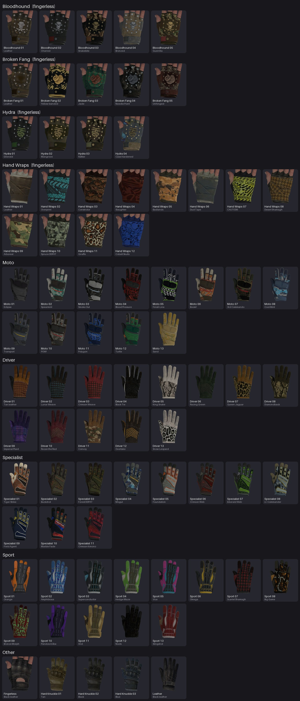
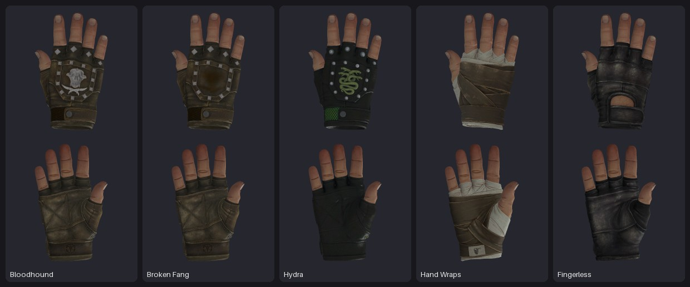

# Z-City CS:GO Gloves

Аддон для Garry's Mod, который добавляет **81 перчатку из CS:GO** в слот **Gloves** редактора
внешности режима **Z-City**. Перчатки можно выбрать для любой внешности (любая мужская или
женская модель из редактора), их видят все игроки, они остаются на рэгдолле и на трупе.

С версии 2.0.0 это ещё и общий аддон для внешности: в сборку попадает Lua из остальных архивов
репозитория — **Z-City Appearance Mod** и «привязки» одежды, — а файлы самой одежды кладутся в
папки `materials` и `models` аддона. С версии 2.2.0 раскладывать их по папкам самому не нужно:
в аддоне лежит **`sort_content.bat`**, который находит каждому файлу его место прямо в
установленном аддоне. С версии 2.4.0 сборка ещё и **запускает** Lua одежды и проверяет по дороге,
чтобы ни одно имя и ни одна вещь не потерялись, — см.
[«Одежда и Appearance Mod»](#одежда-и-appearance-mod) и
[«Чтобы ничего не терялось»](#чтобы-ничего-не-терялось).



> **Важно.** Аддон написан по исходникам Z-City из `z_city.zip` и проверяется на имитации игры
> (1615 автоматических проверок Lua-кода, проверка всех моделей, материалов и текстур): там, где
> он создаётся, Garry's Mod нет. В игре версия 1.0.0 рисовала перчатки в стороне от рук; в 1.0.1
> посадка на руки сделана по-другому, в 1.1.0 у перчаток с открытыми пальцами появились свои
> пальцы, в 1.2.0 добавлены перчатки Driver и Specialist, в 1.2.1 у пальцев другая кожа, в 1.3.0
> добавлены перчатки Sport, в 2.0.0 — Appearance Mod и привязки одежды, в 2.1.0 сборка научилась
> раскладывать файлы одежды по именам, в 2.2.0 то же делает `sort_content.bat` в установленном
> аддоне, а одежда «не на тех частях тела» и вторая пара рук под перчаткой исправлены по
> скриншотам из игры, в 2.3.0 перчатка стала единственной парой рук у любой модели, в 2.4.0
> привязана одежда Drill Clothes, а имена файлов одежды сборка узнаёт, запуская её Lua, — но **сам
> аддон там, где он пишется, в игре не запускается: каждое
> исправление — это предположение о причине, проверенное только на имитации**. Что посмотреть при
> запуске, написано в разделе [«Первая проверка в игре»](#первая-проверка-в-игре).

## Содержание

- [Установка](#установка)
- [Обновление](#обновление)
- [Одежда и Appearance Mod](#одежда-и-appearance-mod)
- [Как пользоваться](#как-пользоваться)
- [Первая проверка в игре](#первая-проверка-в-игре)
- [Настройки](#настройки)
- [Хуки для своих правил](#хуки-для-своих-правил)
- [Особенности и ограничения](#особенности-и-ограничения)
- [Как это устроено](#как-это-устроено)
- [Разработка](#разработка)

## Установка

### 1. Получить аддон

**Готовый архив.** Скачайте `zcity_csgo_gloves.zip` (около 225 МБ) со страницы
[Releases](https://github.com/yaumaDDD/hand/releases) и распакуйте его — внутри папка
`zcity_csgo_gloves`. Переходите к шагу 2.

**Или соберите сами** — это нужно, только если вы меняли файлы репозитория. Тяжёлые файлы (модели
и текстуры) лежат в репозитории в тех же архивах `.7z` и `.zip`, в которых были загружены, и готовый аддон
собирается из них одной командой.

Нужен [Python](https://www.python.org/downloads/) 3.7 или новее (при установке на Windows
отметьте «Add python.exe to PATH»).

| Система | Что сделать |
| --- | --- |
| Windows | запустить `build_addon.bat` двойным щелчком |
| Linux / macOS | `python3 build_addon.py` |

Для распаковки архивов скрипт использует модуль `py7zr` или установленный 7-Zip. Если нет ни
того, ни другого, `build_addon.bat` сам поставит `py7zr`; на Linux/macOS выполните
`python3 -m pip install py7zr`.

Ещё сборке нужен модуль `lupa`: с ним она запускает Lua одежды и узнаёт имена её файлов (см.
[«Чтобы ничего не терялось»](#чтобы-ничего-не-терялось)). `build_addon.bat` ставит его сам; на
Linux/macOS — `python3 -m pip install lupa`. Без него аддон тоже соберётся, но сборка напишет
`NOT RUN`, а `sort_content.bat` в таком аддоне будет знать меньше имён и предупредит об этом.

Результат — папка `build/zcity_csgo_gloves` (424 файла, около 364 МБ). Во время сборки временно
нужно около 1,5 ГБ свободного места. По пути скрипт вырезает из моделей перчаток голую руку CS:GO,
оставляя только пальцы открытых перчаток (см. [«Как это устроено»](#как-это-устроено)), а в конце
сам проверяет, что каждая модель находит свои материалы и текстуры.

Параметры сборки:

| Параметр | Что делает |
| --- | --- |
| `--out ПАПКА` | куда положить аддон (имя папки — строчными буквами) |
| `--zip` | дополнительно упаковать результат в `build/zcity_csgo_gloves.zip` (около 225 МБ) |
| `--original-textures` | оставить исходные текстуры 4096 px: около 1020 МБ вместо 364 МБ, разницы на руках почти не видно |
| `--keep-temp` | не удалять распакованные архивы `build/_extract` (нужно для скриптов из `tools/`) |
| `--gloves-only` | не класть в аддон Lua и файлы других аддонов из остальных архивов — только перчатки, как до 2.0.0 |

### 2. Положить в игру

Скопируйте папку `zcity_csgo_gloves` в

```
<Steam>/steamapps/common/GarrysMod/garrysmod/addons/
```

на сервере (или у себя, если сервер запускается из игры). Для одиночной игры этого достаточно.

### 3. Раздать файлы игрокам

Lua-код сервер отправляет игрокам сам, а модели и текстуры — нет. Если у игрока их нет, перчатки
у него просто не рисуются (без «ERROR»-моделей), а в консоли появляется одно предупреждение.
Варианты:

- **Workshop (лучший).** Загрузите собранную папку в Мастерскую и впишите номер в
  `lua/zcity_csgo_gloves/sh_config.lua` на сервере: `WorkshopID = "1234567890"`. Игроки скачают
  аддон при входе.

  ```
  gmad.exe create -folder "C:\путь\build\zcity_csgo_gloves" -out "C:\путь\zcity_csgo_gloves.gma"
  gmpublish.exe create -addon "C:\путь\zcity_csgo_gloves.gma" -icon "C:\путь\icon.jpg"
  ```

  Обе программы лежат в `GarrysMod/bin`, иконка — JPG 512×512.
- **FastDL.** `FastDL = true` в том же файле: сервер добавит файлы перчаток в список загрузки
  (одежду из папок `materials` и `models` он так не отправляет).
  Это около 364 МБ на каждого нового игрока, поэтому Workshop удобнее.
- **Вручную.** Игроки копируют ту же папку себе в `garrysmod/addons/`.

## Обновление

Обновлять нужно аддон целиком — и на сервере, и у игроков: от версии к версии меняются не только
Lua-файлы.

- **Папка в `addons`.** Скопируйте новую `zcity_csgo_gloves` поверх старой **с заменой файлов** —
  на сервере и у каждого игрока, который ставил аддон вручную. **Старую папку не удаляйте, если в
  ней лежит одежда**: её материалы и модели есть только у вас, в архиве аддона их нет. Замена
  затрагивает только файлы самого аддона; разложенная одежда, папка `_not_used` и отчёты остаются.
  Удалить старую папку целиком можно, только если в ней нет ничего своего.
- **Workshop.** Загрузите новую сборку как обновление того же аддона.
- **FastDL.** Новые файлы игроки скачают сами. Но игра не скачивает повторно файл, который у
  игрока уже есть, поэтому после обновления **с 1.0.x** у тех, кто заходил на сервер раньше,
  останутся старые модели. Им нужно один раз удалить папку
  `garrysmod/download/models/zcity_csgo_gloves`.

**С 1.0.x.** В 1.1.0 изменились **модели** (из них вырезана голая рука) и добавилась кожа пальцев.
Если у игрока остались модели от 1.0.x (или нет новых файлов), ничего не ломается: аддон это
замечает, один раз пишет об этом в консоль и рисует открытые перчатки так, как было в 1.0.1, —
поверх собственных пальцев модели.

**С 1.1.0.** В 1.2.0 добавились перчатки Driver и Specialist: две модели, их материалы, текстуры и
иконки. Файлы прежних перчаток не менялись, выбранные игроками перчатки остаются теми же. У
игрока, которому новые файлы не достались, перчатки Driver и Specialist просто не рисуются (в
консоли одно предупреждение), остальные работают как раньше.

**С 1.1.0 или 1.2.0.** В 1.2.1 у пальцев открытых перчаток другая кожа: текстура заменена, а имя
файла прежнее. При FastDL тем, кто уже скачал прежнюю, нужно один раз удалить папку
`garrysmod/download/materials/zcity_csgo_gloves/skin`.

**С 1.2.x.** В 1.3.0 добавились перчатки Sport: модель, её материалы, текстуры и иконки
(около 96 МБ). Файлы
прежних перчаток не менялись, выбранные игроками перчатки остаются теми же. У игрока, которому
новые файлы не достались, перчатки Sport просто не рисуются (в консоли одно предупреждение),
остальные работают как раньше.

**С 1.3.0.** В 2.0.0 в аддон добавлены Appearance Mod и привязки одежды — см.
[«Одежда и Appearance Mod»](#одежда-и-appearance-mod). Перчатки и их файлы не менялись, но ставить
эту версию на сервер без файлов одежды нельзя: Appearance Mod заменяет модели игроков своими. Тем, кому
нужны только перчатки, подойдёт 1.3.0 или сборка с `--gloves-only`.

**С 2.0.0.** В 2.1.0 изменилась только сборка: материалы, текстуры и модели одежды она теперь
сама раскладывает по именам, в каких бы папках они ни пришли, — см.
[«Куда класть файлы»](#куда-класть-файлы). Код аддона и файлы перчаток прежние; пока одежды в
репозитории нет, архив релиза отличается от 2.0.0 только номером версии и двумя заметками в
папках `materials` и `models`.

**С 2.0.0 или 2.1.0.** В 2.2.0:

- в папке аддона появился `sort_content.bat` — раскладывает материалы, текстуры и модели одежды
  по местам в уже установленном аддоне, см. [«Куда класть файлы»](#куда-класть-файлы);
- одежда больше не должна попадать на чужие части тела, а под перчаткой — оставаться вторая пара
  рук, когда у модели игрока установлены не все материалы, см.
  [«Одежда не на своих местах и двойные руки»](#одежда-не-на-своих-местах-и-двойные-руки);
- `zcg_content` показывает и материалы, которых не хватает самим моделям, и находит файлы,
  которые лежат не там.

Файлы перчаток прежние. Если в папке аддона уже лежит одежда, **не удаляйте её вместе со старой
версией**: скопируйте новую папку `zcity_csgo_gloves` поверх старой с заменой файлов (с 2.0.0 и
2.1.0 так можно — файлы аддона только добавились), потом запустите `sort_content.bat`.

**С 2.2.0.** В 2.2.1 изменился только `sort_content.bat` (папка `sort_content`) и сборка —
раскладка файлов из своих папок, см. [«Свои папки»](#куда-класть-файлы):

- файл в своей папке внутри `materials` аддона (`materials/materials0000/materials 3/…`)
  находится по имени и тогда, когда другие файлы аддона уже лежат на местах — в 2.2.0 такой
  файл молча оставался, где лежал;
- материал, который Lua называет в одной папке, а текстуры держит в другой, кладётся туда, где
  его называет Lua, — в 2.2.0 он уезжал в папку своей текстуры;
- о тёзках, которых нечем различить, отчёт пишет и тогда, когда они лежат внутри аддона, и
  называет папки, к которым файл подходит; одинаковые копии раскладываются сами;
- файлы, про которые ничего не известно, больше не считаются «лежащими на своём месте»: их число
  показано отдельно, а папки перечислены в новом разделе отчёта «Оставлено в тех же папках».

Файлы перчаток те же, что в 2.2.0, в Lua аддона изменился только номер версии.

**С 2.2.x.** В 2.3.0 изменился только Lua-код перчаток: пока перчатка CS:GO надета, она —
единственная пара рук своего хозяина, см.
[«Одежда не на своих местах и двойные руки»](#одежда-не-на-своих-местах-и-двойные-руки).

- Раньше кисти модели под перчаткой убирались подменой их материала, а кости кистей сжимались
  только у моделей, у которых такого материала нет. Теперь делается и то и другое сразу, у любой
  модели. Со сжатыми костями уходит всё, что на них держится, каким бы материалом оно ни было
  покрыто и к какой бы бодигруппе ни относилось: голые руки торса-футболки, вторая пара кистей,
  перчатки самой модели.
- `zcg_hide_bones` читается по-новому: `1` (по умолчанию) и `2` — у всех моделей, `3` — как было
  до 2.3.0, `0` — никогда. Менять ничего не нужно: и прежнее `1`, и прежнее `2` теперь значат «у
  всех».
- `zcg_debug` показывает, что ещё может рисовать руки на игроке: включённые бодигруппы модели,
  прицепленные к игроку модели, экипировку Z-City и чужие хуки рисования.

Файлы перчаток и одежды прежние: достаточно скопировать новую папку `zcity_csgo_gloves` поверх
старой с заменой файлов — на сервере и у игроков.

**С 2.3.0.** В 2.4.0 перчатки и их файлы не менялись. Изменилось то, что касается одежды, — см.
[«Чтобы ничего не терялось»](#чтобы-ничего-не-терялось):

- добавлена привязка **[ZCITY] Drill Clothes** — 22 вещи, мужские и женские. Её файлы
  (`materials/zcity_drill/…`) кладутся в аддон так же, как остальная одежда; после этого ещё раз
  запустите `sort_content.bat`;
- сборка **запускает** Lua одежды и берёт имена файлов из самих таблиц редактора, а
  `sort_content.bat` получает их списком (`sort_content/lua_names.txt`). В 2.3.0 он не знал ни
  одного файла Drill Clothes, а два из них — `sheet_16.vmt` и `sheet_31.vmt` — мог увезти в папку
  Appearance Mod, где есть файлы с такими же именами;
- `sort_content.bat` пишет «ВНИМАНИЕ», если списка нет, если Lua в аддоне добавлен или изменён
  после сборки, если Lua-файл при сборке остановился на ошибке;
- раскладка стала точнее в трёх местах (см. [«Куда класть файлы»](#куда-класть-файлы)): тёзку из
  двух наборов выдают его соседи по папке; материал, который версия до 2.4.0 положила на место
  тёзки, теперь кладётся ещё и на своё; а про файл, имя которого Lua называет, но который на это
  место не взят, в «Замечаниях» отчёта написано, куда он положен и что с ним делать;
- `zcg_content` в игре сверяет ещё и сами таблицы редактора: всё ли, что добавляет Lua одежды из
  этого аддона, в них есть (список — `lua/zcity_csgo_gloves/sh_bound.lua`, его пишет сборка);
- сборка останавливается, если два архива приносят разные Lua-файлы с одним путём, и называет
  архив, из которого ей нечего взять.

Обновление: скопировать новую папку `zcity_csgo_gloves` поверх старой с заменой файлов — на
сервере и у игроков. Ни один из 421 файла версии 2.3.0 не пропал (413 совпадают байт в байт),
добавились три: Lua Drill Clothes и два списка.

## Одежда и Appearance Mod

С версии 2.0.0 сборка кладёт в аддон не только перчатки, но и Lua-код других аддонов, который
лежит в репозитории архивами. Сейчас это:

| Архив | Аддон | Что добавляет | Где ждёт свои файлы |
| --- | --- | --- | --- |
| `apperance.zip` | Z-City Appearance Mod | окна с предпросмотром вместо выпадающих меню редактора, 28 моделей игроков (15 стандартных заменяет своими, 13 добавляет), одежда, лица, класс Rebel | `models/slav/`, `materials/models/humans/slav/`, `materials/models/humans/modern/` и ещё десяток папок в `materials/models/` |
| `луашки для привязок всей одежды.zip` | ZCITY Clothing+ | свой редактор, одежда и свои модели игроков (вместе с Appearance Mod остаются модели мода) | `models/zcityadodser/`, `materials/models/humans/male/group01/`, `materials/models/humans/female/group01/` |
| | Z-City \| bib's custom shirts | 70 футболок и 3 класса игроков | `materials/models/humans/male/group01/`, `models/player/dewobedil/vocaloid/` |
| | Z-CITY \| Maga's small clothes pack | 9 вещей | `materials/models/gate/` |
| | Z-CITY\|usec basic clothes | 1 вещь | `materials/models/humans/male/group01/` |
| | Z-City Armbands | 10 повязок | `models/zcband/`, `materials/zcbands41/` |
| `еще лушашки для привязок + аддон json 2.zip` | [ZCITY] Drill Clothes (с 2.4.0) | 22 вещи, каждая и для мужских, и для женских моделей | `materials/zcity_drill/` |
| `еще лушашки для привязок + аддон json.zip` | Z-City Clothes RP Update | **ничего**: в архиве только `addon.json`, Lua в нём нет — привязывать нечего. Сборка так и пишет: `NOTHING for the addon` | — |

Это только «привязки» — Lua, который называет материалы и модели по именам. **Самих материалов и
моделей одежды в репозитории нет**: их нужно положить в папки `materials` и `models` аддона.
Все имена, которые называет этот Lua (637), перечислены в
[`docs/content_names.txt`](docs/content_names.txt) — и те, что написаны в его тексте, и те, что
видны только в таблицах редактора после его запуска (таких 35, см.
[«Чтобы ничего не терялось»](#чтобы-ничего-не-терялось)).

> **Этот список — не перечень файлов, которые нужно собрать.** В нём только то, что называет Lua.
> Игре нужно больше: материал (`.vmt`) тянет свои текстуры (`.vtf` — их бывает несколько, и
> называются они не обязательно так же), модель (`.mdl`) — свои материалы и файлы `.vvd`, `.vtx`,
> `.phy`. Выбирать файлы по списку не надо: кладите папки `materials` и `models` исходных
> аддонов целиком, как есть.

### Куда класть файлы

Игра ищет файл только по точному пути. Lua называет материал `models/gate/epl` — значит, нужен
ровно `materials/models/gate/epl.vmt`, а путь текстуры записан уже в нём. Файл, лежащий на
уровень выше или в «своей» папке, игра не найдёт; отсюда чёрно-розовые клетки, а у моделей
игроков — ещё и [одежда не на своих местах](#одежда-не-на-своих-местах-и-двойные-руки). Искать
файл по имени игра не умеет, поэтому это делается до игры. Способов три.

**1. `sort_content.bat` — в установленном аддоне (с 2.2.0).** Самый простой способ; папки могут
называться как угодно.

1. Положите аддон в `garrysmod/addons/` и **закройте игру** (пока она открыта, файлы заняты и
   переложить их нельзя).
2. Положите весь контент в `zcity_csgo_gloves/materials` и `zcity_csgo_gloves/models` — как он
   есть, в любых папках. Или не кладите никуда, а перетащите папку с контентом (или архив `.zip`)
   мышью на `sort_content.bat`: файлы будут скопированы в аддон. Архивы `.7z` и `.rar` сначала
   распакуйте.
3. Запустите `sort_content.bat` двойным щелчком. Он читает имена из Lua аддона и из списка,
   который оставила сборка (`sort_content/lua_names.txt` — имена, найденные запуском этого Lua),
   находит каждый файл и перекладывает его туда, где его ищет игра, — по тем же правилам, что и
   сборка (они описаны ниже). В конце печатает, сколько файлов переложено и чего не хватает; всё
   подробно — в `sort_content_report.txt` рядом с ним. Строка «ВНИМАНИЕ» в начале значит, что
   каких-то имён он может не знать, — см. [«Чтобы ничего не терялось»](#чтобы-ничего-не-терялось).
4. Запустите игру, в консоли наберите `zcg_content` — см. [«Проверка»](#проверка).

**Свои папки.** Папки могут быть какими угодно — в том числе свои, с номерами, с файлами прямо
внутри, без подпапок:

```
zcity_csgo_gloves/materials/materials0000/materials 1/naomi_facemap_new.vmt
zcity_csgo_gloves/materials/materials0000/materials 1/naomi_facemap_new.vtf
zcity_csgo_gloves/materials/materials0000/materials 2/...
```

Каждый файл находится по имени: материал — по имени, которое называет Lua или модель, текстура —
по пути, записанному в материале, в какой бы папке с номером она ни лежала. Чтобы так сработало:

- кладите материал (`.vmt`) **вместе со всеми его текстурами** (`.vtf`) — не только с
  одноимённой; чего не хватит, отчёт перечислит в разделе «Материал ищет текстуру, а её нет»;
- в одну свою папку — файлы **одной** исходной папки: тогда и те файлы, которых никто не
  называет, уедут вместе с соседями;
- **тёзки** — файлы с одним именем из разных папок игры (`cub_facemap.vmt` в `group02`, `group03`
  и `group03m`; `facemap_01.vmt` в `male_02`, `male_04` …). Их различает то, что они говорят сами:
  рядом с материалом лежит его текстура, названная в нём по пути его же папки. Если сказать им
  нечего, никто не гадает: файлы остаются на месте, а в «Замечаниях» отчёта написано, к каким
  папкам каждый подходит. Тогда назовите свою папку так же, как называется настоящая
  (`materials0000/group02/cub_facemap.vmt`) — этого достаточно. Совсем одинаковые файлы (копии
  одного и того же) раскладываются сами, если копий столько же, сколько имён;
- файл, про который **ничего не известно** (его не называет ни Lua, ни модель, ни материал, и
  соседи по папке ничего не подсказывают — например, текстура без своего материала), остаётся в
  своей папке. За «лежит на своём месте» он не считается: `sort_content.bat` пишет, сколько
  таких файлов, а отчёт в разделе «Оставлено в тех же папках» называет их папки. Игра по такому
  пути ничего не ищет — значит, либо файл не нужен, либо не хватает того, кто его называет.

Проще всего ничего не выбирать и не перекладывать: скопировать исходные папки целиком.

Запускать можно сколько угодно раз: добавили файлы — запустили ещё раз. Что важно:

- **Ничего не удаляется.** Файл, которому места не нашлось (второй экземпляр, тёзка, которого
  нечем отличить), переезжает в папку `_not_used` внутри аддона, и в отчёте написано почему.
  Файлы самих перчаток не трогаются и не заменяются.
- **Нужен Python 3.7 или новее.** Если его нет, `sort_content.bat` один раз скачивает с
  python.org переносную копию (около 11 МБ) в `%LOCALAPPDATA%\zcg_python` — ничего не
  устанавливая в систему; для этого нужен интернет.
- **Запуск прервался** (закрыли окно, выключился компьютер) — следующий запуск доводит начатое до
  конца: файлы в пути лежат в папке `_sorting` вместе со списком, куда они шли.
- **Код возврата**: `0` — готово, `1` — не та папка или нет такого источника, `2` — часть файлов
  не удалось переложить (обычно открыта игра).
- Игре `sort_content.bat`, папки `sort_content`, `_not_used` и отчёт не мешают, а при загрузке в
  Мастерскую пропускаются (`addon.json`).
- Не Windows: `python3 sort_content/sort_content.py` из папки аддона; источники — аргументами,
  `--dry-run` — только показать, что будет сделано.

**2. Отдать раскладку сборке.** Для тех, кто собирает аддон сам или хочет получить релиз уже с
одеждой внутри. Положите контент в репозиторий:

- архивами `.zip` или `.7z` в корень, имена любые (`material 1.zip`, `material 2.zip`, …);
- одним архивом, который 7-Zip разбил на тома: `content.7z.001`, `content.7z.002`, … — когда
  всё вместе больше 25 МБ, которые пропускает страница загрузки GitHub («Добавить к архиву» →
  «Разбить на тома размером» → `24M`);
- папками в корень: `material 1`, `material 2`, … (для сборки у себя);
- или прямо в `zcity_csgo_gloves/materials` и `zcity_csgo_gloves/models`.

**Как файлу находится место** — и в `sort_content.bat`, и в сборке (это один и тот же код,
`tools/place_content.py`). Папкам, в которых лежат материалы, текстуры и модели, доверия нет:
всё идёт по именам. Lua называет материалы и модели, модель — свои материалы, материал — свои
текстуры; каждое такое имя ищется среди всего, что положено, и файл кладётся туда, где его будет
искать игра:

| Что | Как находит своё место |
| --- | --- |
| материал или модель, которые называет Lua | по имени файла, где бы он ни лежал |
| материал модели | по списку папок и имён, записанному в самом `.mdl` |
| текстура | по пути, записанному в `.vmt`, который ею пользуется |
| файл, который никто не называет | идёт туда же, куда ушла его папка; иначе остаётся, где лежал (вне папок `materials` и `models` — пропускается) |

Одного имени мало: в одежде полно тёзок — `sheet_01.vmt` есть и у мужчин, и у женщин,
`male_01.mdl` — у двух аддонов. Поэтому сборка смотрит, как папки файла соотносятся с нужным
путём:

- **файл лежит по нужному пути** — остаётся на месте;
- **путь тот же, но сдвинут на уровень** (`materials/gate/…` вместо `materials/models/gate/…`) —
  это тот самый файл, и папка переезжает целиком, вместе с тем, что никем не названо;
- **соседняя папка того же дерева** (`…/male/group01/` и `…/female/group01/`) — это другой файл:
  вместо недостающего он не берётся никогда;
- **папки ничего не говорят** (`material 1/…`) — остаётся только имя. Файл берётся, если он такой
  один и подходит к одному имени. Тёзок различает то, что файлы говорят сами: текстура лежит
  рядом с материалом, который её называет; рядом с материалом лежит его собственная текстура —
  значит, оба из той папки, куда ведёт её путь; модель собрана под определённый путь.
  Материал, который Lua называет в одной-единственной папке, кладётся именно туда, даже если
  его текстуры — из другой папки и лежат рядом с ним: материалы и текстуры нередко хранят
  порознь. Такой материал заодно говорит, чей это набор: если материалы из `materials 14`,
  текстуры которых названы в `models/drill_pack/`, ушли в `zcity_drill/`, то и лежащий с ними
  `sheet_16.vmt` с текстурой из `models/drill_pack/` — оттуда же, хотя Lua называет файл с таким
  именем ещё и в папке другого набора (с 2.4.0; раньше такой файл уходил вслед за текстурой,
  туда, где его никто не ищет).

Материал, который уже лежит на чьём-то месте, а текстуру берёт ровно с именем недостающего
материала (`zcity_drill/sheet_16` для `materials/zcity_drill/sheet_16.vmt`), — это он и есть: он
кладётся и туда, копией, а с прежнего места не убирается (с 2.4.0). Так находится файл, который
версия до 2.4.0 отдала тёзке из другого набора.

Чего решить нельзя, сборка не угадывает, а называет: файл, одинаково подходящий к нескольким
именам; несколько разных файлов на одно имя; имя, для которого нет файла (он может быть частью
игры или Z-City); файл, который не называет никто. С 2.4.0 — ещё и файл, имя которого Lua
называет, а на это место он не взят, потому что ничто не говорит, что это он: в «Замечаниях»
написано, где он теперь лежит и в каких папках Lua ждёт файл с таким именем. Если он оттуда,
переложите его в ту папку сами; пока имя пустует, а файл лежит там, где его никто не называет,
замечание повторяется при каждом запуске. Отсюда два совета:

- надёжнее всего оставлять папки такими, как в аддоне, откуда взят контент, — лишний или
  пропущенный уровень сборка исправит сама;
- если раскладываете по своим папкам, то одна своя папка на одну папку игры, а материалы — вместе
  со своими текстурами. Файлы из разных папок игры, ссыпанные в одну кучу, сборка разберёт
  только там, где им есть чем отличаться.

**Отчёт.** `sort_content.bat` пишет его в `sort_content_report.txt` в папке аддона, сборка — в
`build/content_report.txt` (коротко — в своём выводе). Когда аддон собирается на GitHub для
релиза, отчёт прикрепляется к релизу рядом с архивом (если в репозитории есть материалы или
модели одежды). Отчёт на русском, разделы у обоих одни:

| Раздел | Что в нём |
| --- | --- |
| «Переложено» | что нашлось по имени или переехало вместе со своей папкой: из какой папки в какую и сколько файлов |
| «Оставлено в тех же папках» | файлы, про которые ничего не известно: ни их, ни их папки никто не называет, или их не отличить от тёзок. Лежат там же, где лежали (из источника — положены по тем же папкам), по папкам и с числом файлов. Если это ваши собственные папки с номерами — см. «Свои папки» выше |
| «Не использовано» | файлы, которым места не нашлось, и причина: его никто не называет, и лежит он не в папке `materials` или `models`; не отличить от тёзок; такой же файл есть в более позднем источнике; на этом месте лежит файл самого аддона; его место занял другой файл. `sort_content.bat` убирает такие файлы в `_not_used`, сборка просто не берёт |
| «Замечания» | сомнения: файл подходит к нескольким именам, на одно имя несколько разных файлов, один файл пришёл в двух разных версиях; с 2.4.0 — файл, имя которого Lua называет в другой папке, где его нет (куда он положен и где его ждут), и материал, положенный ещё и на место недостающего, потому что берёт его текстуру |
| «Lua называет, а файла нет» | имена из Lua, для которых файла не нашлось |
| «Модель ищет материал, а его нет» | материалы, которые записаны в модели и которых нет |
| «Материал ищет текстуру, а её нет» | текстуры, которые записаны в материале и которых нет |
| «Не часть аддона» | файлы источника, над которыми нет папки `lua`, `materials`, `models` …: чужой `addon.json`, заметки. Пропущены |

Три раздела «…а файла нет» — то, чего в игре не будет видно, если этих файлов нет и в самой игре
или в Z-City.

Остальное (Lua, звуки) кладётся по папкам, как раньше: всё, что лежит под папкой `lua` или
`sound`, попадает в аддон по тому же пути, а папка `homigrad` или `autorun` без `lua` над ней —
в `lua/`. Архивы других видов (`.rar`) сборка не читает и говорит об этом.

**3. Разложить самому.** В папке `zcity_csgo_gloves` из архива релиза уже есть `materials` и
`models`. Файлы должны лежать по тем же путям, что в аддоне, из которого взяты
(`materials/models/humans/...`, `models/zcband/...`). Внутри `materials` тоже есть папка `models`
— это материалы моделей, и чаще всего ошибаются именно на этот уровень. Ошиблись —
`sort_content.bat` исправит.

И сборка, и `sort_content.bat` приводят пути материалов и моделей к строчным буквам (иначе их не
найдёт игра на Linux и не примет Мастерская) и не заменяют чужими файлы самого аддона. Из двух
разных файлов на одно место берётся тот, чей источник позже (архивы в репозитории идут по именам,
папки, отданные `sort_content.bat`, — в том порядке, в каком они ему даны); то, что уже лежит в
папке аддона, — последним.

### Проверка

В консоли игры: **`zcg_content`**. Команда проходит по таблицам редактора внешности — что бы их
ни заполнило — и печатает, чего на этом компьютере нет (весь список пишется в
`garrysmod/data/zcg_content.txt`):

- модели и материалы, которые называет редактор;
- материалы, из которых сделаны установленные модели игроков (они записаны в самих `.mdl`), —
  именно из-за них одежда оказывается не на своих местах;
- для каждого недостающего файла — нет ли файла с таким же именем в другой папке: тогда он просто
  лежит не там, и это исправляет `sort_content.bat`;
- с 2.4.0 — всё ли, что добавляет Lua одежды из этого аддона, есть в самих таблицах (см.
  [«Чтобы ничего не терялось»](#чтобы-ничего-не-терялось)).

Пустой список значит, что каждая вещь из редактора найдёт свои файлы. Если контента не хватает,
аддон через 15 секунд после входа в игру сам пишет об этом одну строку в консоль.
`zcg_content_server` (суперадмин) или `zcg_content` в консоли выделенного сервера — то же для
файлов сервера; о моделях, которых нет на сервере, он сам пишет в консоль после запуска.

До игры то же самое по тексту Lua: `sort_content.bat` в конце печатает, скольких названных
файлов не хватает; `python tools/list_content.py` — какие папки названы и сколько файлов из них
уже в сборке. Сама сборка печатает, сколько названных файлов нашлось, и пишет в
`build/content_report.txt`, что куда положено и чего нет.

### Чтобы ничего не терялось

Вещь может потеряться в трёх местах: её файл не узнал `sort_content.bat`; её Lua не попал в аддон
или не выполнился; в самой игре что-то пересоздало таблицы редактора. С 2.4.0 проверяется каждое.

**1. Имена файлов.** До 2.4.0 имена брались только из текста Lua: всё, что в кавычках и начинается
с `models/`, `materials/` или `sound/`. Этого мало. Lua может назвать материал от папки
`materials` (`{"Drill 07", "zcity_drill/sheet_16"}`) или собрать имя на ходу
(`"…/lake_facemap" .. i`) — в тексте таких имён нет. А файл, имени которого `sort_content.bat` не
знает, для него ничей: в 2.3.0 он не знал ни одного файла Drill Clothes, и `sheet_16.vmt` с
`sheet_31.vmt` — если они лежали в своей папке вроде `materials 14` — мог увезти в
`materials/models/humans/modern/male/`: там Appearance Mod называет файлы с такими же именами.
Текстуры при этом оставались на месте. Если так и случилось, запустите `sort_content.bat` из
2.4.0 ещё раз: такой материал он узнаёт по текстуре и кладёт ещё и на своё место (в отчёте об
этом будет замечание).

Теперь сборка **запускает** Lua одежды (`tools/lua_names.py`): в LuaJIT, на небольшой имитации
игры, поверх настоящих файлов внешности Z-City и её же загрузчиком — в том порядке, в котором
файлы загружает игра, как сервер и как клиент, с хуками запуска и минутой таймеров. После каждого
файла она читает таблицы редактора той же функцией, которой в игре пользуется `zcg_content`. Так
нашлись 35 имён, которых в тексте нет: 22 материала Drill Clothes и 13 лиц. Lua запускается на
тех же байтах, что лежат в файле: названия вещей в любой кодировке (например, русские в
Windows-1251) остаются разными названиями и не сливаются в одно.

У `sort_content.bat` на вашем компьютере запускать Lua нечем, поэтому найденные имена сборка
кладёт рядом с ним списком `sort_content/lua_names.txt`. Он читает и текст Lua, и список, пишет,
сколько имён известно только из списка, и предупреждает — строкой «ВНИМАНИЕ», — если:

- списка нет, или аддон собран там, где запустить Lua было нечем (нет модуля `lupa`). Возьмите
  аддон из [выпуска на GitHub](https://github.com/yaumaDDD/hand/releases);
- в аддоне есть Lua-файл, добавленный или изменённый после сборки (он назван). Такой файл только
  прочитан: имена, которых нет в его тексте, не известны. Чтобы учитывались и они, Lua нужно
  добавить в сборку — архивом в репозиторий;
- Lua-файл при сборке остановился на ошибке (он назван вместе с ошибкой). Что он добавляет после
  этого места, не известно, — и в игре этой одежды, скорее всего, тоже не будет.

**2. Lua в аддоне.** Про каждый архив сборка печатает, сколько Lua-файлов из него взято и какие
файлы оставлены; об архиве, из которого взять нечего, пишет `NOTHING for the addon`. Если два
архива приносят **разные** Lua-файлы с одним и тем же путём, сборка останавливается и называет
оба: раньше молча оставался тот, что позже по имени архива, а всё, что добавлял другой,
пропадало. Имя, которое один файл кладёт в таблицы, а более поздний заменяет или убирает, тоже
печатается — сейчас это только 15 моделей игроков Clothing+, которые Appearance Mod заменяет
своими; ни одна вещь и ни одно лицо так не теряются.

**3. Таблицы в игре.** Всё, что Lua одежды кладёт в таблицы редактора, — 905 записей: вещи, лица,
модели игроков, повязки — сборка записывает в `lua/zcity_csgo_gloves/sh_bound.lua`. В игре
`zcg_content` сверяет с этим списком сами таблицы. Если всё на месте, он пишет одну строку:

```
[CS:GO Gloves] the clothing Lua of this addon: all 905 clothes, faces, models and accessories it adds are in the appearance tables
```

Если нет — называет каждую запись, которой нет или которая стала другой, и Lua-файл, который
должен был её добавить:

```
[CS:GO Gloves] the clothing Lua of this addon: 44 of the 905 clothes, faces, models and accessories it adds are NOT in the appearance tables the way it puts them there:
  lua/autorun/zcity_drill_clothes.lua: 44
    Clothes/1/Drill 01 = zcity_drill/players_sheet_02   [not there]
    ...
```

В консоль идут первые 40 записей; если их больше, весь список пишется в
`garrysmod/data/zcg_bound.txt`. Так бывает, если:

- Lua-файл не загрузился или остановился на ошибке — ищите его имя рядом со словом `error` выше в
  консоли, и на сервере тоже;
- файл Z-City `homigrad/new_appearance/sh_shared.lua` перезагрузился на работающем сервере (его
  сохранили в редакторе): он создаёт таблицы одежды заново, и всё, что добавили привязки,
  пропадает до перезапуска карты;
- другой аддон использует те же названия вещей или сам заменяет модели игроков — тогда в скобках
  написано, что стоит на этом месте сейчас.

Если чего-то нет, аддон через минуту после запуска сам пишет об этом одну строку в консоль — и на
сервере, и у игрока. Сам он в таблицах ничего не чинит: это только проверка. Число 905 — для
сборки из выпуска; в аддоне, собранном без `lupa`, списка нет, и `zcg_content` об этом молчит.

Имитация ведёт себя так, как, по мнению автора, ведёт себя игра; в самой игре она не проверялась.
Точный ответ для работающей игры даёт `zcg_content`.

### Одежда не на своих местах и двойные руки

Так это выглядит: в окне выбора штанов все плитки показывают одни и те же ноги с текстурой не на
тех частях; футболка натянута на штаны; сквозь перчатку CS:GO проступают кисть и пальцы самой
модели. Причина, скорее всего, одна, и она не в коде одежды.

Z-City, Appearance Mod и этот аддон находят «слот» одежды — куртку, штаны, обувь, кисти — по
месту материала в списке `Entity:GetMaterials()`. А игра пропускает в этом списке материалы,
файлов которых нет, и всё, что стоит после пропуска, сдвигается на одно место вверх. Достаточно
одного неустановленного материала модели игрока — и куртка попадает на штаны, штаны на обувь, а
аддон прячет под перчаткой не кисти, а что-то другое: кисти остаются видны.

С 2.2.0 сделано три вещи:

1. **Полный список материалов** (`lua/zcity_csgo_gloves/sh_materials.lua`). Аддон читает список
   материалов прямо из файла модели и возвращает пропущенные имена на их места;
   `Entity:GetMaterials()` начинает отвечать так же. Слоты снова считаются правильно — и у
   Z-City, и у Appearance Mod, и у перчаток, — даже когда файлов не хватает. Для модели, у
   которой установлено всё, не меняется ничего. Выключается строкой
   `CompleteMaterialList = false` в `sh_config.lua`.
2. **Перчатка — единственная пара рук** (в таком виде с 2.3.0). Пока перчатка нарисована, кисти
   модели под ней убираются двумя способами сразу, и ни один не зависит от другого:
   - материал кистей заменяется невидимым;
   - кости кистей и пальцев на время рисования модели сжимаются в запястье, а сразу после
     возвращаются как были. Тем же приёмом сама Z-City убирает голову игрока из вида от первого
     лица.

   Вместе с костями уходит всё, что на них держится, — каким бы материалом оно ни было покрыто и
   к какой бы бодигруппе ни относилось: кисти без своего материала, голые руки торса-футболки,
   вторая пара кистей из другой бодигруппы, перчатки самой модели. До 2.3.0 кости сжимались
   только у моделей без материала кистей, поэтому всё, что нарисовано на кисти другим материалом,
   оставалось видно — вторая пара рук. Переменная `zcg_hide_bones`: `1` — у всех моделей (по
   умолчанию; `2` — то же самое), `3` — только у моделей без материала кистей (как до 2.3.0),
   `0` — никогда.
3. **Файлы на места** — `sort_content.bat`, см. выше. Первые два пункта возвращают на места
   слоты, но сам недостающий материал не появится, пока его файла нет: будет чёрно-розовая
   клетка, зато на своей части тела.

**Что перчатка убрать не может** — руки, которые рисуются не вместе с игроком: отдельную модель
рук, которую другой аддон рисует сам, в своё время (даже если она привязана к костям игрока). У
самой Z-City таких нет — это проверено по её коду: рук от первого лица она не создаёт (игрок
видит собственное тело), кулаки и оружие держат руки самого игрока, а её собственные «крутые
перчатки» выключены. Если вторая пара рук всё-таки останется, значит, её рисует что-то ещё —
`zcg_debug` перечисляет кандидатов.

Это исправление сделано по скриншотам и по коду Z-City и мода; **в настоящей игре оно не
проверялось**. Если после 2.3.0 руки всё ещё двойные или одежда не там — нужны скриншот и вывод
`zcg_debug` (смотря на себя или на другого игрока). В нём написано, как прячутся кисти и были ли
они сжаты, какие бодигруппы модели включены (`bodies of the model`), что к игроку прицеплено
(`attached to it`, `equipment of Z-City`), кто ещё рисует в хуках Z-City, и оба списка материалов
модели с пометкой `<- not installed` у тех, которых нет.

### Что важно знать

- **Модели игроков — из Appearance Mod.** Он заменяет все 15 стандартных моделей (Male 01–09,
  Female 01–06) своими и добавляет ещё 13; все 28 лежат в `models/slav/...`. Пока этих моделей
  нет в `models`, игроки будут моделями ERROR. Сначала положите файлы, потом ставьте аддон на
  сервер — или соберите без чужого Lua: `python build_addon.py --gloves-only`.
  ZCITY Clothing+ тоже подменяет стандартные модели (`models/zcityadodser/...`), но Appearance
  Mod делает это позже, когда все файлы уже загружены, поэтому в общей сборке остаются его
  модели (проверено на имитации: файлы загружены в порядке загрузчика Z-City).
- **Игрокам файлы одежды должны приходить так же, как перчатки** — см.
  [«Раздать файлы игрокам»](#3-раздать-файлы-игрокам). `FastDL = true` отправляет только
  перчатки; чтобы игроки получали и одежду, загрузите собранную папку в Мастерскую и впишите
  `WorkshopID`.
- **Ставить эти аддоны отдельно не нужно:** их Lua уже в сборке, нужны только их материалы и
  модели. Если те же аддоны остаются установленными (например, по подписке в Мастерской),
  ничего не ломается: пути файлов те же, игра возьмёт один из двух одинаковых, а материалы и
  модели найдёт в них. Если автор обновит аддон, копии станут разными — тогда обновите архив в
  репозитории или оставьте что-то одно.
- Lua этих аддонов кладётся в сборку без изменений. Тесты проверяют его синтаксис, а связку
  перчаток с Appearance Mod — на настоящем коде мода из `apperance.zip`. Саму одежду на имитации
  игры проверить нельзя.

### Перчатки и Appearance Mod

С модом кнопка **Gloves** открывает его окно «Select Gloves» с трёхмерным предпросмотром. Обычные
перчатки Z-City остаются в нём как были, а 81 перчатка CS:GO туда не выкладывается (в окне три
плитки в ряд, и на предпросмотре у всех были бы голые руки): вместо них первой стоит плитка
**CS:GO gloves...** Она открывает тот же каталог с иконками, что и без мода, — навести значит
примерить, щёлкнуть значит выбрать. Выбранная перчатка видна на большой модели редактора.

Если окно мода в новой версии изменится и плитку добавить не удастся, перчатки CS:GO появятся в
нём обычным списком по именам, а в консоли будет одна строка об этом.

## Как пользоваться

1. `Esc` → **Appearance** — откроется редактор внешности Z-City.
2. Кнопка **Gloves**. В меню остаются обычные перчатки Z-City, а внизу появляется пункт
   **CS:GO gloves...**
3. Справа открывается окно с иконками. Наведение на иконку — примерка на модели, щелчок — выбор.
   Щелчок мимо окна закрывает его без изменений.
4. **Apply**. Как и остальная внешность в Z-City, перчатки появляются на игроке со следующего
   возрождения.

Обычные перчатки Z-City и пункт **None** работают как раньше: выбрали их — перчатка CS:GO
снимается.

### Список перчаток

| Группа | Идентификаторы | Кол-во | Пальцы | Имя группы в настройках |
| --- | --- | --- | --- | --- |
| Bloodhound | `bloodhound_1` … `bloodhound_5` | 5 | открытые | `bloodhound` |
| Broken Fang | `brokenfang_1` … `brokenfang_5` | 5 | открытые | `brokenfang` |
| Hydra | `hydra_1` … `hydra_4` | 4 | открытые | `hydra` |
| Hand Wraps | `handwrap_1` … `handwrap_12` | 12 | открытые | `handwrap` |
| Fingerless | `fingerless_1` | 1 | открытые | `fingerless` |
| Moto | `moto_1` … `moto_13` | 13 | закрытые | `moto` |
| Hard Knuckle | `hardknuckle_1` … `hardknuckle_3` | 3 | закрытые | `hardknuckle` |
| Leather | `leather_1` | 1 | закрытые | `leather` |
| Driver | `driver_1` … `driver_13` | 13 | закрытые | `driver` |
| Specialist | `specialist_1` … `specialist_11` | 11 | закрытые | `specialist` |
| Sport | `sport_1` … `sport_13` | 13 | закрытые | `sport` |

У перчаток с открытыми пальцами пальцы свои: они входят в модель перчатки и точно под неё
подогнаны, а кисть модели игрока под такой перчаткой скрывается так же, как под закрытой.



Эта картинка, как и каталог выше, — не снимок из игры: она нарисована из файлов готовой сборки
тем же простым растеризатором, что и иконки.

Подписи расцветок в каталоге и в окне выбора («Charred», «Spearmint» и т. д.) подобраны по
текстурам и служат только подсказкой. Их можно менять в `tools/zcg_layout.py`; идентификаторы и
имена вида `CS:GO Moto 05` менять нельзя — они сохранены в файлах внешности игроков.

## Первая проверка в игре

Текущая версия ещё не запускалась в настоящей игре, поэтому после установки пройдите по списку —
это займёт пару минут и сразу покажет, если что-то не так.

1. Запустите Z-City. В консоли не должно быть ошибок со словами `CS:GO Gloves`. Команда
   `zcg_status` (консоль сервера или суперадмин) должна показать `registered in Z-City: true`.
2. В своей консоли: `zcg_preview moto_1`. Перчатка сразу появляется на ваших руках (видите её
   только вы). Проверьте **посадку на кисти** и **стык манжеты с рукавом** — без оружия, с
   пистолетом и с винтовкой, от первого и от третьего лица. **Рук должна быть одна пара:** из
   перчатки не должны проступать ни кисти модели, ни руки футболки или другой одежды — проверьте
   в той одежде, в которой это было видно раньше.
3. Открытые пальцы: `zcg_preview handwrap_1`, затем `bloodhound_1` и `fingerless_1`. Из перчатки
   должны выходить пальцы с кожей — одна пара, без второй «под ними» и без чёрно-фиолетовых
   клеток. Посмотрите, как пальцы сгибаются на оружии и подходит ли **оттенок кожи** к руке
   модели (он один для всех, см. `zcg_finger_tint` ниже). В конце — `zcg_preview off`.
4. Новые перчатки: `zcg_preview driver_1`, `specialist_1`, `sport_1` — закрытые, как Moto, смотреть
   то же самое. Отдельно `zcg_preview specialist_5`: она должна быть **серо-оранжевой**, как в
   каталоге. Это единственная перчатка, которой аддон сам подставляет материалы (в модели их
   нет); если она красная, как `specialist_6`, подстановка в игре не сработала.
5. Редактор: `Esc` → **Appearance** → **Gloves** → **CS:GO gloves...** — открывается ли окно,
   примеряется ли перчатка на модели при наведении.
6. Выберите перчатку, **Apply**, возродитесь. Пусть второй игрок подтвердит, что видит её.
   Упадите в рэгдолл — перчатка должна остаться на теле.
7. Если что-то выглядит неправильно, выполните в консоли `zcg_debug`. Команда печатает всё, что
   аддон знает о вас, а если вы смотрите на другого игрока или рэгдолл — о нём: версию, настройки,
   была ли перчатка нарисована (и если нет — почему), где в этот момент кости кистей игрока и
   перчатки. Этот вывод и скриншот — лучшее, что можно приложить к сообщению об ошибке.

Что может потребовать правки и чем это лечится без кода:

| Что видно | Что сделать |
| --- | --- |
| перчатки висят в стороне от рук или повёрнуты | `zcg_bonemerge 1` (другой способ посадки); в любом случае пришлите вывод `zcg_debug` |
| перчатки нет, а кисти на месте | `zcg_debug` — в строке `drawn` написана причина |
| под перчаткой пропал кусок руки или запястья | `zcg_hide_hands 0` или `HideHands = { moto = false }` в `sh_config.lua` |
| сквозь перчатку проступает кожа модели, видны её пальцы, рук больше одной пары («двойные руки») | проверить, что `zcg_hide_hands` равна `1`, а `zcg_hide_bones` у вас — `1`; `zcg_content` — нет ли недостающих материалов модели; если не помогло — нужны скриншот и весь вывод `zcg_debug`. См. [«Одежда не на своих местах и двойные руки»](#одежда-не-на-своих-местах-и-двойные-руки) |
| одежда не на тех частях тела, в окнах выбора одежды все плитки одинаковые | `zcg_content` и `sort_content.bat` — там же |
| кисть под перчаткой мелькает, дёргается, пропадает или уменьшается то, что в руке | `zcg_hide_bones 3` (как до 2.3.0) или `0` — и вывод `zcg_debug` |
| манжета рукава у перчатки стянута к запястью | так уходят кисти: сжимается всё, что держится на костях кисти, край рукава тоже. Вернуть как было до 2.3.0 — `zcg_hide_bones 3` |
| пальцы открытых перчаток темнее или светлее руки | подобрать оттенок: `zcg_finger_tint 0.9 0.85 0.8` (видно сразу, только у себя), найденные числа записать в `FingerTint` в `sh_config.lua` |
| пальцы открытых перчаток сидят плохо, нужно как в 1.0.1 | `zcg_fingers 0` — перчатка рисуется поверх собственных пальцев модели; для одной группы — `HideHands = { handwrap = false }` |
| у открытых перчаток пальцы модели вместо своих, в консоли `older version` | у этого игрока остались модели от 1.0.x — см. [«Обновление»](#обновление) |
| `specialist_5` красная, как `specialist_6` | в игре не сработала подстановка материалов — пришлите вывод `zcg_debug` (в нём строки `glove material`) |
| перчаток Driver, Specialist или Sport не видно, остальные на месте | у этого игрока нет файлов версии 1.2.0 (для Sport — 1.3.0) — см. [«Обновление»](#обновление) |
| перчатки нужны и на моделях классов (полиция и т. п.) | `zcg_any_model 1` |
| вместо скрытой руки чёрно-фиолетовые клетки | `HideMaterial = "zcity_csgo_gloves/invisible"` в `sh_config.lua` |

**С Appearance Mod и одеждой.** `zcg_content` в консоли — список должен быть пустым (если нет —
`sort_content.bat`, см. [«Куда класть файлы»](#куда-класть-файлы)). В окнах выбора одежды плитки
должны быть разными, а вещь — сидеть на своей части тела. Затем
**Gloves** → первая плитка **CS:GO gloves...** в окне мода → каталог; после выбора перчатка видна
на модели редактора и на игроке.

## Настройки

### Консольные переменные

| Переменная | Где | По умолчанию | Что делает |
| --- | --- | --- | --- |
| `zcg_any_model` | сервер | `0` | `0` — перчатки видны, пока на игроке модель из его внешности; `1` — также на моделях, которые ставят классы, выбор модели и т. п. |
| `zcg_hide_hands` | сервер | `1` | прятать собственные кисти модели под перчаткой (иначе кожа проступает сквозь неё). `0` — не прятать никогда; открытые перчатки тогда рисуются без своих пальцев |
| `zcg_fingers` | сервер | `1` | `1` — у перчаток с открытыми пальцами свои пальцы (из модели перчатки); `0` — как в 1.0.1: перчатка поверх собственных пальцев модели |
| `zcg_enable` | клиент | `1` | `0` — не рисовать перчатки CS:GO у себя на экране |
| `zcg_hide_bones` | клиент | `1` | под перчаткой сжимать кости кистей и пальцев модели в запястье, чтобы от её рук не оставалось ничего, из чего бы они ни были сделаны: `1` — у всех моделей (`2` — то же самое); `3` — только у моделей, у которых кисти не отдельным материалом (как до 2.3.0); `0` — никогда |
| `zcg_bonemerge` | клиент | `0` | как перчатка сажается на руки: `0` — аддон сам ставит каждую кость перчатки на кость игрока; `1` — это делает движок (`EF_BONEMERGE`). Менять, только если перчатки не на руках |

Серверные переменные сохраняются и передаются клиентам автоматически, клиентские сохраняются у
каждого игрока.

### Команды

| Команда | Где | Что делает |
| --- | --- | --- |
| `zcg_status` | консоль сервера, суперадмин | версия, состояние и перчатка каждого игрока |
| `zcg_preview <id>` / `zcg_preview off` | клиент | надеть перчатку на себя только на своём экране (для проверки) |
| `zcg_finger_tint <r> <g> <b>` | клиент | примерить оттенок кожи пальцев открытых перчаток: `1 1 1` — как есть, `0.8 0.8 0.8` — темнее, `1.1 1 0.95` — светлее и теплее. Действует только на своём экране до перезапуска игры; чтобы оставить для всех — `FingerTint` в `sh_config.lua` |
| `zcg_debug` | клиент | диагностика по себе или по игроку / рэгдоллу под прицелом: перчатка, как спрятаны кисти, кости, оба списка материалов модели |
| `zcg_content` | клиент, консоль сервера | каких моделей и материалов внешности нет на этом компьютере и не лежат ли они в другой папке |
| `zcg_content_server` | суперадмин | то же для файлов сервера |

### Файл `lua/zcity_csgo_gloves/sh_config.lua`

| Параметр | По умолчанию | Что делает |
| --- | --- | --- |
| `WorkshopID` | `nil` | номер аддона в Мастерской (строкой) — игроки скачают его при входе |
| `FastDL` | `false` | отправлять файлы аддона через FastDL |
| `PrecacheModels` | `true` | сервер заранее кэширует 13 моделей перчаток, чтобы у игроков не было подвисания при первом показе |
| `PollInterval` | `0.3` | как часто (в секундах) сервер сверяет перчатку каждого игрока |
| `HideHands` | `{}` | не прятать кисти модели под отдельной группой перчаток, например `{ handwrap = false }` (открытая перчатка тогда рисуется без своих пальцев). Имена групп — в [списке перчаток](#список-перчаток) |
| `FingerMaterial` | `"zcity_csgo_gloves/skin/fingers"` | кожа пальцев открытых перчаток; `false` — то же, что `zcg_fingers 0` |
| `FingerTint` | `nil` | оттенок этой кожи, например `Vector(0.9, 0.85, 0.8)`; числа удобно подобрать командой `zcg_finger_tint` |
| `HideMaterial` | `nil` | материал-«невидимка»; `nil` — `null` из игры, а если его нет — материал из аддона |
| `CompleteMaterialList` | `true` | `Entity:GetMaterials()` отдаёт полный список материалов модели, с теми, файлов которых нет, — чтобы одежда и кисти не съезжали на чужие слоты; `false` — не трогать эту функцию игры |
| `MenuText` | `"CS:GO gloves..."` | текст пункта в меню **Gloves** |
| `PickerTitle` | `"CS:GO gloves"` | заголовок окна выбора |

## Хуки для своих правил

```lua
-- СЕРВЕР. Верните false, чтобы запретить перчатку (она не будет показана никому).
-- variant: id ("moto_5"), name ("CS:GO Moto 05"), label, model, body, fingerless,
--          family = { id = "moto", title = "Moto", fingerless = false }
hook.Add("ZCityCSGOGloves_CanWear", "vip_only_moto", function(ent, variant)
	if not ent:IsPlayer() then return end
	if variant.family.id == "moto" and not ent:IsUserGroup("vip") then return false end
end)

-- КЛИЕНТ. Верните false, чтобы убрать перчатку из окна выбора.
hook.Add("ZCityCSGOGloves_CanSelect", "vip_only_moto", function(ply, variant)
	if variant.family.id == "moto" and not ply:IsUserGroup("vip") then return false end
end)

-- СЕРВЕР И КЛИЕНТ. Вызывается один раз, когда перчатки зарегистрированы в Z-City.
hook.Add("ZCityCSGOGloves_Ready", "my_addon", function() end)
```

Для ограничений нужны оба первых хука: `CanSelect` только прячет иконку, а запрещает перчатку
именно `CanWear` на сервере.

Таблицы для своих аддонов: `ZCGloves.Variants` (список), `ZCGloves.ByID["moto_5"]`,
`ZCGloves.ByName["CS:GO Moto 05"]`. Перчатка игрока на клиенте — `ZCGloves.GloveOf(ply)`.

## Особенности и ограничения

- **Женские модели.** Перчатки сделаны по мужской кисти, поэтому на женских моделях могут сидеть
  чуть свободнее.
- **Боты** со случайной внешностью перчаток CS:GO не получают — Z-City не даёт им слот перчаток.
- **Модели классов.** Если класс заменил модель игрока, перчатки по умолчанию скрываются
  (`zcg_any_model 0`), потому что подбирались под модель из внешности.
- **Пальцы открытых перчаток** — из модели перчатки, с кожей рук CS:GO. Оттенок у них один для
  всех игроков и может отличаться от кожи модели; он подбирается (`zcg_finger_tint`,
  `FingerTint`), но общий для всех. Вернуть собственные пальцы модели — `zcg_fingers 0`.
- **Одна пара рук.** Пока перчатка нарисована, кости кистей и пальцев её хозяина сжаты в запястье
  (`zcg_hide_bones`) — от конца хука `CoolPostDrawAppearance` до начала `PostDrawAppearance`, то
  есть на время рисования самой модели. Если другой аддон рисует что-то на игроке в этих же
  хуках, он может застать кисти сжатыми: стандартная библиотека хуков игры порядка не знает. С
  ULib (ULX) или Hook Library от Srlion аддон сам встаёт последним в первом хуке и первым во
  втором, и всё чужое рисуется с целыми кистями.
- **Модели без материала кистей** (см. `zcg_any_model 1`): кисть у такой модели прячется только
  сжатием костей, и открытая перчатка рисуется со своими пальцами. С `zcg_hide_bones 0` спрятать
  кисть нечем — открытая перчатка рисуется без своих пальцев, поверх пальцев модели.
- **`Entity:GetMaterials()`** с 2.2.0 отвечает полным списком материалов модели — и другим
  аддонам тоже. Для моделей, у которых установлены все материалы, ответ прежний; выключается
  `CompleteMaterialList = false`.
- **Отрезанные руки.** Если у игрока нет обеих рук, перчатки не рисуются.
- **Рукава CS:GO**, которые есть в моделях перчаток, не используются — у Z-City своя одежда.
- **Обновления Z-City.** Если в новой версии редактора кнопка **Gloves** изменится и аддон её не
  найдёт, перчатки всё равно можно выбрать: они останутся в обычном меню списком по именам
  `CS:GO …`. Об ошибках в окне выбора аддон один раз пишет в консоль и возвращает стандартное меню.
- **Удаление аддона** безопасно: у игроков с выбранной перчаткой CS:GO будут обычные руки.
- **Specialist 05.** В модели Specialist одиннадцать перчаток, но только десять пар материалов:
  пятая и шестая названы в ней одинаково. Материалы пятой в архивах есть, и аддон ставит их на
  модель сам (`Entity:SetSubMaterial`). В настоящей игре это не проверялось — см.
  [«Первая проверка в игре»](#первая-проверка-в-игре).
- **Рельеф Specialist.** Карты рельефа в архивах есть только у шести расцветок из одиннадцати
  (1, 5, 7, 9, 10, 11), а исходные материалы остальных ссылались на папки, которых в архивах нет.
  Расцветкам без своей карты назначена та из двух гладких вязаных (9 или 10), чьё плетение
  совпадает с тканью на их цветной текстуре: 2, 3, 4 — от девятой, 6 и 8 — от десятой. Узор
  самой расцветки при этом виден (он в цвете), отличаться от оригинала может только мелкий
  рельеф. Таблица — `SPECIALIST_BUMP` в `tools/zcg_layout.py`.
- **Driver 01** — материал, который модель называет первым; в CS:GO такая расцветка не
  продавалась, поэтому подпись у неё описательная.
- **Sport.** В архивах расцветки Sport пронумерованы без названий: подписи в каталоге подобраны
  по виду текстур и могут не совпадать с названиями CS:GO. Sport 01 (оранжевая) — материал,
  который модель называет первым; в CS:GO такая расцветка не продавалась, подпись описательная.
- **Appearance Mod, окно BODYGROUPS.** Ползунок Hands в положении «голые руки» может выбрать
  перчатку CS:GO: мод ищет вариант по имени бодигруппы, а у перчаток CS:GO она та же, что у
  «None». Нужное выбирается в окне **Gloves**. Кнопка случайной внешности мода тоже может
  выбрать перчатку CS:GO.
- Из архивов не используются 2 модели без материалов (`mix_arms_old`,
  `v_bare_hands`) и 10 текстур, на которые ничто не ссылается.

## Как это устроено

- Каждая перчатка добавляется в `hg.Appearance.Bodygroups.HANDS` — список, из которого Z-City
  строит меню **Gloves**. Выбранное имя сохраняется во внешности игрока средствами самого Z-City,
  файлы режима не изменяются.
- Сервер раз в 0,3 с сверяет внешность каждого игрока и передаёт клиентам идентификатор перчатки
  сетевой строкой `zcg_glove`; на рэгдоллы она ставится в хуке `Ragdoll_Create`.
- Клиент рисует перчатку отдельной моделью в хуке Z-City `CoolPostDrawAppearance` — прямо перед
  тем, как Z-City рисует самого игрока. К этому моменту Z-City уже переставил руки на оружие
  (сам записал матрицы костей), и аддон копирует матрицу каждой кости игрока в одноимённую кость
  перчатки — тем же приёмом Z-City сажает свои модели поверх игрока. Поэтому перчатка рисуется
  ровно там же, где и кисть. Если у модели нет вспомогательной кости запястья или костей пальцев,
  они достраиваются от предплечья и кисти.
- Под перчаткой материал кистей игрока временно заменяется невидимым — но только пока перчатка
  действительно нарисована. Место этого материала ищется в полном списке материалов модели,
  прочитанном из её файла (`sh_materials.lua`): список самой игры пропускает материалы, файлов
  которых нет.
- Там же, сразу после перчатки, кости кистей и пальцев игрока сжимаются в запястье (в 20 раз,
  каждая кость ниже кисти — вместе с ней): модель рисуется без кистей, что бы на них ни было. В
  `PostDrawAppearance` матрицы возвращаются — если их к этому моменту не пересчитал сам движок;
  тогда возвращать нечего. Перчатка свою позу уже взяла с целых костей. Это тот же приём
  (`hg.bone_apply_matrix`), которым Z-City убирает голову из вида от первого лица, а её
  выключенные «крутые перчатки» прятали руки игрока.
- В каждой модели перчатки, кроме самой перчатки, лежит голая рука CS:GO, под которую она
  делалась: целиком, от плеча, а у открытых перчаток — вместе с пальцами, которые из перчатки
  выходят. Игроку Z-City вторая рука не нужна, а пальцы нужны, и материал у них общий. Поэтому
  сборка вырезает руку из списка треугольников модели (`tools/patch_models.py`): остаются только
  треугольники, все три вершины которых двигаются костью кисти или пальца. До версии 1.1.0 рука
  целиком делалась невидимой, и из открытой перчатки торчали пальцы модели игрока, под которые
  она не подогнана.
- Кожи для этих пальцев в архивах с перчатками не было. Цвет взят из `hands2.zip`: `bare_arm_135`
  — голая рука того же семейства, под которое сделаны модели перчаток (сами они называют
  `bare_arm_133`), с той же развёрткой, чистая кожа по всей кисти; текстура используется как
  есть. Рельефа и карты блеска к ней в архиве нет, они взяты из `hands.zip` — это материал рук
  первых версий CS:GO с той же развёрткой и той же нарисованной кистью. В нём всё, что закрывала
  одна конкретная перчатка, лишено блеска; `tools/make_skin.py` возвращает блеск там, где
  текстуру используют пальцы, и больше ничего не трогает. До версии 1.2.0 из `hands.zip` брался
  и цвет: он там под перчаткой затемнён, и затемнение приходилось убирать расчётом.
- Версия 1.0.0 привязывала перчатку к игроку средствами движка (bonemerge) и рисовала её после
  игрока; в игре такая перчатка висела в стороне от рук — судя по скриншотам, она не получала то
  положение рук, которое Z-City задаёт сам. Привязка движком осталась как запасной способ
  (`zcg_bonemerge 1`), рисуется она теперь тоже до игрока.
- Материалы перчаток переписаны: исходные были рассчитаны на «MW Base» и в обычном Garry's Mod
  давали чёрно-розовые блики. 41 текстура 4096 px заменена версией 1024 px
  (`optimized_textures.7z`, `…2.7z`, `…3.7z`) — аддон стал меньше на 655 МБ.

## Разработка

```
zcity_csgo_gloves/        заготовка аддона: Lua, материалы (.vmt), иконки, кожа пальцев,
                          sort_content.bat (его скрипты сборка берёт из tools/)
*.7z, sport*.zip          исходные архивы с моделями и текстурами
hands2.zip                голая рука CS:GO (bare_arm_135) — цвет кожи пальцев
hands.zip                 материал рук первых версий CS:GO — рельеф и блеск кожи пальцев
optimized_textures.7z     уменьшенные версии 24 самых больших текстур
optimized_textures2.7z    то же для 15 текстур перчаток Driver и Specialist
optimized_textures3.7z    то же для 2 текстур перчаток Sport
z_city.zip                исходники Z-City, по которым писался аддон
apperance.zip             Z-City Appearance Mod (Lua) — кладётся в сборку как есть
луашки ... одежды.zip     привязки одежды (Lua пяти аддонов) — кладутся в сборку как есть
еще лушашки ... json 2.zip  привязка Drill Clothes (Lua) — кладётся в сборку как есть
еще лушашки ... json.zip  только addon.json аддона «Z-City Clothes RP Update»: взять из него нечего
любой другой архив,       контент других аддонов: сборка раскладывает его по именам
папка в корне
build_addon.py / .bat     сборка готового аддона
.github/workflows/        release.yml — при публикации релиза GitHub сам собирает аддон и
                          прикладывает zip; test.yml — тесты при каждом изменении кода,
                          в том числе sort_content.bat на Windows
docs/gloves.jpg           каталог
docs/fingers.jpg          открытые перчатки крупно
docs/content_names.txt    материалы и модели, которые называет Lua одежды
tools/                    вспомогательные скрипты (Python)
```

| Скрипт | Назначение | Нужно |
| --- | --- | --- |
| `tools/zcg_layout.py` | единое описание: какие архивы куда ложатся, группы и расцветки | — |
| `tools/test_lua.py` | проверка синтаксиса (и своего Lua, и чужого из архивов) и 1615 проверок Lua-кода на имитации Garry's Mod и Z-City (`tools/lua_tests/`), в том числе запуск Lua одежды | `lupa` |
| `tools/list_content.py` | какие материалы и модели называет Lua из остальных архивов (по тексту и по запуску) и сколько из них уже в сборке; с `--files` — все имена (`docs/content_names.txt`) | `lupa` — для имён, видных только при запуске |
| `tools/lua_names.py` | запускает Lua одежды на имитации игры (`tools/lua_names.lua`) и читает таблицы редактора: какие имена туда попадают, какой файл их положил, что заменено более поздним файлом. Вызывается сборкой; сам по себе печатает отчёт (`python tools/lua_names.py`, с папкой `lua` — для готового аддона) | `lupa` |
| `tools/place_content.py` | находит место материалам, текстурам и моделям из остальных архивов по именам (вызывается сборкой и `sort_content.py`) | — |
| `tools/sort_content.py` | то, что запускает `sort_content.bat`: раскладывает контент в установленном аддоне. Сборка кладёт его в аддон (папка `sort_content`) вместе с нужными ему скриптами и двумя списками: имён самой Z-City (`stock_names.txt`) и имён, найденных запуском Lua одежды (`lua_names.txt`) | — |
| `tools/content_report.py` | отчёт о раскладке на русском — общий для сборки и `sort_content.py` | — |
| `tools/test_content.py` | 368 проверок этой раскладки на придуманных файлах с настоящими именами, в том числе на 200 случайных наборах, упакованных так, как пакуют люди, `sort_content.py` на установленном аддоне и сборка с придуманными архивами Lua (без `lupa` — 359) | — |
| `tools/test_sort_tool.py` | `sort_content.py` в том виде, в каком он лежит в аддоне (без остального репозитория); на Windows — через сам `sort_content.bat` | — |
| `tools/glua.py` | переводит диалект Lua Garry's Mod в обычный Lua — для проверки синтаксиса и для запуска (`continue`) | — |
| `tools/make_vmts.py` | создаёт очищенные `.vmt` из исходных | — |
| `tools/patch_models.py` | вырезает из моделей голую руку, оставляя пальцы (вызывается сборкой; сам по себе только печатает отчёт) | — |
| `tools/make_lua_data.py` | создаёт `sh_data.lua` из `zcg_layout.py` и моделей | — |
| `tools/make_skin.py` | делает кожу пальцев (`materials/zcity_csgo_gloves/skin/`) из `hands2.zip` и `hands.zip` | `numpy`, `pillow` |
| `tools/render_previews.py` | рисует иконки и каталог (свой простой растеризатор); с `--closeup docs/fingers.jpg` — картинку открытых перчаток из готовой сборки | `numpy`, `pillow` |
| `tools/optimize_textures.py` | уменьшает текстуры больше 6 МБ до 1024 px DXT5; результат кладётся в `optimized_textures*.7z`, сборка откажется работать, если для большой текстуры там нет замены | `numpy`, `etcpak` |

Тесты:

```
python -m pip install lupa
python tools/test_lua.py
python tools/test_content.py
python tools/test_sort_tool.py
```

Остальным скриптам нужны распакованные архивы:

```
python build_addon.py --keep-temp
python tools/make_vmts.py build/_extract
python tools/make_lua_data.py build/_extract
python tools/make_skin.py build/_extract
python tools/render_previews.py build/_extract
```

Чтобы добавить или переименовать расцветку, измените `tools/zcg_layout.py`, выполните эти команды
(`make_skin.py` — только если добавилась модель с открытыми пальцами) и запустите тесты.
Результаты всех этих скриптов лежат в репозитории, самой сборке они не нужны.

## Права

Модели и текстуры перчаток взяты из Counter-Strike: Global Offensive (© Valve) в виде порта под
скелет рук Garry's Mod и лежат в репозитории в исходных архивах без изменений; оттуда же, из
`hands2.zip` и `hands.zip`, кожа пальцев.

Lua из `apperance.zip` и `луашки для привязок всей одежды.zip` принадлежит авторам аддонов
Мастерской — Z-City Appearance Mod, ZCITY Clothing+, Z-City | bib's custom shirts, Z-CITY | Maga's
small clothes pack, Z-CITY|usec basic clothes, Z-City Armbands — и кладётся в сборку без изменений.
